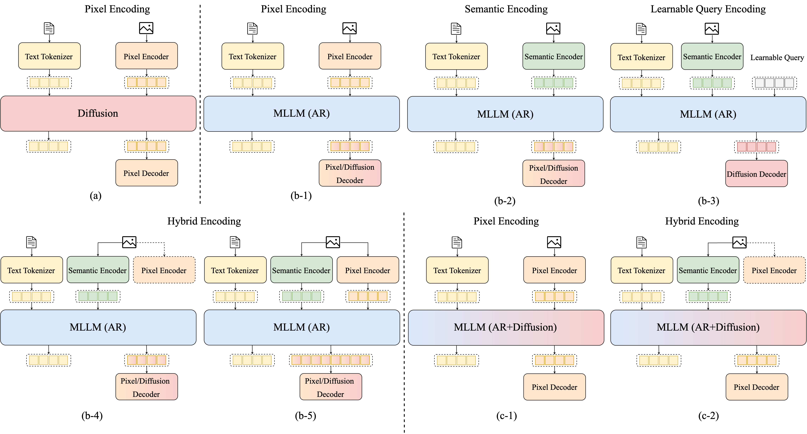

<div align="center">
  
<p>
  
</p>

# Awesome Multimodal Modeling 
<p><strong>A Comprehensive Survey & Curated List of Multimodal Modeling</strong><br/><sub>From Traditional Fusion to Native & Unified Architectures</sub></p>

<p>
  <a href="https://awesome.re"></a>
  <a href="https://github.com/OpenEnvision/Awesome-Multimodal-Modeling/pulls"></a>
  
  
  
</p>

<p>
  <a href="#1-introduction--definitions"></a>
  <a href="#2-traditional-multimodal-models"></a>
  <a href="#3-multimodal-large-language-models-mllms"></a>
  <a href="#4-unified-multimodal-models-umms"></a>
  <a href="#5-native-multimodal-models-nmms"></a>
  <a href="#6-closed-source-multimodal-models"></a>
  <a href="#7-resources"></a>
</p>

<p><sub><a href="#1-introduction--definitions">Overview</a> · <a href="#2-traditional-multimodal-models">Traditional</a> · <a href="#3-multimodal-large-language-models-mllms">MLLMs</a> · <a href="#4-unified-multimodal-models-umms">UMMs</a> · <a href="#5-native-multimodal-models-nmms">NMMs</a> ·<a href="#6-closed-source-multimodal-models">Closed Source Models</a> · <a href="#7-resources">Resources</a></sub></p>

</div>

## 📢 News
- **[2026-10-19]** Updated the curated model and design-analysis coverage; added a dedicated [Benchmarks & Evaluation](#74-benchmarks--evaluation) section and matching website collection, with explicit date and release-status qualifications.
- **[2026-06-06]** 🚀 We released two new **open-source model collections**:  
  - **[Unified Multimodal Model Zoo (UMM Zoo)](https://huggingface.co/collections/OpenEnvisionLab/unified-multimodal-model-zoo)** – a curated collection of unified multimodal models for understanding, generation, reasoning, and editing.  
  - **[Native Multimodal Model Zoo (NMM Zoo)](https://huggingface.co/collections/OpenEnvisionLab/native-multimodal-model-zoo)** – a curated collection of native multimodal models that natively integrate perception, reasoning, and generation.  
- **[2026-04-13]** ⭐ The repository has already gained **over 100 stars** in just one day! Thank you all for the incredible support. We will keep updating this list with more cutting-edge models and resources. **Your continued stars and PRs are warmly welcomed!**
- **[2026-04-12]** 🎉 We are excited to launch **Awesome Multimodal Modeling** — a curated reading list organized by architectural paradigms. A comprehensive survey paper is coming soon! Stay tuned.

## Table of Contents

<details open>
<summary><strong>Browse the list</strong></summary>

- [Awesome Multimodal Modeling](#awesome-multimodal-modeling)
  - [📢 News](#-news)
  - [Table of Contents](#table-of-contents)
  - [About This List](#about-this-list)
    - [At a Glance](#at-a-glance)
    - [Curation Principles](#curation-principles)
  - [1. Introduction \& Definitions](#1-introduction--definitions)
    - [1.1 Multimodal Model Evolution Stages](#11-multimodal-model-evolution-stages)
      - [Traditional Multimodal Models](#traditional-multimodal-models)
      - [Multimodal Large Language Models (MLLMs)](#multimodal-large-language-models-mllms)
      - [Unified Multimodal Models (UMMs)](#unified-multimodal-models-umms)
      - [Native Multimodal Models (NMMs)](#native-multimodal-models-nmms)
        - [NMM — Early Fusion](#nmm--early-fusion)
        - [NMM — Late Fusion](#nmm--late-fusion)
    - [1.2 Scope \& Taxonomy](#12-scope--taxonomy)
    - [1.3 Architecture Diagrams](#13-architecture-diagrams)
  - [2. Traditional Multimodal Models](#2-traditional-multimodal-models)
    - [2.1 Multimodal Representations \& Alignment](#21-multimodal-representations--alignment)
      - [Multimodal Representations](#multimodal-representations)
      - [Multimodal Fusion](#multimodal-fusion)
      - [Multimodal Alignment](#multimodal-alignment)
    - [2.2 Multimodal Pretraining](#22-multimodal-pretraining)
  - [3. Multimodal Large Language Models (MLLMs)](#3-multimodal-large-language-models-mllms)
    - [3.1 Taxonomy Based on Vision Adapter](#31-taxonomy-based-on-vision-adapter)
      - [MLP/Others Projector](#mlpothers-projector)
      - [Q-Former](#q-former)
      - [Cross-Attention](#cross-attention)
      - [Hybrid Adaptor](#hybrid-adaptor)
      - [Interface Unspecified](#interface-unspecified)
    - [3.2 Omni MLLMs](#32-omni-mllms)
  - [4. Unified Multimodal Models (UMMs)](#4-unified-multimodal-models-umms)
    - [4.1 Taxonomy by Generation Paradigm](#41-taxonomy-by-generation-paradigm)
      - [Diffusion-Based UMMs](#diffusion-based-umms)
      - [Autoregressive (AR) UMMs](#autoregressive-ar-umms)
        - [Pixel Encoding](#pixel-encoding)
        - [Semantic Encoding](#semantic-encoding)
        - [Learnable Query Encoding](#learnable-query-encoding)
        - [Hybrid Encoding (Pseudo)](#hybrid-encoding-pseudo)
        - [Hybrid Encoding (Joint)](#hybrid-encoding-joint)
      - [Hybrid (AR + Diffusion) UMMs](#hybrid-ar--diffusion-umms)
        - [Pixel Encoding](#pixel-encoding-1)
        - [Hybrid Encoding](#hybrid-encoding)
    - [4.2 Any-to-Any / Omni UMMs](#42-any-to-any--omni-umms)
    - [4.3 Related Generators (U+G Unverified)](#43-related-generators-ug-unverified)
  - [5. Native Multimodal Models (NMMs)](#5-native-multimodal-models-nmms)
    - [5.1 Design Analyses \& Scaling Laws](#51-design-analyses--scaling-laws)
    - [5.2 Early Fusion NMMs](#52-early-fusion-nmms)
    - [5.3 Encoder-Based NMMs](#53-encoder-based-nmms)
    - [5.4 Any-to-Any / Omni NMMs](#54-any-to-any--omni-nmms)
    - [5.5 Training-Native Models](#55-training-native-models)
  - [6. Closed-Source Multimodal Models](#6-closed-source-multimodal-models)
    - [Year 2026](#year-2026)
    - [Year 2025](#year-2025)
    - [Year 2024](#year-2024)
    - [Year 2023](#year-2023)
  - [7. Resources](#7-resources)
    - [7.1 Related Awesome Lists](#71-related-awesome-lists)
    - [7.2 Slides \& Survey Papers](#72-slides--survey-papers)
    - [7.3 Code Repositories \& Tools](#73-code-repositories--tools)
    - [7.4 Benchmarks \& Evaluation](#74-benchmarks--evaluation)
      - [Unified Understanding & Generation](#unified-understanding--generation)
      - [Interleaved & Any-to-Any Evaluation](#interleaved--any-to-any-evaluation)
      - [General Multimodal & Robustness](#general-multimodal--robustness)
      - [Image Generation Evaluation](#image-generation-evaluation)
  - [How to Contribute](#how-to-contribute)
    - [Validation Rules](#validation-rules)
    - [Entry Format](#entry-format)
  - [Citation](#citation)
  - [License](#license)

</details>

## About This List

**In this section:** [At a Glance](#at-a-glance) · [Curation Principles](#curation-principles)

This repository provides a **structured, community-maintained** survey of multimodal models, covering the full evolutionary arc from early fusion methods to today's natively-trained omni-models. We emphasize **precise architectural definitions** and classification, especially for the often-conflated categories of Unified Multimodal Models (UMMs) and Native Multimodal Models (NMMs).

> **Scope**: Primary focus on **image + text** modalities; audio/video/3D are annotated where present. Omni/any-to-any models are marked with <kbd>Omni</kbd>.

### At a Glance

| Dimension | Coverage |
|---|---|
| Primary scope | Image + text multimodal models, with explicit annotations for video, audio, and omni extensions |
| Core taxonomy | Traditional multimodal models, MLLMs, UMMs, and NMMs with explicit architecture/training qualifications |
| Key distinction | `U+G unification` for UMMs; architectural and optimization coupling for NMMs, with overlapping membership allowed |
| What makes this repo different | Architecture-first categorization, fusion-aware definitions, and curated links to adjacent awesome lists |
| Intended audience | Researchers, students, and engineers building or surveying multimodal systems |

### Curation Principles

> **Coverage audit:** the additions and release-status updates in this revision were checked against primary sources through **2026-10-19**. This is a curated selection, not an exhaustive index of every paper published by that date.


| Principle | Rule |
|---|---|
| Source quality | Prefer official conference proceedings, OpenReview, ACL Anthology, CVF Open Access, arXiv, and official project pages |
| Classification policy | Category assignment is based on this repository's **architecture-first definitions**, which may differ from authors' own branding |
| Venue policy | Prefer the published venue; label author-reported acceptances where proceedings have not been checked. Keep first-paper dates separate from conference years |
| Date policy | `First public: YYYY-MM-DD` records the earliest verified exact-date public announcement; retain month precision where only a month is known. Distinguish paper submission, API availability, weights release and revision dates. Website year filters use the venue/release year; chronological sorting uses the explicit first-public date where recorded, otherwise the dated venue/release |
| Availability policy | Distinguish code, downloadable weights, API previews and future promises; record model-weight licenses separately from code licenses |
| Scope discipline | Models, benchmarks, datasets, and analysis papers are tracked separately to avoid mixing artifacts |
| Inclusion bar | We prioritize landmark papers, broadly adopted benchmarks, open implementations, or papers that clarify important taxonomy boundaries |

> Classification note: for ambiguous models sitting between `MLLM`, `UMM`, and `NMM`, this list records the category that best matches the **training recipe and architectural coupling**, not just the paper title. Architecture-native and training-native qualifications distinguish fusion structure from training history.

<p align="right"><a href="#awesome-multimodal-modeling">Back to Top</a></p>

---

## 1. Introduction & Definitions

**In this section:** [1.1 Multimodal Model Evolution Stages](#11-multimodal-model-evolution-stages) · [1.2 Scope & Taxonomy](#12-scope--taxonomy) · [1.3 Architecture Diagrams](#13-architecture-diagrams)

### 1.1 Multimodal Model Evolution Stages

**Subtopics:** [Traditional Multimodal Models](#traditional-multimodal-models) · [Multimodal Large Language Models (MLLMs)](#multimodal-large-language-models-mllms) · [Unified Multimodal Models (UMMs)](#unified-multimodal-models-umms) · [Native Multimodal Models (NMMs)](#native-multimodal-models-nmms)

We use the following **precise, architecture-first definitions** throughout this list. Understanding these distinctions is critical for correctly classifying modern models.

#### Traditional Multimodal Models

 
> *Pre-2023 mainstream era*

Representation alignment or fusion of modality-specific processing streams, without a large language model backbone. Covers cross-modal retrieval, classification and captioning; alignment-only dual encoders and models with joint fusion layers are distinguished by their architectures. Examples: CLIP, ALIGN, ViLBERT, BLIP.

#### Multimodal Large Language Models (MLLMs)

 
> *Pretrained-backbone multimodal language models*

Combine a **pretrained visual backbone or visual abstractor** (e.g., ViT/CLIP/SigLIP, Q-Former, cross-attention adapter) with a **pretrained LLM** through a connector. The defining property is inheritance from strong pretrained unimodal backbones rather than joint multimodal pretraining from scratch. These models are primarily **text-output understanding/reasoning systems**, even when auxiliary generators are attached externally.

Key characteristics:
- ✅ Pretrained visual encoder / abstractor
- ✅ Pretrained LLM backbone
- ✅ Connector layer or cross-attention bridge
- ❌ No end-to-end multimodal pretraining from scratch
- ❌ No native image generation inside the same backbone

Examples: **LLaVA**, **Qwen-VL**, **InternVL**, **MiniCPM-V**, **CogVLM**

#### Unified Multimodal Models (UMMs)

 
> *Single framework for Understanding + Generation (U+G)*

A **single framework** that handles both multimodal understanding and visual generation. UMMs may reuse pretrained components or modular tokenizers; the defining feature is **U+G unification**, not whether the model is trained from scratch.

Key characteristics:
- ✅ Unified understanding + generation
- ✅ Shared model interface or shared backbone for U+G
- ⚠️ May use pretrained components
- ⚠️ May use decoupled encoders / modular tokenizers
- ⚠️ If a model is also natively trained from scratch, its architectural details belong primarily in **NMMs (§5)**

Examples: **Show-o**, **Janus**, **OpenUni**, **BAGEL**, **BLIP3-o**

#### Native Multimodal Models (NMMs)

 
> *Architectural integration and multimodal optimization*

NMMs are described along two dimensions: **architectural nativity** captures how early and persistently modalities share core computation; **optimization nativity** captures when multimodal objectives enter training and which core parameters they optimize. Entries that establish only one dimension are qualified as **architecture-native** or **training-native**. Training from scratch provides strong optimization evidence, but is not assumed for every entry. UMM and NMM membership can overlap.

Key characteristics:
- ✅ Fusion structure and training history are recorded separately
- ✅ Pretrained components and initialization are annotated per model
- ✅ Architecture-native entries may inherit pretrained backbones
- ✅ Input: text tokens + image patches/tokens
- ✅ Output: text (understanding focus; generation optional)

NMMs are described by **fusion topology and input architecture**, with initialization recorded separately. [§5.2](#52-early-fusion-nmms) records supported early-fusion architectures; [§5.3](#53-encoder-based-nmms) groups encoder-based systems without inferring fusion depth from encoder presence. Training-native entries without a confirmed architectural grouping are listed separately in [§5.5](#55-training-native-models):

##### NMM — Early Fusion
Modality tokens or embeddings enter shared core computation **before the first shared backbone block**. Separate tokenizers, input encoders, modality-specific experts, or output decoders can remain; their presence does not by itself imply late fusion.

- Shared backbone computation over multimodal states
- Discrete tokens, continuous latents, or pixel patches
- Modality interaction from the first shared block
- Initialization and trainable components annotated separately
- Examples: **Chameleon**, **Emu3**, **Transfusion**; **Show-o**, **Show-o2**, **OneCat**, and **Llama 4** carry architecture-native qualifications

##### NMM — Late Fusion
Cross-modal interaction begins only after modality-specific backbone layers, rather than at the first shared block. This is a claim about **where modalities interact**, independent of whether the components were pretrained or initialized from scratch.

- Identify the modality-specific stages and the first interaction layer
- Record initialization and multimodal optimization separately
- A dedicated vision encoder alone does not establish this topology; encoder-based systems with unverified fusion depth are grouped in [§5.3](#53-encoder-based-nmms)

### 1.2 Scope & Taxonomy

```text
Multimodal Models
├── 2. Traditional Multimodal Models
│   ├── 2.1 Multimodal Representations & Alignment
│   │   ├── Multimodal Representations
│   │   ├── Multimodal Fusion
│   │   └── Multimodal Alignment
│   └── 2.2 Multimodal Pretraining
├── 3. Multimodal Large Language Models (MLLMs)
│   ├── 3.1 Taxonomy Based on Vision Adapter
│   └── 3.2 Omni MLLMs
├── 4. Unified Multimodal Models (UMMs)
│   ├── 4.1 Taxonomy by Generation Paradigm
│   │   ├── Diffusion-Based UMMs
│   │   ├── Autoregressive (AR) UMMs
│   │   │   ├── Pixel Encoding
│   │   │   ├── Semantic Encoding
│   │   │   ├── Learnable Query Encoding
│   │   │   ├── Hybrid Encoding (Pseudo)
│   │   │   └── Hybrid Encoding (Joint)
│   │   └── Hybrid (AR + Diffusion) UMMs
│   │       ├── Pixel Encoding
│   │       └── Hybrid Encoding
│   ├── 4.2 Any-to-Any / Omni UMMs
│   └── 4.3 Related Generators (U+G Unverified)
└── 5. Native Multimodal Models (NMMs)
    ├── 5.1 Design Analyses & Scaling Laws
    ├── 5.2 Early Fusion NMMs
    ├── 5.3 Encoder-Based NMMs
    ├── 5.4 Any-to-Any / Omni NMMs
    └── 5.5 Training-Native Models
```

### 1.3 Architecture Diagrams

The NMM diagrams below distinguish fusion topology from input architecture. The early-fusion diagram illustrates a from-scratch variant; initialization and input interfaces are specified per model in §5. Encoder-based entries do not inherit a strict late-fusion label from these schematic examples.

```
┌─────────────────────────────────────────────────────────────────┐
│           TRADITIONAL MULTIMODAL MODEL                          │
│                                                                 │
│  [Image] ──► [CNN/ViT Encoder] ──┐                              │
│                                  ├──► [Fusion] ──► [Output]     │
│  [Text]  ──► [LSTM/BERT]       ──┘                              │
└─────────────────────────────────────────────────────────────────┘

┌─────────────────────────────────────────────────────────────────┐
│           MLLM — PRETRAINED BACKBONES + VISUAL INTERFACE         │
│                                                                 │
│  [Image] ──► [Pretrained ViT/CLIP] ──► [Projector/Q-Former]     │
│                                                │                │
│                                                ▼                │
│  [Text]  ──────────────────────────► [Pretrained LLM] ──► [Text]│
└─────────────────────────────────────────────────────────────────┘

┌─────────────────────────────────────────────────────────────────┐
│           UMM — UNIFIED UNDERSTANDING + GENERATION              │
│                                                                 │
│  [Image/Text Input] ──► [Shared/Modular Tokenizer]              │
│                                │                                │
│                                ▼                                │
│                   [Unified Transformer]                         │
│                       │           │                             │
│                       ▼           ▼                             │
│             [Text Output]      [Image Output]                   │
└─────────────────────────────────────────────────────────────────┘

┌─────────────────────────────────────────────────────────────────┐
│           NMM — EARLY FUSION (Trained from Scratch)             │
│                                                                 │
│  [Text tokens] ──┐                                              │
│                  └──► [Single Decoder Transformer] ──► [Text]   │
│  [Image patches ──► Linear Patchify] ──┘                        │
│   (raw pixels, minimal preprocessing)                           │
│   Multimodal interaction from Layer 1                           │
└─────────────────────────────────────────────────────────────────┘

┌─────────────────────────────────────────────────────────────────┐
│           NMM — ENCODER-BASED INPUT ARCHITECTURE               │
│                                                                 │
│  [Image] ──► [Vision Encoder] ──► [Visual Interface]           │
│                                         │                       │
│                                         ▼                       │
│  [Text]  ──────────────────────► [Backbone] ──► [Text]         │
│   Initialization and first interaction layer recorded per model │
└─────────────────────────────────────────────────────────────────┘
```

<p align="right"><a href="#awesome-multimodal-modeling">Back to Top</a></p>

---

## 2. Traditional Multimodal Models

**In this section:** [2.1 Multimodal Representations & Alignment](#21-multimodal-representations--alignment) · [2.2 Multimodal Pretraining](#22-multimodal-pretraining)

> Pre-chat-MLLM and non-native multimodal systems that established the basic vocabulary of alignment, fusion, retrieval, captioning, and multimodal pretraining.

<a id="21-multimodel-representations--alignment"></a>

### 2.1 Multimodal Representations & Alignment

**Subtopics:** [Multimodal Representations](#multimodal-representations) · [Multimodal Fusion](#multimodal-fusion) · [Multimodal Alignment](#multimodal-alignment)

#### Multimodal Representations

| Paper | Venue | Links | Notes | Task |
|---|---|---|---|---|
| Identifiability Results for Multimodal Contrastive Learning <!-- entry:45712b3ec9f3 --> | ICLR 2023 | [Paper](https://arxiv.org/abs/2303.09166) | Theoretical identifiability analysis of contrastive multimodal learning | representation learning |
| Unpaired Vision-Language Pre-training via Cross-Modal CutMix <!-- entry:62a0a56956e4 --> | ICML 2022 | [Paper](https://arxiv.org/abs/2206.08919) | Introduces CutMix-style augmentation for unpaired VLP | vision-language pretraining |
| Balanced Multimodal Learning via On-the-fly Gradient Modulation <!-- entry:f0c46fb08184 --> | CVPR 2022 | [Paper](https://arxiv.org/abs/2203.15332) | Balances modality learning via dynamic gradient reweighting | multimodal optimization |
| FLAVA: A Foundational Language And Vision Alignment Model <!-- entry:339d65a91b1c --> | arXiv 2021 | [Paper](https://arxiv.org/abs/2112.04482) | Unified architecture for vision-language understanding and generation | foundation multimodal model |
| UniT: Multimodal Multitask Learning with a Unified Transformer <!-- entry:64f43671fa13 --> | arXiv 2021 | [Paper](https://arxiv.org/abs/2102.10772) | Single transformer for multiple multimodal tasks | multimodal multitask learning |
| Perceiver: General Perception with Iterative Attention <!-- entry:5444b0f43db0 --> | ICML 2021 | [Paper](https://arxiv.org/abs/2103.03206) | General-purpose architecture for high-dimensional multimodal inputs | general multimodal architecture |
| Learning Transferable Visual Models From Natural Language Supervision <!-- entry:9fac946b2b27 --> | ICML 2021 | [Paper](https://arxiv.org/abs/2103.00020) | Contrastive vision-language pretraining at scale | vision-language contrastive learning |
| VinVL: Revisiting Visual Representations in Vision-Language Models <!-- entry:97a00dffe4b2 --> | arXiv 2021 | [Paper](https://arxiv.org/abs/2101.00529) | Improved visual features for VL tasks | vision-language representation improvement |
| 12-in-1: Multi-Task Vision and Language Representation Learning <!-- entry:6c42b8b8e4bc --> | CVPR 2020 | [Paper](https://arxiv.org/abs/1912.02315) | Unified multi-task learning across 12 VL tasks | multi-task learning |
| Learning Video Representations using Contrastive Bidirectional Transformer <!-- entry:0abef83f684c --> | arXiv 2019 | [Paper](https://arxiv.org/abs/1906.05743) | Contrastive transformer for video representation learning | video contrastive learning |
| OmniNet: A Unified Architecture for Multi-modal Multi-task Learning <!-- entry:ac1a824b08e1 --> | arXiv 2019 | [Paper](https://arxiv.org/abs/1907.07804) | Unified encoder-decoder for multimodal tasks | unified multimodal architecture |
| Learning Representations by Maximizing Mutual Information Across Views <!-- entry:a46cadf65dfc --> | arXiv 2019 | [Paper](https://arxiv.org/abs/1906.00910) | InfoMax principle for cross-view representation learning | self-supervised learning |
| ViCo: Word Embeddings from Visual Co-occurrences <!-- entry:34bedde2b36b --> | ICCV 2019 | [Paper](https://arxiv.org/abs/1908.08527) | Learning word embeddings from visual context | vision-language embeddings |
| Learning Factorized Multimodal Representations <!-- entry:ee007ab7470c --> | ICLR 2019 | [Paper](https://arxiv.org/abs/1806.06176) | Factorized latent space for multimodal data | representation disentanglement |
| Deep Fragment Embeddings for Bidirectional Image Sentence Mapping <!-- entry:41fc42457ac1 --> | NeurIPS 2014 | [Paper](https://arxiv.org/abs/1406.5679) | Fragment-level image-sentence alignment | vision-language alignment |
| DeViSE: A Deep Visual-Semantic Embedding Model <!-- entry:efba9d5b8e97 --> | NeurIPS 2013 | [Paper](https://proceedings.neurips.cc/paper_files/paper/2013/hash/7cce53cf90577442771720a370c3c723-Abstract.html) | Early deep vision-to-language embedding model | vision-language embedding |
| Multimodal Deep Learning <!-- entry:a695104d7952 --> | ICML 2011 | [Paper](https://icml.cc/2011/papers/399_icmlpaper.pdf) | Foundational multimodal deep learning framework | multimodal deep learning |

#### Multimodal Fusion

| Paper | Venue | Links | Notes | Task |
|---|---|---|---|---|
| Robust Contrastive Learning against Noisy Views <!-- entry:b183adffa484 --> | arXiv 2022 | [Paper](https://arxiv.org/abs/2201.04309) | Robust contrastive learning under noisy multi-view inputs | contrastive learning |
| Attention Bottlenecks for Multimodal Fusion <!-- entry:6985294dcd41 --> | NeurIPS 2021 | [Paper](https://arxiv.org/abs/2107.00135) | Introduces bottleneck attention mechanism for efficient multimodal fusion | multimodal fusion |
| VMLoc: Variational Fusion For Learning-Based Multimodal Camera Localization <!-- entry:2a5bdd552b14 --> | AAAI 2021 | [Paper](https://arxiv.org/abs/2003.07289) | Variational multimodal fusion for camera localization tasks | multimodal localization |
| Trusted Multi-View Classification <!-- entry:4608a8c17436 --> | ICLR 2021 | [Paper](https://arxiv.org/abs/2102.02051) | Confidence-aware weighting for multi-view classification | multi-view classification |
| Deep-HOSeq: Deep Higher-Order Sequence Fusion for Multimodal Sentiment Analysis <!-- entry:246a57ee2ecf --> | ICDM 2020 | [Paper](https://arxiv.org/abs/2010.08218) | Higher-order sequence fusion for multimodal sentiment analysis | multimodal sentiment analysis |
| What Makes Training Multi-Modal Classification Networks Hard? <!-- entry:4d952f214100 --> | CVPR 2020 | [Paper](https://arxiv.org/abs/1905.12681) | Analyzes optimization challenges in multimodal classification | theoretical/empirical analysis |
| DeepCU: Integrating Both Common and Unique Latent Information for Multimodal Sentiment Analysis <!-- entry:4d35aca9a775 --> | IJCAI 2019 | [Paper](https://www.ijcai.org/Proceedings/2019/503) | Separates shared and private latent representations for fusion | multimodal sentiment analysis |
| XFlow: Cross-modal Deep Neural Networks for Audiovisual Classification <!-- entry:250053fcb9c5 --> | IEEE TNNLS 2019 | [Paper](https://arxiv.org/abs/1709.00572) | Cross-modal feature exchange network for audio-visual tasks | audio-visual classification |
| MFAS: Multimodal Fusion Architecture Search <!-- entry:9dc6d2e787f9 --> | CVPR 2019 | [Paper](https://arxiv.org/abs/1903.06496) | Neural architecture search for optimal multimodal fusion design | architecture search |
| The Neuro-Symbolic Concept Learner: Interpreting Scenes, Words, and Sentences From Natural Supervision <!-- entry:24be1ccf0659 --> | ICLR 2019 | [Paper](https://arxiv.org/abs/1904.12584) | Neuro-symbolic model combining perception and reasoning | neuro-symbolic learning |
| Efficient Low-rank Multimodal Fusion with Modality-Specific Factors <!-- entry:bba68ec99a4a --> | ACL 2018 | [Paper](https://arxiv.org/abs/1806.00064) | Low-rank factorization for efficient multimodal fusion | efficient fusion |
| Memory Fusion Network for Multi-view Sequential Learning <!-- entry:c2ae2e87974d --> | AAAI 2018 | [Paper](https://arxiv.org/abs/1802.00927) | Memory-based fusion across temporal multimodal sequences | sequential multimodal learning |
| Tensor Fusion Network for Multimodal Sentiment Analysis <!-- entry:aca65202498a --> | EMNLP 2017 | [Paper](https://arxiv.org/abs/1707.07250) | Tensor-based full interaction modeling across modalities | multimodal sentiment analysis |

#### Multimodal Alignment

| Paper | Venue | Links | Notes | Task |
|---|---|---|---|---|
| LanguageBind: Extending Video-Language Pretraining to N-modality by Language-based Semantic Alignment <!-- entry:fbaca709ab17 --> | arXiv 2023 | [Paper](https://arxiv.org/abs/2310.01852) [Code](https://github.com/PKU-YuanGroup/LanguageBind) | Language-centered alignment across image, video, audio, depth, thermal, and IMU modalities | multimodal alignment |
| CLIP <!-- entry:a93adb5a3e62 --> | ICML 2021 | [Paper](https://arxiv.org/abs/2103.00020) | 400M+ image-text pairs; dual-encoder (Vision Transformer + Text Transformer); contrastive alignment of separate image/text embeddings; no joint image-text backbone | zero-shot image classification, retrieval |
| CoMIR: Contrastive Multimodal Image Representation for Registration <!-- entry:15f5d87dfee5 --> | NeurIPS 2020 | [Paper](https://arxiv.org/abs/2006.06325) | Contrastive learning for multimodal image registration alignment | multimodal alignment |
| Multimodal Transformer for Unaligned Multimodal Language Sequences <!-- entry:3efff8a9c285 --> | ACL 2019 | [Paper](https://arxiv.org/abs/1906.00295) | Transformer-based alignment for unaligned multimodal sequences | sequence alignment |
| Temporal Cycle-Consistency Learning <!-- entry:06bf31e66135 --> | CVPR 2019 | [Paper](https://arxiv.org/abs/1904.07846) | Uses cycle-consistency for temporal cross-modal alignment | temporal alignment |
| Deep Canonical Correlation Analysis <!-- entry:70ddd0ba9caa --> | ICML 2013 | [Paper](https://proceedings.mlr.press/v28/andrew13.html) | Deep learning extension of CCA for cross-view representation alignment | representation alignment |

### 2.2 Multimodal Pretraining

| Paper | Venue | Links | Notes | Task |
|---|---|---|---|---|
| Align before Fuse: Vision and Language Representation Learning with Momentum Distillation <!-- entry:1c665c8547e1 --> | NeurIPS 2021 Spotlight | [Paper](https://arxiv.org/abs/2107.07651) | Momentum distillation for aligning vision-language representations before fusion | vision-language pretraining |
| Less is More: ClipBERT for Video-and-Language Learning via Sparse Sampling <!-- entry:bb47afed48b0 --> | CVPR 2021 | [Paper](https://arxiv.org/abs/2102.06183) | Sparse frame sampling for efficient video-language pretraining | video-language pretraining |
| UniT: Multimodal Multitask Learning with a Unified Transformer <!-- entry:521128b79b82 --> | arXiv 2021 | [Paper](https://arxiv.org/abs/2102.10772) | Unified transformer for multitask multimodal learning | unified multimodal pretraining |
| Large-Scale Adversarial Training for Vision-and-Language Representation Learning <!-- entry:45b380a92ee8 --> | NeurIPS 2020 | [Paper](https://arxiv.org/abs/2006.06195) | Adversarial training improves robustness of vision-language representations | robust multimodal pretraining |
| Vokenization: Improving Language Understanding with Contextualized, Visual-Grounded Supervision <!-- entry:9d3054860d65 --> | EMNLP 2020 | [Paper](https://arxiv.org/abs/2010.06775) | Grounds language tokens in visual context via voken supervision | vision-grounded language modeling |
| Integrating Multimodal Information in Large Pretrained Transformers <!-- entry:99ae4af02d66 --> | ACL 2020 | [Paper](https://arxiv.org/abs/1908.05787) | Injects multimodal signals into large pretrained transformer architectures | multimodal transformer pretraining |
| VL-BERT: Pre-training of Generic Visual-Linguistic Representations <!-- entry:a840da71000f --> | arXiv 2019 | [Paper](https://arxiv.org/abs/1908.08530) | Joint vision-language BERT-style pretraining | vision-language pretraining |
| VisualBERT: A Simple and Performant Baseline for Vision and Language <!-- entry:8d6593a4c949 --> | arXiv 2019 | [Paper](https://arxiv.org/abs/1908.03557) | Early unified transformer for vision-language understanding | vision-language pretraining |
| ViLBERT: Pretraining Task-Agnostic Visiolinguistic Representations for Vision-and-Language Tasks <!-- entry:134c7993fe2e --> | NeurIPS 2019 | [Paper](https://arxiv.org/abs/1908.02265) | Two-stream transformer for cross-modal vision-language learning | vision-language pretraining |
| Unicoder-VL: A Universal Encoder for Vision and Language by Cross-modal Pre-training <!-- entry:8307db450b1d --> | arXiv 2019 | [Paper](https://arxiv.org/abs/1908.06066) | Cross-modal encoder for universal vision-language representations | vision-language pretraining |
| LXMERT: Learning Cross-Modality Encoder Representations from Transformers <!-- entry:5f60dce5229c --> | EMNLP 2019 | [Paper](https://arxiv.org/abs/1908.07490) | Cross-modality transformer encoder for vision-language reasoning | vision-language pretraining |
| VideoBERT: A Joint Model for Video and Language Representation Learning <!-- entry:e33b62d9cb29 --> | ICCV 2019 | [Paper](https://arxiv.org/abs/1904.01766) | Joint discrete token modeling for video and language | video-language pretraining |

<p align="right"><a href="#awesome-multimodal-modeling">Back to Top</a></p>

---

## 3. Multimodal Large Language Models (MLLMs)

**In this section:** [3.1 Taxonomy Based on Vision Adapter](#31-taxonomy-based-on-vision-adapter) · [3.2 Omni MLLMs](#32-omni-mllms)

> Models that connect a **pretrained visual encoder / abstractor** to a **pretrained LLM**. Primarily text-output understanding and reasoning systems, defined by inherited pretrained unimodal backbones rather than multimodal pretraining from scratch.

### 3.1 Taxonomy Based on Vision Adapter

These groups describe the **vision-to-language interface**, rather than attention variants inside the language backbone. MLP/Others includes linear projections, spatial merging and pixel shuffle; Q-Former covers query-transformer connectors; Cross-Attention refers to bridges attending to separate visual features. Hybrid Adaptor covers combinations such as learned pooling plus projection, or projection plus visual experts inside the language backbone.

#### MLP/Others Projector

| Paper | Venue | Links | Notes | Task |
|---|---|---|---|---|
| WeVisDoc: From Coverage to Capability for Robust End-to-End Document Parsing <!-- entry:b1a80e3f-29f4-4805-8db7-c33e2d62302e --> | arXiv 2026-09-17 | [Paper](https://arxiv.org/abs/2609.20423) [Code](https://github.com/Tencent/WeVisDoc) [HF](https://huggingface.co/tencent/WeVisDoc-4B) | Paper first submitted: 2026-09-17. Fine-tunes Qwen3-VL-2B/4B-Instruct, retaining their visual encoder and merger/projector; page images and instructions produce structured Markdown, LaTeX formulas and HTML tables. Coverage-driven and residual-error-driven training target degraded documents. Code and 2B/4B checkpoints available as of 2026-10-19. | document parsing, OCR, table/formula recognition, robustness |
| VideoScout: Learning Agentic Active Exploration with Adaptive Reasoning Pacing for Long Video Understanding <!-- entry:6bdb4757-9113-42b8-b59c-e8427dcd4f6a --> | arXiv 2026-09-14 | [Paper](https://arxiv.org/abs/2609.15606) | Paper first submitted: 2026-09-14. Qwen2.5-VL-7B initialization retains its vision encoder and projector; SFT and trajectory-level DAPO learn adaptive viewing speed, revisiting and note taking for long-video answers. Text/video input produces text and viewing actions; code and checkpoint release not established in the checked primary source as of 2026-10-19. | long-video understanding, active exploration, temporal reasoning |
| LFM2.5-VL-3B <!-- entry:57dfde95-3935-444a-87ea-d41f4d4a56f1 --> | Model release 2026-08-12 | [Announcement](https://www.liquid.ai/blog/lfm2-5-vl-3b) [HF](https://huggingface.co/LiquidAI/LFM2.5-VL-3B) [Implementation](https://github.com/huggingface/transformers/blob/main/src/transformers/models/lfm2_vl/modeling_lfm2_vl.py) | First public: 2026-08-12. Pretrained LFM2.5-2.6B with SigLIP2 NaFlex 400M, pixel-unshuffle and a two-layer MLP projector; text/image/multi-image inputs produce text, grounding coordinates and tool calls. Weights and inference implementations available under the Liquid AI model license; aimed at low-latency edge use. | image understanding, multi-image reasoning, OCR, grounding, tool use, edge deployment |
| PaddleOCR-VL-1.6: Expanding the Frontier of Document Parsing with Under-Optimized Region Refinement and Progressive Post-Training <!-- entry:fef106cc-75a7-48d2-8da4-7aab0899524a --> | arXiv 2026-06-02 | [Paper](https://arxiv.org/abs/2606.03264) [Code](https://github.com/PaddlePaddle/PaddleOCR) [HF](https://huggingface.co/PaddlePaddle/PaddleOCR-VL-1.6) | First public: 2026-05-28 (weights); paper first submitted 2026-06-02. 0.9B document VLM retaining the 1.5 native-resolution encoder, adaptive MLP connector and ERNIE language backbone; region refinement and progressive post-training improve recognition. Document-image/text inputs produce structured text, tables, formulas and spotting coordinates. Code and weights available. | document parsing, multilingual OCR, tables, formulas, text spotting |
| PaddleOCR-VL-1.5: Towards a Multi-Task 0.9B VLM for Robust In-the-Wild Document Parsing <!-- entry:be52d1a8-4ef5-43b0-ab69-acce44899eea --> | arXiv 2026-01-29 | [Paper](https://arxiv.org/abs/2601.21957) [Code](https://github.com/PaddlePaddle/PaddleOCR) [HF](https://huggingface.co/PaddlePaddle/PaddleOCR-VL-1.5) | First public: 2026-01-29 (paper and weights). 0.9B VLM combines a native-resolution visual encoder, adaptive MLP connector and ERNIE-4.5-0.3B; document-image/text inputs produce structured text and localized recognition. Adds seal recognition, text spotting and robustness training; full page parsing uses the accompanying layout pipeline. Code and Apache-2.0 checkpoints available. | document parsing, multilingual OCR, seal recognition, text spotting |
| GLM-4.6V / GLM-4.6V-Flash <!-- entry:7008e2ed-ab3e-4132-a91d-2a09ed0c82b2 --> | Model release 2025-12-08 | [Announcement](https://z.ai/blog/glm-4.6v) [Code](https://github.com/zai-org/GLM-V) [HF](https://huggingface.co/zai-org/GLM-4.6V) [Flash](https://huggingface.co/zai-org/GLM-4.6V-Flash) | First public: 2025-12-08. 106B and 9B vision-language variants with 128K trained context; visual patch merging and gated MLP projection connect the vision path to the language backbone. Text/image/video inputs produce text and tool calls, with visual observations passed directly to tools. Code and MIT-licensed weights available; native tool use does not establish from-scratch multimodal training. | image/video understanding, document understanding, visual tool use |
| SmolVLM2 <!-- entry:d1572012-5a87-4657-97df-d77bedeca06f --> | Model release 2025-02-20 | [Announcement](https://huggingface.co/blog/smolvlm2) [HF](https://huggingface.co/HuggingFaceTB/SmolVLM2-2.2B-Instruct) [Paper](https://arxiv.org/abs/2504.05299) | First public: 2025-02-20. Video-trained 256M, 500M and 2.2B family extending the SigLIP/SmolLM projector design; text/image/multi-image/video inputs produce text. Uses video/image training mixtures and efficient visual compression for device deployment. Checkpoints and inference/fine-tuning support available under Apache 2.0; the shared family report was submitted 2025-04-07. | image/video understanding, multi-image reasoning, efficiency, on-device deployment |
| Idefics3 <!-- entry:cdf46f7d728d --> | arXiv 2024 | [Paper](https://arxiv.org/abs/2408.12637) [HF](https://huggingface.co/HuggingFaceM4/Idefics3-8B-Llama3) | SigLIP vision encoder with pixel-shuffle spatial compression and projection to a Llama 3 backbone; replaces Idefics2’s Perceiver resampler. | visual understanding, document understanding |
| MiniMax-01: Scaling Foundation Models with Lightning Attention <!-- entry:2c99591d0881 --> | arXiv 2025 | [Paper](https://arxiv.org/pdf/2501.08313) | MiniMax-VL-01 uses a 303M ViT, a two-layer MLP visual projector and MiniMax-Text-01; Lightning/Softmax hybrid attention describes the language backbone. | visual understanding |
| VideoJev: System One Model for Video Understanding and Interaction <!-- entry:78026b0c4ff8 --> | arXiv 2026 | [Paper](https://arxiv.org/abs/2610.18615) [Code](https://github.com/MCG-NJU/VideoJev) | 4B / 35B-A3B; initialized from Qwen3.5-4B / Qwen3.6-35B-A3B, retaining their pretrained ViT, visual projection and language backbone; candidate-scoring heads unify temporal grounding and multiple-choice QA. | video QA, temporal grounding |
| Video-o3: Native Interleaved Clue Seeking for Long Video Multi-Hop Reasoning <!-- entry:a05d8e42211b --> | ICML 2026 | [Paper](https://arxiv.org/abs/2601.23224) [Code](https://github.com/MCG-NJU/Video-o3) | Qwen2.5-VL-7B (also Qwen3-VL-4B); inherits the pretrained Qwen ViT, visual projector and language backbone; interleaves reasoning with VideoCrop tool calls and learns from SFT plus trajectory-guided RL. | long-video reasoning, visual tool use |
| VideoChat3: Fully Open Video MLLM for Efficient and Generalist Video Understanding <!-- entry:c6bb35e75524 --> | arXiv 2026 | [Paper](https://arxiv.org/abs/2607.14935) [Code](https://github.com/MCG-NJU/VideoChat3) | 4B; I3D-ViT initialized from image-pretrained MoonViT, with a lightweight projector and Qwen3-4B text backbone; spatiotemporal visual compression supports generalist offline and proactive streaming understanding. | video understanding, temporal grounding, proactive streaming |
| TimeLens2: Generalist Video Temporal Grounding with Multimodal LLMs <!-- entry:7c5478feeb7f --> | arXiv 2026 | [Paper](https://arxiv.org/abs/2607.17423) [Code](https://github.com/MCG-NJU/TimeLens2) | 2B / 4B / 8B; inherits the pretrained Qwen3-VL ViT, visual projector and language backbones; verified SFT and temporal-grounding GRPO adapt them to generalist interval localization. | video temporal grounding |
| OneStreamer: Unifying Perception, Memory, and Proactive Response in Streaming Video Interaction <!-- entry:e521ee756545 --> | arXiv 2026 | [Paper](https://arxiv.org/abs/2610.01762) [Code](https://github.com/MCG-NJU/OneStreamer) | 4B; initialized from Qwen3-VL-4B-Instruct with its pretrained vision encoder frozen and the multimodal projector and language model fine-tuned; hierarchical caption memory and control states support proactive streaming interaction. | streaming video understanding, memory, proactive response |
| Ling-3.0-flash-VL <!-- entry:131f2b143637 --> | Model release 2026 | [HF](https://huggingface.co/inclusionAI/Ling-3.0-flash-VL) | Open-weight VLM (MIT) extending Ling-3.0-flash with a ViT and a two-layer MLP projector; supports image and video inputs with text outputs. BF16 and quantized checkpoints belong to the same model entry | image/video understanding, document understanding, visual reasoning, GUI agents |
| LLaDA-UI <!-- entry:e2ced2c3a076 --> | Model release 2026 | [Code](https://github.com/inclusionAI/LLaDA-UI) [HF](https://huggingface.co/inclusionAI/LLaDA-UI) | SigLIP-initialized native-resolution ViT connects to LLaDA2.0-mini-base through spatial 4-to-1 feature grouping and a two-layer MLP; block-wise diffusion generates text reasoning and GUI actions. Code and weights are available; checkpoint license is unspecified in the model card as of 2026-09-15 | screenshot understanding, GUI grounding, mobile/desktop/web agents |
| Muse Glimmer-30B <!-- entry:20121831c0bb --> | Model release 2026 | [HF](https://huggingface.co/meta-models/Muse-Glimmer-30B) [Implementation](https://github.com/huggingface/transformers/blob/main/src/transformers/models/muse_glimmer/modeling_muse_glimmer.py) | Open-weight 30B model (Apache 2.0), distilled from Muse Spark; a dedicated Perception Encoder connects to the language backbone through an MLP adapter and linear projection; text and image inputs, text outputs | visual understanding, visual reasoning, coding, agentic tool use |
| DiffusionGemma <!-- entry:6c1b69946296 --> | Google DeepMind, 2026 | [Model Card](https://ai.google.dev/gemma/docs/diffusiongemma/model_card) [HF](https://huggingface.co/google/diffusiongemma-26B-A4B-it) [Implementation](https://github.com/huggingface/transformers/blob/main/src/transformers/models/diffusion_gemma/modeling_diffusion_gemma.py) | Open-weight Gemma 4-based model (Apache 2.0); normalized visual features enter the language model through a linear projection, while an encoder-decoder architecture uses block-wise discrete diffusion for text generation. Image/video understanding with text output; no native image generation | visual understanding, video understanding, reasoning, efficient text generation |
| Mistral Medium 3.5 <!-- entry:581a49c71364 --> | Mistral AI, 2026 | [Announcement](https://mistral.ai/news/vibe-remote-agents-mistral-medium-3-5/) [HF](https://huggingface.co/mistralai/Mistral-Medium-3.5-128B) [Implementation](https://github.com/huggingface/transformers/blob/main/src/transformers/models/mistral3/modeling_mistral3.py) | Open-weight 128B dense VLM under a Modified MIT license; a from-scratch vision encoder connects through a patch merger and MLP projector to the language backbone. Supports text/image inputs and text outputs; whole-model from-scratch multimodal training is not established | visual understanding, reasoning, coding, long-horizon agents |
| Mage-VL: An Efficient Codec-Native Streaming Multimodal Foundation Model <!-- entry:a4f76f6c6504 --> | arXiv 2026 | [Paper](https://arxiv.org/abs/2607.24904) [Project](https://microsoft.github.io/Mage/) [Model](https://huggingface.co/microsoft/Mage-VL) | 4B codec-native streaming VLM combining a from-scratch Mage-ViT visual encoder, two-layer MLP projector, and pretrained Qwen3-4B-Instruct-2507 decoder; codec-guided token selection reduces visual tokens by over 75% | image/video understanding, long video, proactive streaming |
| StepX-Edge: An On-Device UI Vision-Language Model via Architecture-Training-Deployment Co-Design <!-- entry:891fc2c0d3e9 --> | arXiv 2026 | [Paper](https://arxiv.org/abs/2607.22708) | 0.9B on-device UI VLM with UI-aware layered visual encoding and a progressive dimensionality projection connector; quantized deployment is validated on Snapdragon 8 Gen5 | UI understanding, OCR, grounding, on-device deployment |
| MiniCPM-V 4.5: Cooking Efficient MLLMs via Architecture, Data, and Training Recipe <!-- entry:784bcd978c5e --> | arXiv 2025 | [Paper](https://arxiv.org/abs/2509.18154) [Code](https://github.com/OpenBMB/MiniCPM-o) [Model](https://huggingface.co/openbmb/MiniCPM-V-4_5) | Efficient 8B MLLM built with Qwen3-8B, SigLIP2-400M and a unified 3D-Resampler for compact image-video encoding | visual understanding, document/OCR, video understanding, edge deployment |
| Moondream 3.1 <!-- entry:f92e09eab448 --> | Model Release 2026 | [Project](https://moondream.ai/) [Model](https://huggingface.co/moondream/moondream3.1-9B-A2B) | Efficient sparse MoE VLM with 9B total and 2B active parameters; supports visual reasoning, query, caption, detection, pointing and segmentation | visual understanding, grounding, segmentation, edge deployment |
| LLaVA-OneVision-1.5: Fully Open Framework for Democratized Multimodal Training <!-- entry:3d79f7c7dbf6 --> | arXiv 2025 | [Paper](https://arxiv.org/abs/2509.23661) [Code](https://github.com/EvolvingLMMs-Lab/LLaVA-OneVision-1.5) [HF](https://huggingface.co/collections/lmms-lab/llava-onevision-15-68d385fe73b50bd22de23713) | 4B / 8B; 85M mid-training data + 22M instruction data; ViT–MLP–LLM architecture with pretrained RICE-ViT, a two-layer MLP projector, and Qwen3 backbone; supports image, multi-image, and video | visual understanding, video |
| SAIL-VL2 Technical Report <!-- entry:ef4b09688a77 --> | arXiv 2025 | [Paper](https://arxiv.org/abs/2509.14033) | Open-suite 2B/8B vision-language foundation model with SAIL-ViT, progressive multimodal training, SFT-RL thinking fusion, and strong image/video reasoning across 106 datasets | visual understanding, video, reasoning |
| Kwai Keye-VL 2.0 Technical Report <!-- entry:a8635ca87b15 --> | arXiv 2026 | [Paper](https://arxiv.org/pdf/2606.10651) | achieves state-of-the-art performance among models of similar scale, particularly excelling in fine-grained temporal localization | video understanding |
| Penguin-VL: Exploring the Efficiency Limits of VLM with LLM-based Vision Encoders <!-- entry:9a83d69d6704 --> | arXiv 2026 | [Paper](https://arxiv.org/pdf/2603.06569) | LLM-initialized vision encoder (non-CLIP); text-to-vision weight reuse, generative-aligned visual features, optimized for dense perception. | visual understanding |
| Youtu-VL: Unleashing Visual Potential via Unified Vision-Language Supervision <!-- entry:6afc9b10a65d --> | arXiv 2026 | [Paper](https://arxiv.org/abs/2601.19798) | SigLIP2 vision encoder with 2×2 Spatial Merge and a two-layer MLP projector to Youtu-LLM; unified autoregressive supervision over visual and text targets supports fine-grained understanding and dense prediction. | visual understanding, grounding, segmentation, depth estimation |
| STEP3-VL-10B Technical Report <!-- entry:c5be04d37b34 --> | arXiv 2026 | [Paper](https://arxiv.org/pdf/2601.09668) | 10B-scale foundation multimodal; unified unfrozen pre-training + PaCoRe test-time scaling, frontier-level reasoning with compact footprint. | visual understanding |
| GLM-OCR <!-- entry:63e6fcdfd826 --> | arXiv 2026 | [Paper](https://arxiv.org/abs/2603.10910) | GLM-OCR is an efficient 0.9B-parameter compact multimodal model designed for real-world document understanding. | OCR, structured extraction |
| Kimi K2.5 <!-- entry:9abc141a190d --> | arXiv 2026 | [Paper](https://arxiv.org/abs/2602.02276) | joint text-vision pretraining, Agent Swarm framework; coding, vision, reasoning, agentic tasks; reduces latency by up to 4.5x | visual agentic intelligence, agentic, reasoning |
| Kwai Keye-VL 1.5 Technical Report <!-- entry:7f92deecdabb --> | arXiv 2025 | [Paper](https://arxiv.org/pdf/2509.01563) | Adaptive Slow-Fast encoding; 8B parameter scale with 128K long-context; SOTA video reasoning & human-preference aligned. | visual understanding |
| olmOCR / olmOCR-2 <!-- entry:ba88c303fe67 --> | arXiv 2025 | [Paper](https://arxiv.org/abs/2510.19817) | Efficient low-VRAM OCR model based on Qwen2.5-VL fine-tune; excels at preserving semantic structure and markdown output | OCR, structured extraction |
| PaddleOCR-VL: Boosting Multilingual Document Parsing via a 0.9B Ultra-Compact Vision-Language Model <!-- entry:c2963e06a299 --> | arXiv 2025-10-16 | [Paper](https://arxiv.org/abs/2510.14528) [Code](https://github.com/PaddlePaddle/PaddleOCR) [HF](https://huggingface.co/PaddlePaddle/PaddleOCR-VL) | Paper first submitted: 2025-10-16. Original 0.9B document VLM with a NaViT-style dynamic-resolution encoder, adaptive MLP connector and ERNIE-4.5-0.3B; document-image/text inputs produce multilingual text, table, formula and chart representations. Code and weights available; later 1.5 and 1.6 releases are listed separately. | OCR, multilingual document parsing |
| DeepSeek-OCR <!-- entry:38aa93388bfa --> | arXiv 2025 | [Paper](https://arxiv.org/abs/2510.18234) [HF](https://huggingface.co/deepseek-ai) | Lightweight ~3B MoE vision model optimized for high-volume OCR, document digitization, charts and formulas; efficient inference | OCR, document |
| Kimi-VL <!-- entry:fa9de03ace1f --> | arXiv 2025 | [Paper](https://arxiv.org/abs/2504.07491) [HF](https://huggingface.co/moonshotai/Kimi-VL-A3B-Thinking)  | Projector + MoE backbone; long video/PDF/GUI, agentic capabilities, chain-of-thought vision reasoning | visual understanding, agentic, video |
| Seed1.5-VL Technical Report <!-- entry:4db125db06cf --> | arXiv 2025 | [Paper](https://arxiv.org/pdf/2505.07062) | 20B MoE + 532M ViT; native-resolution vision-language foundation model; efficient asymmetric architecture. | visual understanding |
| Qwen3-VL <!-- entry:16a7510b3d51 --> | arXiv 2025 | [Paper](https://arxiv.org/abs/2511.21631) [HF](https://huggingface.co/Qwen)  | Frontier-grade vision/OCR (32+ languages), video analysis, agentic capabilities, strong multimodal reasoning; includes large MoE variants (e.g., 235B) | visual understanding, video, omni |
| SmolVLM: Redefining small and efficient multimodal models <!-- entry:9882b406ff1d --> | arXiv 2025-04-07 | [Paper](https://arxiv.org/abs/2504.05299) [Announcement](https://huggingface.co/blog/smolvlm) [HF](https://huggingface.co/HuggingFaceTB/SmolVLM-Instruct) [256M](https://huggingface.co/HuggingFaceTB/SmolVLM-256M-Instruct) | First public: 2024-11-26 (original release); family paper submitted 2025-04-07. Compact image-first SigLIP/SmolLM family using pixel-shuffle compression and projection; text/image/multi-image inputs produce text, with sampled-frame video explored in the original release. Code and Apache-2.0 checkpoints available; SmolVLM2 separately records dedicated video training and release. | visual understanding, efficiency, on-device deployment |
| LLaDA-V: Large Language Diffusion Models with Visual Instruction Tuning <!-- entry:3f867c841943 --> | arXiv 2025 | [Paper](https://arxiv.org/pdf/2505.16933) | Diffusion LLM as LLM backbone; vision encoder: SigLIP | visual understanding |
| jina-vlm <!-- entry:841576614252 --> | arXiv 2025 | [Paper](https://arxiv.org/abs/2512.04032) [HF](https://huggingface.co/jinaai/jina-vlm)  | SigLIP2 + Qwen backbone with custom projector; optimized for semantic VQA, diagrams, scans and document semantics | visual understanding, VQA, document |
| Phi-4-Multimodal <!-- entry:50d495e7643b --> | arXiv 2025 | [Paper](https://arxiv.org/abs/2503.01743) [HF](https://huggingface.co/microsoft/Phi-4-multimodal)  | Small-parameter (LoRA + projectors) multimodal; vision + speech support, efficient on-device deployment | visual understanding, on-device |
| Molmo / PixMo <!-- entry:679feb472bc8 --> | CVPR 2025 | [Paper](https://openaccess.thecvf.com/content/CVPR2025/html/Deitke_Molmo_and_PixMo_Open_Weights_and_Open_Data_for_State-of-the-Art_CVPR_2025_paper.html) [Code](https://github.com/allenai/molmo)  | Strong open-data/open-weight VLM pipeline | visual understanding |
| FastVLM: Efficient Vision Encoding for Vision Language Models <!-- entry:f4b31258764a --> | CVPR 2025 | [Paper](https://openaccess.thecvf.com/content/CVPR2025/papers/Vasu_FastVLM_Efficient_Vision_Encoding_for_Vision_Language_Models_CVPR_2025_paper.pdf) | efficient multimodal visual encoding for on-device deployment | visual understanding, on-device |
| Qwen2.5-VL: Technical Report <!-- entry:c8545e051fb1 --> | arXiv 2025 | [Paper](https://arxiv.org/abs/2502.13923) [HF](https://huggingface.co/Qwen/Qwen2.5-VL-7B-Instruct)  | Stronger document, grounding, and video capabilities | visual understanding |
| General OCR Theory: Towards OCR-2.0 via a Unified End-to-end Model <!-- entry:1ec500a3a58c --> | arXiv 2024 | [Paper](https://arxiv.org/abs/2409.01704) [HF/Code](https://github.com/Ucas-HaoranWei/GOT-OCR2.0) | Specialized end-to-end OCR model with grounding (boxes + points); strong on scientific papers, slides, and mixed visual-text docs | OCR, grounding |
| LLaVA-OneVision: Easy Visual Task Transfer <!-- entry:b4405f165242 --> | arXiv 2024 | [Paper](https://arxiv.org/abs/2408.03326) [Code](https://github.com/LLaVA-VL/LLaVA-NeXT)  | Single model for image, multi-image, and video transfer | visual understanding |
| MiniCPM-V: A GPT-4V Level MLLM on Your Phone <!-- entry:0c4b1492ad22 --> | arXiv 2024 | [Paper](https://arxiv.org/abs/2408.01800) [Code](https://github.com/OpenBMB/MiniCPM-V)   | On-device efficient MLLM | visual understanding |
| NVILA: Efficient Frontier Visual Language Models <!-- entry:1636f3e3d710 --> | CVPR 2025 | [Paper](https://openaccess.thecvf.com/content/CVPR2025/papers/Liu_NVILA_Efficient_Frontier_Visual_Language_Models_CVPR_2025_paper.pdf) | Efficient general purpose multimodal LLM; spatial and temporal "Scale then compress" design; vision encoder: SigLIP | visual understanding |
| GLM-4V <!-- entry:5cf6000f2a72 --> | arXiv 2024 | [Paper](https://arxiv.org/abs/2406.12793) | ViT-based vision encoder (EVA-02-CLIP-L); high-resolution input support (up to 1120x1120) via image tiling and a visual interface to the language model, optimized for document and OCR tasks | visual understanding |
| xGen-MM (BLIP-3) <!-- entry:10ac6a157bd9 --> | arXiv 2024 | [Paper](https://arxiv.org/abs/2408.08872)  | Open training recipe, datasets, and safety-tuned variants | visual understanding |
| DeepSeek-VL2: Mixture-of-Experts Vision-Language Models <!-- entry:91f81214a7e8 --> | arXiv 2024 | [Paper](https://arxiv.org/abs/2412.10302) [Code](https://github.com/deepseek-ai/DeepSeek-VL2)  | MoE VLM with dynamic tiling and efficient inference | visual understanding |
| Pixtral <!-- entry:d6694ce2c29c --> | arXiv 2024  | [Paper](https://arxiv.org/abs/2410.07073) [HF](https://huggingface.co/mistralai)  | 12B open-weight model with strong instruction following, image+text understanding; competitive with larger open VLMs | visual understanding |
| Qwen2-VL <!-- entry:5cade95381d3 --> | arXiv 2024 | [Paper](https://arxiv.org/abs/2409.12191) [HF](https://huggingface.co/Qwen/Qwen2-VL-7B-Instruct)  | Dynamic resolution; native video | visual understanding |
| Cambrian-1: A Fully Open, Vision-Centric Exploration <!-- entry:7ae364d28a40 --> | NeurIPS 2024 | [Paper](https://arxiv.org/abs/2406.16860) [Code](https://github.com/cambrian-mllm/cambrian)  | Spatial Vision Aggregator | visual understanding |
| PaliGemma: A Versatile 3B VLM for Transfer <!-- entry:cf60a524ee5e --> | arXiv 2024 | [Paper](https://arxiv.org/abs/2407.07726) [HF](https://huggingface.co/google/paligemma-3b-mix-224)   | SigLIP encoder + Gemma backbone; strong transfer model | visual understanding |
| InternLM-XComposer2 <!-- entry:76191a79f0d1 --> | arXiv 2024 | [Paper](https://arxiv.org/abs/2401.16420) [Code](https://github.com/InternLM/InternLM-XComposer)  | Compositional visual grounding | visual understanding |
| Phi-3-Vision <!-- entry:a1d9b3ef7ff8 --> | arXiv 2024 | [Paper](https://arxiv.org/abs/2404.14219) [HF](https://huggingface.co/microsoft/Phi-3-vision-128k-instruct)   | Small but capable | visual understanding |
| LLaVA-HR: High Resolution MLLMs <!-- entry:6d99319e7e9d --> | CVPR 2024 | [Paper](https://arxiv.org/abs/2403.03003) | Mixture-of-Resolution Adaptation | visual understanding |
| InternVL2 <!-- entry:2f5069b4da0c --> | Model release 2024 | [HF](https://huggingface.co/OpenGVLab/InternVL2-8B)  | Instruction-tuned InternVL family release with strong multilingual and OCR capabilities | visual understanding |
| InternVL: Scaling up Vision Foundation Models <!-- entry:4fc0cf573a56 --> | CVPR 2024 | [Paper](https://arxiv.org/abs/2312.14238) [Code](https://github.com/OpenGVLab/InternVL)  | Progressively aligned ViT + LLM | visual understanding |
| MM1: Methods, Analysis & Insights from Multimodal LLM Pre-training <!-- entry:4e413c7e565a --> | arXiv 2024 | [Paper](https://arxiv.org/abs/2403.09611) | Large-scale proprietary recipe study for multimodal LLM pretraining | visual understanding |
| Ovis: Structural Embedding Alignment for Multimodal Large Language Model <!-- entry:d07b9686f2d4 --> | arXiv 2024 | [Paper](https://arxiv.org/abs/2405.20797) [Code](https://github.com/AIDC-AI/Ovis) | Structural embedding alignment between visual tokens and LLM token space | visual understanding |
| TextMonkey: An OCR-Free Large Multimodal Model for Understanding Document <!-- entry:e9ddd13dd4d1 --> | arXiv 2024 | [Paper](https://arxiv.org/abs/2403.04473) [Code](https://github.com/Yuliang-Liu/Monkey) | OCR-free document MLLM emphasizing text-heavy images | document understanding, OCR |
| MoE-LLaVA: Mixture of Experts for Large Vision-Language Models <!-- entry:0bc42194326a --> | arXiv 2024 | [Paper](https://arxiv.org/abs/2401.15947) [Code](https://github.com/PKU-YuanGroup/MoE-LLaVA) | Sparse MoE extension of LLaVA-style visual instruction tuning | visual understanding |
| MobileVLM: A Fast, Strong and Open Vision Language Assistant for Mobile Devices <!-- entry:9be5f8d97ce8 --> | arXiv 2023 | [Paper](https://arxiv.org/abs/2312.16886) [Code](https://github.com/Meituan-AutoML/MobileVLM) | Lightweight VLM for mobile deployment | efficient visual assistant |
| Vary: Scaling up the Vision Vocabulary for Large Vision-Language Models <!-- entry:b825c16a16bc --> | arXiv 2023 | [Paper](https://arxiv.org/abs/2312.06109) [Code](https://github.com/Ucas-HaoranWei/Vary) | Expands visual vocabulary for dense OCR/document-style perception | document understanding, OCR |
| LLaMA-VID: An Image is Worth 2 Tokens in Large Language Models <!-- entry:0c9afc44848c --> | arXiv 2023 | [Paper](https://arxiv.org/abs/2311.17043) [Code](https://github.com/dvlab-research/LLaMA-VID) | Compresses each frame/image into compact context tokens for efficient video MLLMs | video understanding |
| Video-LLaVA: Learning United Visual Representation by Alignment Before Projection <!-- entry:65e7c0730d5e --> | arXiv 2023 | [Paper](https://arxiv.org/abs/2311.10122) [Code](https://github.com/PKU-YuanGroup/Video-LLaVA) | Unified image-video representation before projection into LLM | image/video understanding |
| GLaMM: Pixel Grounding Large Multimodal Model <!-- entry:ec871acbc08c --> | arXiv 2023 | [Paper](https://arxiv.org/abs/2311.03356) [Code](https://github.com/mbzuai-oryx/groundingLMM) | Pixel-level grounding and phrase-region reasoning | grounded visual understanding |
| Ferret: Refer and Ground Anything Anywhere at Any Granularity <!-- entry:c181f709be6d --> | arXiv 2023 | [Paper](https://arxiv.org/abs/2310.07704) [Code](https://github.com/apple/ml-ferret) | Referring and grounding across points, boxes, and free-form regions | grounded visual dialogue |
| LLaVA-1.5: Improved Baselines with Visual Instruction Tuning <!-- entry:2b98d9d14fbe --> | arXiv 2023 | [Paper](https://arxiv.org/abs/2310.03744) [Code](https://github.com/haotian-liu/LLaVA) | Strong simple baseline with CLIP visual encoder, MLP projector, and instruction tuning | visual instruction tuning |
| ImageBind-LLM: Multi-modality Instruction Tuning <!-- entry:e92f67c170d0 --> | arXiv 2023 | [Paper](https://arxiv.org/abs/2309.03905) [Code](https://github.com/OpenGVLab/LLaMA-Adapter) | Connects ImageBind-aligned modalities to an LLM for multi-modality instruction following | multi-modal instruction tuning |
| PointLLM: Empowering Large Language Models to Understand Point Clouds <!-- entry:71f0eed537e4 --> | arXiv 2023 | [Paper](https://arxiv.org/abs/2308.16911) [Code](https://github.com/OpenRobotLab/PointLLM) | Extends LLM-based multimodal understanding to 3D point clouds | 3D understanding |
| LISA: Reasoning Segmentation via Large Language Model <!-- entry:8dee95207ffa --> | arXiv 2023 | [Paper](https://arxiv.org/abs/2308.00692) [Code](https://github.com/dvlab-research/LISA) | Couples MLLM reasoning with segmentation mask output | reasoning segmentation |
| GPT4RoI: Instruction Tuning Large Language Model on Region-of-Interest <!-- entry:2b3794c1c1d2 --> | arXiv 2023 | [Paper](https://arxiv.org/abs/2307.03601) [Code](https://github.com/jshilong/GPT4RoI) | Region-of-interest instruction tuning for fine-grained visual reasoning | region-level understanding |
| 3D-LLM: Injecting the 3D World into Large Language Models <!-- entry:a2d3f7fca479 --> | arXiv 2023 | [Paper](https://arxiv.org/abs/2307.12981) [Code](https://github.com/UMass-Foundation-Model/3D-LLM) | Projects 3D scene features into LLMs for 3D reasoning and dialogue | 3D understanding |
| Shikra: Unleashing Multimodal LLM's Referential Dialogue Magic <!-- entry:6bc45a8d3e33 --> | arXiv 2023 | [Paper](https://arxiv.org/abs/2306.15195) [Code](https://github.com/shikras/shikra) | Referential dialogue with natural-language coordinates and grounding | grounded visual dialogue |
| LLaVA-Med: Training a Large Language-and-Vision Assistant for Biomedicine in One Day <!-- entry:3f4dc4927c28 --> | arXiv 2023 | [Paper](https://arxiv.org/abs/2306.00890) [Code](https://github.com/microsoft/LLaVA-Med) | Biomedical adaptation of LLaVA-style visual instruction tuning | biomedical visual assistant |
| DetGPT: Detect What You Need via Reasoning <!-- entry:695653967e36 --> | arXiv 2023 | [Paper](https://arxiv.org/abs/2305.14167) [Code](https://github.com/OptimalScale/DetGPT) | Uses LLM reasoning to orchestrate detection tools and visual grounding | detection reasoning |
| VisionLLM: Large Language Model is also an Open-Ended Decoder for Vision-Centric Tasks <!-- entry:c1d3b365193d --> | arXiv 2023 | [Paper](https://arxiv.org/abs/2305.11175) [Code](https://github.com/OpenGVLab/VisionLLM) | Treats vision-centric tasks as open-ended decoding with LLMs | vision-centric decoding |
| MultiModal-GPT: A Vision and Language Model for Dialogue with Humans <!-- entry:dbad304e363f --> | arXiv 2023 | [Paper](https://arxiv.org/abs/2305.04790) [Code](https://github.com/open-mmlab/Multimodal-GPT) | Instruction-tuned image-text dialogue model | visual dialogue |
| LLaMA-Adapter V2: Parameter-Efficient Visual Instruction Model <!-- entry:bc538763945e --> | arXiv 2023 | [Paper](https://arxiv.org/abs/2304.15010) [Code](https://github.com/OpenGVLab/LLaMA-Adapter) | Parameter-efficient visual instruction tuning via adapters | visual instruction tuning |
| LLaMA-Adapter: Efficient Fine-tuning of Language Models with Zero-init Attention <!-- entry:f849f878ffcf --> | arXiv 2023 | [Paper](https://arxiv.org/abs/2303.16199) [Code](https://github.com/OpenGVLab/LLaMA-Adapter) | Early adapter-based multimodal instruction tuning on LLaMA | visual instruction tuning |
| LLaVA <!-- entry:f389075f2dae --> | arXiv 2023 | [Paper](https://arxiv.org/abs/2304.08485) [Code](https://github.com/haotian-liu/LLaVA) | 7B / 13B+ CLIP vision encoder (frozen/pretrained) + linear projection to LLM (Vicuna/LLaMA); common modular pretrained-backbone baseline | visual instruction tuning, VQA, image captioning |

#### Q-Former

| Paper | Venue | Links | Notes | Task |
|---|---|---|---|---|
| M-MiniGPT4: Multilingual VLLM Alignment via Translated Data <!-- entry:cb97b3630445 --> | arXiv 2026 | [Paper](https://arxiv.org/abs/2603.29467) | Q-Former based (inherits from MiniGPT-4 / BLIP-2) | vision-language understanding |
| Video Q-Former: Multimodal Large Language Model with Spatio-Temporal Querying Transformer <!-- entry:8d44de4d3a9a --> | OpenReview | [Paper](https://openreview.net/pdf/6a4b2bd8b1e48662f75e7fca3b2b64f4848d6d91.pdf) | Spatio-temporal Q-Former (learnable queries for video spatial-temporal feature extraction) | video understanding |
| HierarQ: Task-Aware Hierarchical Q-Former for Enhanced Video Understanding <!-- entry:b3deac477de9 --> | arXiv 2025 | [Paper](https://arxiv.org/abs/2503.08585) | Hierarchical Q-Former (multi-level learnable queries with memory bank for long video) | long video understanding |
| Towards Efficient Visual-Language Alignment of the Q-Former <!-- entry:43d51c79a0d9 --> | arXiv 2024 | [Paper](https://arxiv.org/abs/2410.09489) | PEFT-tuned Q-Former (parameter-efficient fine-tuning on InstructBLIP-style Q-Former) | visual reasoning |
| Matryoshka Query Transformer (MQT) for Large Vision-Language Models <!-- entry:381c87e2209a --> | NeurIPS 2024 | [Paper](https://arxiv.org/abs/2405.19315) | Matryoshka Query Transformer (elastic learnable queries, variable token count) | vision-language understanding |
| Semantically Grounded QFormer for Efficient Vision Language Understanding <!-- entry:e9d4fb974313 --> | arXiv 2023 | [Paper](https://arxiv.org/abs/2311.07449) | Improved Grounded QFormer (direct latent conditioning, bypass input projection) | vision-language understanding |
| Video-LLaMA: An Instruction-tuned Audio-Visual Language Model for Video Understanding <!-- entry:c3fa5903ebb3 --> | arXiv 2023 | [Paper](https://arxiv.org/abs/2306.02858) [Code](https://github.com/DAMO-NLP-SG/Video-LLaMA) | BLIP-2/Q-Former-style visual and audio query transformers for video dialogue | audio-video understanding |
| InstructBLIP: Towards General-purpose Vision-Language Models with Instruction Tuning <!-- entry:838a694e1a33 --> | arXiv 2023 | [Paper](https://arxiv.org/abs/2305.06500) [Code](https://github.com/salesforce/LAVIS) | Instruction-aware Q-Former trained over diverse vision-language tasks | visual instruction tuning |
| VideoChat: Chat-Centric Video Understanding <!-- entry:064761dadbeb --> | arXiv 2023 | [Paper](https://arxiv.org/abs/2305.06355) [Code](https://github.com/OpenGVLab/Ask-Anything) | Video-centric MLLM for temporal dialogue and understanding | video understanding |
| mPLUG-Owl: Modularization Empowers Large Language Models with Multimodality <!-- entry:639ffe00fa44 --> | arXiv 2023 | [Paper](https://arxiv.org/abs/2304.14178) [Code](https://github.com/X-PLUG/mPLUG-Owl) | Modular visual abstractor connected to a pretrained LLM | visual instruction tuning |
| MiniGPT-4: Enhancing Vision-Language Understanding with Advanced Large Language Models <!-- entry:1d0d7ee346e2 --> | arXiv 2023 | [Paper](https://arxiv.org/abs/2304.10592) [Code](https://github.com/Vision-CAIR/MiniGPT-4) | Uses BLIP-2 visual encoder/Q-Former and aligns visual features to Vicuna | visual dialogue |
| BLIP-2: Bootstrapping Language-Image Pre-training with Frozen Image Encoders and Large Language Models <!-- entry:a3d403bc1f52 --> | ICML 2023 | [Paper](https://arxiv.org/abs/2301.12597) [Code](https://github.com/salesforce/LAVIS) | Foundational Q-Former architecture bridging frozen vision encoders and frozen LLMs | vision-language pretraining |

#### Cross-Attention

| Paper | Venue | Links | Notes | Task |
|---|---|---|---|---|
| CASA: Cross-Attention over Self-Attention <!-- entry:4c3de0a3985e --> | arXiv 2025 | [Paper](https://arxiv.org/abs/2512.19535) | Efficient cross-attention via self-attention reformulation; competitive with token insertion on image benchmarks, strong for long video | efficient vision-language fusion, video captioning |
| LLaMA 3.2 Vision <!-- entry:41e7898364b2 --> | arXiv 2024 | [Paper](https://arxiv.org/abs/2407.21783) [HF](https://huggingface.co/meta-llama/Llama-3.2-11B-Vision-Instruct)  | Adapter-based vision addition to Llama 3.2; strong OCR, document VQA, 128K context | visual understanding, document |
| Qwen-VL: A Versatile Vision-Language Model <!-- entry:a31658b8e36a --> | arXiv 2023 | [Paper](https://arxiv.org/abs/2308.12966) [HF](https://huggingface.co/Qwen/Qwen-VL)  | High-res, multi-lang, bounding box | visual understanding |
| Kosmos-2: Grounding Multimodal Large Language Models to the World <!-- entry:fb4b81b3195a --> | arXiv 2023 | [Paper](https://arxiv.org/abs/2306.14824) [Code](https://github.com/microsoft/unilm) | Adds grounded phrase-region modeling to multimodal language modeling | grounded visual understanding |
| Kosmos-1: Language Is Not All You Need: Aligning Perception with Language Models <!-- entry:a49546406c19 --> | arXiv 2023 | [Paper](https://arxiv.org/abs/2302.14045) [Code](https://github.com/microsoft/unilm) | Perception-language model aligning images and language for multimodal reasoning | multimodal reasoning |
| Flamingo: a Visual Language Model for Few-Shot Learning <!-- entry:59c06f66f55e --> | NeurIPS 2022 | [Paper](https://arxiv.org/abs/2204.14198) | Perceiver Resampler + gated cross-attention layers for few-shot multimodal prompting | few-shot visual understanding |
| IDEFICS <!-- entry:88e2324eb8bd --> | — | [Hugging Face](https://huggingface.co/HuggingFaceM4/idefics) | 80B Flamingo-inspired model; Perceiver resampling and gated cross-attention connect visual features to the language model | open-source multimodal understanding |

#### Hybrid Adaptor

| Paper | Venue | Links | Notes | Task |
|---|---|---|---|---|
| MiniCPM-V 4.7 <!-- entry:8b17e058-a5b6-4c71-bc6f-64484c33663f --> | Model release 2026-10-12 | [Code](https://github.com/OpenBMB/MiniCPM-V) [35B-A3B](https://huggingface.co/openbmb/MiniCPM-V-4.7-35B-A3B) [1B](https://huggingface.co/openbmb/MiniCPM-V-4.7-1B) [Architecture](https://huggingface.co/docs/transformers/model_doc/minicpmv4_7) | First public: 2026-10-12. 35B-A3B MoE and 1B VLMs combining SigLIP, a window-attention merger, MLP merger and Qwen3.5 language backbone; canvas M-RoPE and mixed 4x/16x compression support image/multi-image/video inputs with text outputs. Code and Apache-2.0 weights available; Lookahead Expert Scheduling supports on-device MoE inference; DSpark heads released 2026-10-15. | visual understanding, document/OCR, video understanding, on-device deployment |
| MolmoPoint: Better Pointing for VLMs with Grounding Tokens <!-- entry:1edbdf01-5bc5-4079-9839-1c5da8ac071a --> | arXiv 2026-03-30 | [Paper](https://arxiv.org/abs/2603.28069) [Code](https://github.com/allenai/molmo2) [HF](https://huggingface.co/allenai/MolmoPoint-8B) | Paper first submitted: 2026-03-30. Extends Molmo2 with grounding tokens that select image patches/subpatch locations instead of spelling coordinates; retains the attention-pooling plus MLP visual input connector. Image/video/text inputs produce text, points and tracks; includes GUI/video specializations. Code, checkpoints and grounding data available as of 2026-10-19. Output pointing attention is distinct from the visual input bridge. | visual grounding, pointing, tracking, GUI grounding, video understanding |
| Molmo2: Open Weights and Data for Vision-Language Models with Video Understanding and Grounding <!-- entry:77a1f74c-2575-49e1-9c38-d85b896a65d8 --> | arXiv 2026-01-15 | [Paper](https://arxiv.org/abs/2601.10611) [Code](https://github.com/allenai/molmo2) [HF](https://huggingface.co/allenai/Molmo2-8B) | Paper first submitted: 2026-01-15. 4B/8B and OLMo-based 7B family with pretrained SigLIP2 and language backbones, spatial multi-head attention pooling and a shared MLP connector. Text/image/multi-image/video inputs produce text, pointing coordinates and object tracks. Open training code, checkpoints and video/multi-image data available; packing and message-tree training support multiple QA contexts. | image/video understanding, multi-image reasoning, pointing, tracking |
| mPLUG-DocOwl2: High-resolution Compressing for OCR-free Multi-page Document Understanding <!-- entry:26da4558-3793-4368-bfee-1d6eef7db9b4 --> | arXiv 2024-09-05 | [Paper](https://arxiv.org/abs/2409.03420) [Code](https://github.com/X-PLUG/mPLUG-DocOwl/tree/main/DocOwl2) [HF](https://huggingface.co/mPLUG/DocOwl2) | Paper first submitted: 2024-09-05. Adds a global-feature-guided DocCompressor after the convolution/projection H-Reducer, retaining Modality Adaptive Modules in the language backbone; compresses a high-resolution page to 324 visual tokens. Document-image/multi-page/video-frame and text inputs produce textual answers. Code and checkpoints available; three-stage training covers single-page and multi-page documents. | document understanding, multi-page document QA, document video |
| CogVLM: Visual Expert for Pretrained Language Models <!-- entry:01cd930bd396 --> | arXiv 2023 | [Paper](https://arxiv.org/abs/2311.03079) [Code](https://github.com/THUDM/CogVLM) | Pretrained ViT + two-layer MLP adapter + pretrained Vicuna; visual tokens use separate QKV and FFN experts within shared causal self-attention for deep fusion. | visual understanding |
| MiniCPM-V 4.6 <!-- entry:3f9f3811c69c --> | Model release 2026 | [HF](https://huggingface.co/openbmb/MiniCPM-V-4.6) [Architecture](https://huggingface.co/docs/transformers/model_doc/minicpmv4_6) | Open-weight VLM (Apache 2.0) combining a SigLIP vision encoder, window-attention merger, MLP merger, and Qwen3.5 language backbone; supports 4x and 16x visual downsampling for efficient image/video understanding | visual understanding, document/OCR, video understanding, on-device deployment |
| EXAONE 4.5 Technical Report <!-- entry:9780506a6491 --> | arXiv 2026 | [Paper](https://arxiv.org/abs/2604.08644) [Code](https://github.com/LG-AI-EXAONE/EXAONE-4.5) | Integrates a dedicated visual encoder with the EXAONE 4.0 framework for multimodal pretraining, with strong document understanding and Korean contextual reasoning | visual understanding, document |
| Phoenix-VL 1.5 Medium Technical Report <!-- entry:ebee73326e55 --> | arXiv 2026 | [Paper](https://arxiv.org/abs/2605.10391) | 123B multilingual multimodal model continued-pretrained from Mistral Medium 3.1 on localized multimodal and long-context corpora | visual understanding, multilingual |
| DeepSeek-OCR-2 <!-- entry:a62fe11bc1cb --> | arXiv 2026 | [Paper](https://arxiv.org/abs/2601.20552) [HF](https://huggingface.co/deepseek-ai) | Optimized for high-volume OCR, document digitization, charts and formulas; efficient inference | OCR, document |
| Ovis2.5 <!-- entry:daf98e29bea1 --> | arXiv 2025 | [Paper](https://arxiv.org/pdf/2508.11737)  | Following VET architecture; excellent document understanding and fine-grained quantization | visual understanding, document |
| Ovis2 <!-- entry:66a1425c8389 --> | arXiv 2025 | [HF](https://huggingface.co/AIDC-AI/Ovis2-34B)  | Embedding table / projector architecture; excellent document understanding and fine-grained quantization | visual understanding, document |
| mPLUG-Owl3 <!-- entry:655e0a90d5d3 --> | arXiv 2024 | [Paper](https://arxiv.org/abs/2408.04840) [Code](https://github.com/X-PLUG/mPLUG-Owl)  | Long visual sequences | visual understanding |
| NVLM 1.0: Open Frontier-Class Multimodal LLMs <!-- entry:6ea6180b92d0 --> | arXiv 2024 | [Paper](https://arxiv.org/abs/2409.11402) [HF](https://huggingface.co/collections/nvidia/nvlm-10-66f571f7f3b1e4fbad96294b)  | Hybrid multimodal design with strong OCR and reasoning | visual understanding |
| Idefics2 <!-- entry:900d8adb0e86 --> | arXiv 2024 | [Paper](https://arxiv.org/abs/2405.02246) [HF](https://huggingface.co/HuggingFaceM4/idefics2-8b) | SigLIP vision encoder → learned Perceiver pooling → MLP projection; the resulting visual sequence is concatenated with text embeddings in a pretrained Mistral backbone. | visual understanding, document understanding |
| mPLUG-DocOwl 1.5: Unified Structure Learning for OCR-free Document Understanding <!-- entry:70e8cb298b49 --> | arXiv 2024-03-19 | [Paper](https://arxiv.org/abs/2403.12895) [Code](https://github.com/X-PLUG/mPLUG-DocOwl/tree/main/DocOwl1.5) | Paper first submitted: 2024-03-19. OCR-free document understanding with convolution/projection H-Reducer and Modality Adaptive Modules separating visual/text key-value projections inside the pretrained language backbone. Image/text inputs produce textual answers and structured document parsing; unified structure learning uses DocStruct4M and DocReason25K. Code, models and data available; DocOwl2 is a separate entry. | document understanding, OCR, layout understanding |

#### Interface Unspecified

These understanding-model references have confirmed multimodal capabilities, but inspected primary sources do not establish the visual-to-language interface well enough to assign an adapter category. Placement is provisional: it neither establishes pretrained-language-model initialization nor excludes NMM membership. Initialization, fusion depth and training nativity remain independent evidence questions.

| Paper | Venue | Links | Notes | Task |
|---|---|---|---|---|
| Muse Spark Open <!-- entry:dfb8c1bbdb3f --> | Model release 2026-10-15 | [Announcement](https://research.meta.ai/blog/muse-spark-open) [HF](https://huggingface.co/meta-models/Muse-Spark-Open-816B-A42B) | Open-weight 816B-total / 42B-active MoE under the custom Muse Model License, with a 1.8B Perception Encoder. Text/image/audio/video input, text output. Initialization, multimodal training-entry stage, exact connector, and fusion depth are undisclosed; native branding alone does not establish them. Released separately from proprietary Muse Spark 1.3. | image/video/audio understanding, multimodal reasoning, coding, agents |
| Nemotron 3.5 Super VL <!-- entry:5dec97b0-cdb3-4d64-82f1-88f206bada47 --> | Model release 2026-10-15 | [Announcement](https://research.nvidia.com/labs/nemotron/Nemotron-3.5-Super-and-Lightning/) [Report](https://research.nvidia.com/labs/nemotron/files/NVIDIA-Nemotron-3.5-Super-and-Lightning-Technical-Report.pdf) [HF](https://huggingface.co/nvidia/NVIDIA-Nemotron-3.5-Super-VL-120B-A12B-BF16) [Code](https://github.com/NVIDIA-NeMo/Nemotron) | First public: 2026-10-14 (announcement); weights released 2026-10-15. 120B total/12B active, pretrained Nemotron language backbone with a C-RADIO vision encoder and VL connector; precise connector design not established here. Text/image/video inputs produce text and tool calls; BF16/NVFP4 checkpoints and recipes available. Mamba/Transformer hybrid describes the language backbone; Lightning is text-only. | image/video understanding, document understanding, visual tool use, agents |
| Infinity-Parser2 Technical Report <!-- entry:8888c031-5390-46c5-b4ed-de92f6d6571c --> | arXiv 2026-07-08 | [Paper](https://arxiv.org/abs/2607.07836) [Code](https://github.com/infly-ai/INF-MLLM/blob/main/Infinity-Parser2/README.md) [Pro](https://huggingface.co/infly/Infinity-Parser2-Pro) [Flash](https://huggingface.co/infly/Infinity-Parser2-Flash) | First public: 2026-05-11 (models); paper first submitted 2026-07-08. Flash and Pro fine-tune Qwen3.5-2B and Qwen3.5-35B-A3B with 5M bilingual document examples and joint RL across eight tasks; the visual connector is not independently verified here. Document-image/text inputs produce Markdown, HTML, LaTeX and SMILES. Code, checkpoints and Infinity-Doc2-5M available. | document parsing, OCR, layout grounding, table/formula/chart recognition |

### 3.2 Omni MLLMs

| Paper | Venue | Links | Notes | Task | Adaptor |
|---|---|---|---|---|---|
| TLive-Omni: An Omni-Modal Understanding Model for E-Commerce Live Streaming <!-- entry:1e68f07234ae --> | arXiv 2026 | [Paper](https://arxiv.org/abs/2608.20958) [Code](https://github.com/TaoLiveAIGC/TLive-Omni) | 4B/9B; pretrained Qwen3.5 language and vision backbone with a grafted AuT audio encoder and lightweight MLP aligner; Per-vGrid aligns audio-video tokens; up to 256K context; text output | image/video/audio understanding, live-commerce QA | MLP Projector |
| MiMo-V2.5 <!-- entry:ef9ebc5a0a8d --> | Model release 2026 | [HF](https://huggingface.co/XiaomiMiMo/MiMo-V2.5) | Open-weight MoE model (MIT) with a dedicated MiMo ViT and a MiMo-Audio-initialized audio encoder; text pretraining is followed by visual/audio MLP projector warmup and multimodal pretraining. Supports image, video, and audio understanding with text outputs | image/video/audio understanding, multimodal reasoning, long-context agents | MLP Projector |
| MiniCPM-o 4.5: Towards Real-Time Full-Duplex Omni-Modal Interaction <!-- entry:fffd08d6b62a --> | arXiv 2026 | [Paper](https://arxiv.org/abs/2604.27393) [Code](https://github.com/OpenBMB/MiniCPM-o) [Model](https://huggingface.co/openbmb/MiniCPM-o-4_5) | 9B edge-oriented omni model using Omni-Flow for simultaneous visual/audio perception and speech response; supports proactive full-duplex interaction with less than 12GB memory | vision-language understanding, audio understanding, speech generation, full-duplex live interaction | Hybrid |
| Nemotron 3 Nano Omni: Efficient and Open Multimodal Intelligence <!-- entry:95bd90731e92 --> | arXiv 2026 | [Paper](https://arxiv.org/abs/2604.24954) [Code](https://github.com/NVIDIA-NeMo/RL/blob/nano-v3-omni/docs/guides/nemotron-3-nano-omni.md) | Efficiency-optimized omni-modal backbone using Hybrid Mamba2-Transformer MoE; supports massive multi-modal contexts (10k+ tokens) for long-video reasoning and agentic GUI navigation on edge devices | omni-modal understanding & reasoning | Hybrid |
| OmniVideo-R1: Reinforcing Audio-visual Reasoning with Query Intention and Modality Attention <!-- entry:7364d4dbefe6 --> | arXiv 2026 | [Paper](https://arxiv.org/abs/2602.05847) | Reinforced audio-visual reasoning framework with query intention grounding and modality attention fusion | audio-visual reasoning | Hybrid |
| Uni-MoE-2.0-Omni: Scaling Language-Centric Omnimodal Large Model with Advanced MoE, Training and Data <!-- entry:f09dd7888604 --> | arXiv 2025 | [Paper](https://arxiv.org/abs/2511.12609) [Code](https://github.com/HITsz-TMG/Uni-MoE) | MoE-based scaling for omnimodal understanding and generation | omni-modal understanding & generation | MLP Projector |
| Omni-AVSR: Towards Unified Multimodal Speech Recognition with Large Language Models <!-- entry:d7b038735e81 --> | arXiv 2025 | [Paper](https://arxiv.org/abs/2511.07253) [Code](https://github.com/umbertocappellazzo/Omni-AVSR) | Unified audio-visual speech recognition using LLMs | audio-visual speech recognition | Hybrid |
| LongCat-Flash-Omni Technical Report <!-- entry:2f5bd280c1ba --> | arXiv 2025 | [Paper](https://arxiv.org/abs/2511.00279) [Code](https://github.com/meituan-longcat/LongCat-Flash-Omni) | Long-context omni-modal model supporting text and audio generation | long-context omni-modal | Hybrid |
| OmniVinci: Enhancing Architecture and Data for Omni-Modal Understanding LLM <!-- entry:9484f49ae920 --> | arXiv 2025 | [Paper](https://arxiv.org/abs/2510.15870) [Code](https://github.com/NVlabs/OmniVinci) | Architecture and data enhancements for omni-modal understanding | omni-modal understanding | Hybrid |
| InteractiveOmni: A Unified Omni-modal Model for Audio-Visual Multi-turn Dialogue <!-- entry:1954c14a2c9b --> | arXiv 2025 | [Paper](https://arxiv.org/abs/2510.13747) [Code](https://github.com/SenseTime-FVG/InteractiveOmni) | Unified model for audio-visual multi-turn dialogue | audio-visual dialogue | Hybrid |
| OneLLM: One Framework to Align All Modalities with Language <!-- entry:c554a6962ed4 --> | CVPR 2024 | [Paper](https://arxiv.org/abs/2312.03700) | Unified framework aligning eight modalities to language through modality tokenizers and lightweight projectors | all-in-one LLM | Hybrid |
| MoME: Mixture of Matryoshka Experts for Audio-Visual Speech Recognition <!-- entry:e177e8335d13 --> | NeurIPS 2025 | [Paper](https://arxiv.org/abs/2510.04136) | Mixture of Matryoshka experts for efficient audio-visual speech recognition | audio-visual speech recognition | Hybrid |
| Qwen3-Omni Technical Report <!-- entry:8403ff00096e --> | arXiv 2025 | [Paper](https://arxiv.org/abs/2509.17765) [Code](https://github.com/QwenLM/Qwen3-Omni/) | Omni-modal model with text and audio capabilities (Alibaba/Qwen series) | omni-modal | Native |
| Qwen2.5-Omni Technical Report <!-- entry:74a09aadd66a --> | arXiv 2025 | [Paper](https://arxiv.org/abs/2503.20215) [Code](https://github.com/QwenLM/Qwen2.5-Omni/) | Omni-modal technical report with text and audio support (Alibaba/Qwen series) | omni-modal | Hybrid |
| MiniCPM-o 2.6: A GPT-4o Level MLLM for Vision, Speech, and Multimodal Live Streaming on Your Phone <!-- entry:637141c04aeb --> | 2025 | [Paper](https://openbmb.notion.site/MiniCPM-o-2-6-A-GPT-4o-Level-MLLM-for-Vision-Speech-and-Multimodal-Live-Streaming-on-Your-Phone-185ede1b7a558042b5d5e45e6b237da9) [Code](https://github.com/OpenBMB/MiniCPM-o) | On-device GPT-4o level MLLM for vision, speech and multimodal live streaming (OpenBMB) | on-device multimodal live streaming | Hybrid |
| Baichuan-Omni Technical Report <!-- entry:43197959a939 --> | arXiv 2024 | [Paper](https://arxiv.org/abs/2410.08565) [Code](https://github.com/westlake-baichuan-mllm/bc-omni) | Technical report for Baichuan-Omni (Baichuan Inc.) | omni-modal | Hybrid |
| Baichuan-Omni-1.5 Technical Report <!-- entry:5fecee28121c --> | arXiv 2025 | [Paper](https://arxiv.org/abs/2501.15368) [Code](https://github.com/baichuan-inc/Baichuan-Omni-1.5) | Technical report for Baichuan-Omni 1.5 (Baichuan Inc.) | omni-modal | Hybrid |
| VITA: Towards Open-Source Interactive Omni Multimodal LLM <!-- entry:0b7c9334ad60 --> | arXiv 2024 | [Paper](https://arxiv.org/abs/2408.05211) [Code](https://github.com/VITA-MLLM/VITA) | Open-source interactive omni multimodal LLM | interactive omni multimodal | Hybrid |
| VITA-1.5: Towards GPT-4o Level Real-Time Vision and Speech Interaction <!-- entry:5776630e1059 --> | NeurIPS 2025 | [Paper](https://arxiv.org/abs/2501.01957) [Code](https://github.com/VITA-MLLM/VITA) | Real-time vision and speech interaction model | real-time multimodal interaction | Hybrid |
| Mini-Omni2: Towards Open-source GPT-4o with Vision, Speech and Duplex Capabilities <!-- entry:3947298e5c6e --> | NeurIPS 2024 | [Paper](https://arxiv.org/abs/2410.11190) [Code](https://github.com/gpt-omni/mini-omni2) | Open-source GPT-4o style model with vision, speech and duplex capabilities | vision-speech duplex | Hybrid |
| Ola: Pushing the Frontiers of Omni-Modal Language Model with Progressive Modality Alignment <!-- entry:05d9666d78c6 --> | arXiv 2025 | [Paper](https://arxiv.org/abs/2502.04328) [Code](https://github.com/Ola-Omni/Ola) | Progressive modality alignment for omni-modal language model | omni-modal alignment | MLP Projector |
| MIO: A Foundation Model on Multimodal Tokens <!-- entry:ff176cc419cd --> | arXiv 2024 | [Paper](https://arxiv.org/abs/2409.17692) [Code](https://github.com/MIO-Team/MIO) | Foundation model based on multimodal tokens | multimodal tokens | Native |
| EMOVA: Empowering Language Models to See, Hear and Speak with Vivid Emotions <!-- entry:cec7035cf83e --> | CVPR 2025 | [Paper](https://arxiv.org/abs/2409.18042) [Code](https://github.com/emova-ollm/EMOVA) | Multimodal model supporting seeing, hearing and emotional speech | emotional multimodal | Hybrid |
| Stream-Omni: Simultaneous Multimodal Interactions with Large Language-Vision-Speech Model <!-- entry:784065ec5728 --> | arXiv 2025 | [Paper](https://arxiv.org/abs/2506.13642) [Code](https://github.com/ictnlp/Stream-Omni) | Simultaneous multimodal interactions with language-vision-speech model | simultaneous multimodal | Hybrid |
| ShapeLLM-Omni: A Native Multimodal LLM for 3D Generation and Understanding <!-- entry:52a563744ae5 --> | arXiv 2025 | [Paper](https://arxiv.org/abs/2506.01853) [Code](https://github.com/JAMESYJL/ShapeLLM-Omni) | Native multimodal LLM focused on 3D generation and understanding | 3D multimodal | Native |
| Pengi: An Audio Language Model for Audio Tasks <!-- entry:08d9d270d6e0 --> | arXiv 2023 | [Paper](https://arxiv.org/abs/2305.11834) [Code](https://github.com/microsoft/Pengi) | Audio-language model using audio representations with a frozen language model for audio captioning, QA, and retrieval-style tasks | audio-language understanding | Hybrid |
| LTU: Listen, Think, and Understand <!-- entry:30d738fc391c --> | arXiv 2023 | [Paper](https://arxiv.org/abs/2305.10790) [Code](https://github.com/YuanGongND/ltu) | Audio-oriented multimodal instruction-following model for open-ended audio understanding | audio-language understanding | Hybrid |


<p align="right"><a href="#awesome-multimodal-modeling">Back to Top</a></p>

---

## 4. Unified Multimodal Models (UMMs)

**In this section:** [4.1 Taxonomy by Generation Paradigm](#41-taxonomy-by-generation-paradigm) · [4.2 Any-to-Any / Omni UMMs ](#42-any-to-any--omni-umms) · [4.3 Related Generators (U+G Unverified)](#43-related-generators-ug-unverified)

> Models that unify **multimodal understanding and visual generation** within one framework. The defining property is **U+G unification**, not necessarily training from scratch.

> **Boundary with NMMs:** if a unified model's central contribution is **native end-to-end multimodal pretraining from scratch**, we document its architectural details primarily in **§5 NMMs** and keep §4 focused on the unified U+G perspective.

<p align="center">
  
  <br/>
  <em>Overview of representative paradigms and architectures of Unified Multimodal Models (UMMs). Source: https://github.com/AIDC-AI/Awesome-Unified-Multimodal-Models</em>
</p>

### 4.1 Taxonomy by Generation Paradigm

**Subtopics:** [Diffusion-Based UMMs](#diffusion-based-umms) · [Autoregressive (AR) UMMs](#autoregressive-ar-umms) · [Hybrid (AR + Diffusion) UMMs](#hybrid-ar--diffusion-umms)

This taxonomy first identifies **how visual content is sampled**, then records whether the described system also provides an autoregressive understanding/text-output path:

- **Autoregressive (AR):** visual content tokens or embeddings are predicted autoregressively (including masked or next-scale variants). A separately trained image reconstruction decoder may use diffusion; the visual-content prediction stage remains AR.
- **Diffusion-Based:** visual content is sampled through diffusion, masked denoising, or flow matching, and the described system has no separately established AR understanding/text-output path. An MLLM used only to encode conditions, or a prompt rewriter used only to prepare generation inputs, does not establish that output path.
- **Hybrid (AR + Diffusion):** the described system provides both an AR language-output path for understanding/reasoning and diffusion/flow-based visual sampling. The paths may share a backbone or use a query, hidden-state, or prompt connector. The entry must establish both paths; the presence of an AR-capable condition encoder alone is insufficient.

For example, Qwen-Image uses its Qwen-VL component as a condition encoder for MMDiT image sampling and is placed in Diffusion-Based. Qwen-Image-2.0 uses the same generation paradigm, but its U+G membership is unverified; it is retained separately as a [related generator (§4.3)](#43-related-generators-ug-unverified). [UniWorld (Fig. 3 and Table 1)](https://arxiv.org/html/2506.03147v1#S3) explicitly retains an AR VLM understanding branch, evaluates image-to-text understanding, and pairs it with a flow-matching image generator, so it is placed in Hybrid. Merely inheriting a pretrained VLM does not prove that the resulting system exposes its standalone outputs.

Pixel, semantic, learnable-query, and hybrid encoding describe a separate representation dimension. Subsections retain these distinctions within a generation paradigm; entries using diffusion reconstruction decoders state that component explicitly.

#### Diffusion-Based UMMs

| Model | Venue | Links | Paradigm | Notes | Task |
|---|---|---|---|---|---|
| Intern Lumina U2: A Multi-Codebook Diffusion Large Language Model for Omni-Visual Understanding and Image Generation <!-- entry:277852f7-afdb-4eb1-826f-45d44000ba08 --> | arXiv 2026-10-14 | [Paper](https://arxiv.org/abs/2610.20818) [Code](https://github.com/InternLM/InternLumina-U2) [Model](https://huggingface.co/internlm/InternLumina-U2) | Discrete masked diffusion; codebook-depth AR head | Paper first submitted: 2026-10-14; official inference-code announcement is dated 2026-08 (day unspecified). Pretrained LLaDA2.0-mini masked-diffusion MoE with pretrained AToken eight-codebook visual tokens. Spatial positions are denoised in parallel; a local AR head predicts only the codebook depth within each position. This is not an AR visual-content sequence or whole-model scratch training. As of 2026-10-19: inference/SFT code and NVIDIA/Ascend checkpoints released. | image/video/3D understanding, text generation, image generation and editing |
| Multimodal Flow: Unified Flow Modeling of Language and Vision in Embedding Spaces (MF-1) <!-- entry:76dbda2d-2fb7-474f-a365-dd9cd1c4079e --> | arXiv 2026-09-30 | [Paper](https://arxiv.org/abs/2609.40362) [Code](https://github.com/hustvl/Multimodal-Flow) [Model](https://huggingface.co/hustvl/Multimodal-Flow) | Continuous flow matching for text and vision | First public: 2026-09-30. Models continuous text/image embeddings with a shared flow field, chunk-causal attention and modality-specific FFNs. Sequential chunk continuation does not establish a separate AR next-token text-output objective. Reuses modality representations/decoders; whole-model scratch initialization is not established. As of 2026-10-19: code and 1.6B pretraining/SFT checkpoints released. | visual understanding, text/image generation, mixed-sequence continuation |
| Qwen-Image Technical Report <!-- entry:d1f0f40134f3 --> | arXiv 2025 | [Paper](https://arxiv.org/abs/2508.02324) [Code](https://github.com/QwenLM/Qwen-Image) | MMDiT diffusion | Frozen Qwen2.5-VL conditions an MMDiT image generator using semantic and VAE representations; supports text rendering, editing and image-form dense perception tasks. | image generation, editing, dense visual perception |
| LLaDA2.0-Uni: Unifying Multimodal Understanding and Generation with Diffusion Large Language Model <!-- entry:fecc8d2f61dd --> | arXiv 2026-04-22 | [Paper](https://arxiv.org/abs/2604.20796) [Code](https://github.com/inclusionAI/LLaDA2.0-Uni) [Model](https://huggingface.co/inclusionAI/LLaDA2.0-Uni) [FP8](https://huggingface.co/inclusionAI/LLaDA2.0-Uni-FP8) | Unified discrete masked diffusion | First public: 2026-04-22. LLaDA2.0-based MoE predicts masked text/visual tokens; SigLIP-VQ produces discrete semantic tokens and a distilled diffusion reconstruction decoder produces images. As of 2026-10-19: inference code/checkpoints released 2026-04-23; FP8 released 2026-05-06, Diffusers/ComfyUI support 2026-05-12, SGLang-Omni support 2026-05-29. | visual understanding, text generation, image generation and editing, interleaved reasoning |
| Dual Diffusion <!-- entry:51dacbbf53a0 --> | arXiv 2025 | [Paper](https://arxiv.org/abs/2501.00289) [Code](https://github.com/zijieli-Jlee/Dual-Diffusion) | Dual Diffusion | Unified image generation + understanding via bidirectional diffusion | visual understanding, visual generation |
| UniDisc <!-- entry:3b0412ec67b7 --> | arXiv 2025 | [Paper](https://arxiv.org/abs/2503.20853) [Code](https://github.com/alexanderswerdlow/unidisc) | Unified Discrete Diffusion | Discrete diffusion for multimodal U+G | visual understanding, visual generation |
| MMaDA <!-- entry:4d636c1eebcb --> | arXiv 2025 | [Paper](https://arxiv.org/abs/2505.15809) [Code](https://github.com/Gen-Verse/MMaDA) | Multimodal Large Diffusion LM | Diffusion LM for unified understanding/generation | visual understanding, visual generation |
| FUDOKI <!-- entry:310da9488214 --> | arXiv 2025 | [Paper](https://arxiv.org/abs/2505.20147) | Discrete Flow-based Unified | Kinetic-optimal velocities for U+G | visual understanding, visual generation |
| Muddit <!-- entry:5ab51c21c577 --> | arXiv 2025 | [Paper](https://arxiv.org/abs/2505.23606) [Code](https://github.com/M-E-AGI-Lab/Muddit) | Unified Discrete Diffusion | Liberating generation beyond T2I | visual understanding, visual generation |
| Lavida-O <!-- entry:c59c70e78aee --> | arXiv 2025 | [Paper](https://arxiv.org/abs/2509.19244) [Code](https://github.com/adobe-research/LaVida-O) | Elastic Large Masked Diffusion | Elastic masked diffusion for U+G | visual understanding, visual generation |
| UniModel <!-- entry:c21130a40ee9 --> | arXiv 2025 | [Paper](https://arxiv.org/abs/2511.16917) | Visual-Only MMDiT Framework | Visual-only unified multimodal U+G | visual understanding, visual generation |

#### Autoregressive (AR) UMMs

##### Pixel Encoding

| Model | Venue | Links | Modalities | Notes | Task |
|---|---|---|---|---|---|
| LWM <!-- entry:4dc250364707 --> | arXiv 2024 | [Paper](https://arxiv.org/abs/2402.08268) | video + language | World model on million-length video and language with blockwise ring attention | visual understanding, visual generation |
| Chameleon <!-- entry:f889c3e5d764 --> | arXiv 2024 | [Paper](https://arxiv.org/abs/2405.09818) [Code](https://github.com/facebookresearch/chameleon) | image + text | Mixed-modal early-fusion foundation models; token-by-token generation | visual understanding, visual generation |
| ANOLE <!-- entry:da6feba895ab --> | arXiv 2024 | [Paper](https://arxiv.org/abs/2407.06135) [Code](https://github.com/GAIR-NLP/anole) | image + text | Open autoregressive native LMM for interleaved image-text generation | visual understanding, visual generation |
| MMAR <!-- entry:914b7fc47c7d --> | arXiv 2024 | [Paper](https://arxiv.org/abs/2410.10798) | image + text | Lossless multi-modal auto-regressive probabilistic modeling | visual understanding, visual generation |
| Orthus <!-- entry:5e5f3ac28db2 --> | arXiv 2024 | [Paper](https://arxiv.org/abs/2412.00127) [Code](https://github.com/zhijie-group/Orthus) | image + text | Autoregressive interleaved image-text generation with modality-specific heads | visual understanding, visual generation |
| SynerGen-VL <!-- entry:54fe664ba927 --> | arXiv 2024 | [Paper](https://arxiv.org/abs/2412.09604) | image + text | Synergistic image understanding and generation with vision experts and token folding | visual understanding, visual generation |
| Liquid <!-- entry:bc1e6e6cbd95 --> | arXiv 2024 | [Paper](https://arxiv.org/abs/2412.04332) [Code](https://github.com/FoundationVision/Liquid) | image + text | Language models are scalable and unified multi-modal generators | visual understanding, visual generation |
| UGen <!-- entry:7f4711d3bd81 --> | arXiv 2025 | [Paper](https://arxiv.org/abs/2503.21193) | image + text | Unified autoregressive multimodal model with progressive vocabulary learning | visual understanding, visual generation |
| Harmon <!-- entry:ba78a179ba1c --> | arXiv 2025 | [Paper](https://arxiv.org/abs/2503.21979) [Code](https://github.com/wusize/Harmon) | image + text | Shared MAR encoder for semantic + fine-grained harmony; SOTA GenEval | visual understanding, visual generation |
| TokLIP <!-- entry:238805ad99ef --> | arXiv 2025 | [Paper](https://arxiv.org/abs/2505.05422) [Code](https://github.com/TencentARC/TokLIP) | image + text | Marry visual tokens to CLIP for U+G | visual understanding, visual generation |
| Selftok <!-- entry:643de7cbb6c7 --> | arXiv 2025 | [Paper](https://arxiv.org/abs/2505.07538) [Code](https://github.com/selftok-team/SelftokTokenizer) | image + text | Discrete visual tokens for AR / Diffusion / Reasoning | visual understanding, visual generation |
| OneCat <!-- entry:5c430fa9476e --> | arXiv 2025 | [Paper](https://arxiv.org/abs/2509.03498) [Code](https://github.com/onecat-ai/OneCAT) | image + text | Pure decoder-only unified U+G | visual understanding, visual generation |
| Uni-X <!-- entry:716ca104caa7 --> | arXiv 2025 | [Paper](https://arxiv.org/abs/2509.24365) [Code](https://github.com/CURRENTF/Uni-X) | image + text | Two-end-separated architecture mitigating modality conflict | visual understanding, visual generation |
| Emu3 <!-- entry:27e49a245507 --> | arXiv 2024 | [Paper](https://arxiv.org/abs/2409.18869) [Code](https://github.com/baaivision/Emu3) | image + video + text | Early-fusion native autoregressive model; see [NMM / Early Fusion](#52-early-fusion-nmms) for architectural classification | visual understanding, visual generation |

##### Semantic Encoding

| Title | Venue | Links | Focus | Task |
|---|---|---|---|---|
| Ming-UniVision: Joint Image Understanding and Generation with a Unified Continuous Tokenizer <!-- entry:1c40cf51d4ad --> | arXiv 2025 | [Paper](https://arxiv.org/abs/2510.06590) [Code](https://github.com/inclusionAI/Ming-UniVision) | Unified continuous tokenizer for joint understanding and generation | visual understanding, visual generation |
| Bifrost-1: Bridging Multimodal LLMs and Diffusion Models with Patch-level CLIP Latents <!-- entry:84a146dc6949 --> | arXiv 2025 | [Paper](https://arxiv.org/abs/2508.05954) [Code](https://github.com/HL-hanlin/Bifrost-1) | Masked autoregression predicts patch-level CLIP image embeddings; a latent-ControlNet-conditioned diffusion decoder reconstructs the final image. | visual understanding, visual generation |
| X-Omni: Reinforcement Learning Makes Discrete Autoregressive Image Generative Models Great Again <!-- entry:a30b325da1be --> | arXiv 2025 | [Paper](https://arxiv.org/abs/2507.22058) [Code](https://github.com/X-Omni-Team/X-Omni) | RL-enhanced discrete autoregressive unified modeling | visual understanding, visual generation |
| UniCode²: Cascaded Large-scale Codebooks for Unified Multimodal Understanding and Generation <!-- entry:73dc69cf0a05 --> | arXiv 2025 | [Paper](https://arxiv.org/abs/2506.20214) | Cascaded large-scale codebooks for unified modeling | visual understanding, visual generation |
| Vision as a Dialect: Unifying Visual Understanding and Generation via Text-Aligned Representations <!-- entry:50adebbd436a --> | arXiv 2025 | [Paper](https://arxiv.org/abs/2506.18898) [Code](https://github.com/csuhan/Tar) | Text-aligned discrete semantic representations | visual understanding, visual generation |
| UniFork: Exploring Modality Alignment for Unified Multimodal Understanding and Generation <!-- entry:87fc08a78041 --> | arXiv 2025 | [Paper](https://arxiv.org/abs/2506.17202) [Code](https://github.com/tliby/UniFork) | Y-shaped architecture for modality alignment | visual understanding, visual generation |
| Pisces: An Auto-regressive Foundation Model for Image Understanding and Generation <!-- entry:dcc819784fcb --> | arXiv 2025 | [Paper](https://arxiv.org/abs/2506.10395) | Auto-regressive foundation model | visual understanding, visual generation |
| DualToken: Towards Unifying Visual Understanding and Generation with Dual Visual Vocabularies <!-- entry:73b5d2e0abf8 --> | arXiv 2025 | [Paper](https://arxiv.org/abs/2503.14324) | Dual visual vocabularies | visual understanding, visual generation |
| UniTok: A Unified Tokenizer for Visual Generation and Understanding <!-- entry:9b94ce79be6c --> | arXiv 2025 | [Paper](https://arxiv.org/abs/2502.20321) [Code](https://github.com/FoundationVision/UniTok) | Unified tokenizer | visual understanding, visual generation |
| QLIP: Text-Aligned Visual Tokenization Unifies Auto-Regressive Multimodal Understanding and Generation <!-- entry:b4146f25ee13 --> | arXiv 2025 | [Paper](https://arxiv.org/abs/2502.05178) [Code](https://github.com/NVlabs/QLIP) | Text-aligned visual tokenization | visual understanding, visual generation |
| MetaMorph: Multimodal Understanding and Generation via Instruction Tuning <!-- entry:b575a4a93474 --> | arXiv 2024 | [Paper](https://arxiv.org/abs/2412.14164) | Instruction tuning for unified multimodal | visual understanding, visual generation |
| ILLUME: Illuminating Your LLMs to See, Draw, and Self-Enhance <!-- entry:3cd8c121a566 --> | arXiv 2024 | [Paper](https://arxiv.org/abs/2412.06673) | Self-enhancing unified see-and-draw | visual understanding, visual generation |
| PUMA: Empowering Unified MLLM with Multi-granular Visual Generation <!-- entry:fe5299904c68 --> | arXiv 2024 | [Paper](https://arxiv.org/abs/2410.13861) [Code](https://github.com/rongyaofang/PUMA) | Multi-granular visual generation | visual understanding, visual generation |
| VILA-U: a Unified Foundation Model Integrating Visual Understanding and Generation <!-- entry:4cc02fd17724 --> | ICLR 2025 | [Paper](https://arxiv.org/abs/2409.04429) [Code](https://github.com/mit-han-lab/vila-u) | Unified foundation model | visual understanding, visual generation |
| VL-GPT: A Generative Pre-trained Transformer for Vision and Language Understanding and Generation <!-- entry:d46b9c8d2f72 --> | arXiv 2023 | [Paper](https://arxiv.org/abs/2312.09251) | Generative pre-trained transformer | visual understanding, visual generation |
| Generative Multimodal Models are In-Context Learners (Emu2) <!-- entry:3ddf8c3cb208 --> | CVPR 2024 | [Paper](https://arxiv.org/abs/2312.13286) | In-context learning generative multimodal model | visual understanding, visual generation |
| LaVIT: Unified Language-Vision Pretraining in LLM with Dynamic Discrete Visual Tokenization <!-- entry:e73d403150cd --> | ICLR 2024 | [Paper](https://arxiv.org/abs/2309.04669) [Code](https://github.com/jy0205/LaVIT) | Dynamic discrete visual tokenization | visual understanding, visual generation |
| Emu: Generative Pretraining in Multimodality <!-- entry:5f8c7d5b9b5c --> | ICLR 2024 | [Paper](https://arxiv.org/abs/2307.05222) | Generative pretraining in multimodality | visual understanding, visual generation |

##### Learnable Query Encoding

| Title | Venue | Links | Focus | Task |
|---|---|---|---|---|
| Nexus-Gen: A Unified Model for Image Understanding, Generation, and Editing <!-- entry:e044ade0559e --> | arXiv 2025 | [Paper](https://arxiv.org/abs/2504.21356) [Code](https://github.com/modelscope/Nexus-Gen) | Prefilled autoregression predicts visual embeddings in a shared space; a FLUX diffusion decoder converts them into images for generation and editing. | visual understanding, visual generation, editing |
| Making LLaMA SEE and Draw with SEED Tokenizer <!-- entry:5f60e6ce0c3c --> | ICLR 2024 | [Paper](https://arxiv.org/abs/2310.01218) [Code](https://github.com/AILab-CVC/SEED) | SEED tokenizer enabling LLaMA for scalable multimodal autoregression (see and draw) | visual understanding, visual generation |
| Planting a SEED of Vision in Large Language Model <!-- entry:2bacdcc826fc --> | arXiv 2023 | [Paper](https://arxiv.org/abs/2307.08041) [Code](https://github.com/AILab-CVC/SEED) | SEED image tokenizer with 1D causal dependency and high-level semantics for LLM vision | visual understanding, visual generation |

<a id="hybrid-encoding-pseduo"></a>

##### Hybrid Encoding (Pseudo)

| Title | Venue | Links | Focus | Task |
|---|---|---|---|---|
| Skywork UniPic: Unified Autoregressive Modeling for Visual Understanding and Generation <!-- entry:e84b2d1585bc --> | arXiv 2025 | [Paper](https://arxiv.org/abs/2508.03320) [Code](https://github.com/SkyworkAI/Skywork-UniPic) | Unified autoregressive modeling with decoupled encoding for image understanding, generation and editing | visual understanding, visual generation |
| UniFluid: Unified Autoregressive Visual Generation and Understanding with Continuous Tokens <!-- entry:ba3e989b9f60 --> | arXiv 2025 | [Paper](https://arxiv.org/abs/2503.13436) | Unified autoregressive framework using continuous visual tokens | visual understanding, visual generation |
| OmniMamba: Efficient and Unified Multimodal Understanding and Generation via State Space Models <!-- entry:7aaa62406aca --> | arXiv 2025 | [Paper](https://arxiv.org/abs/2503.08686) [Code](https://github.com/hustvl/OmniMamba) | Efficient linear-time unified multimodal model based on Mamba (state space models) | multimodal understanding, visual generation |
| Janus-Pro: Unified Multimodal Understanding and Generation with Data and Model Scaling <!-- entry:d83c9fdf9813 --> | arXiv 2025 | [Paper](https://arxiv.org/abs/2501.17811) [Code](https://github.com/deepseek-ai/Janus) | Scaled-up version of Janus with improved training strategy, more data and larger model size | multimodal understanding, visual generation |
| Janus: Decoupling Visual Encoding for Unified Multimodal Understanding and Generation <!-- entry:928ac8bcc784 --> | arXiv 2024 | [Paper](https://arxiv.org/abs/2410.13848) [Code](https://github.com/deepseek-ai/Janus) | Decoupling visual encoding to enable unified understanding and generation in an autoregressive framework | multimodal understanding, visual generation |

##### Hybrid Encoding (Joint)

| Title | Venue | Links | Focus | Task |
|---|---|---|---|---|
| Argus-Unified: Towards A Compact and Economical Unified Model for Image Understanding and Generation <!-- entry:c17bf41b-f68f-4be8-8612-6606a0f9b878 --> | arXiv 2026-07-28 | [Paper](https://arxiv.org/abs/2607.25527) | First public: 2026-07-28. A frozen pretrained VLM vision encoder supplies continuous understanding features and quantized generation codes; an LLM predicts visual codes autoregressively and a reconstruction decoder produces images. Reuses pretrained VLM components; studies compact models including a 0.5B language backbone. As of 2026-10-19: paper public; official code/weight release not confirmed by inspected primary sources. | image understanding, image generation |
| UniAR: Unified Multimodal Autoregressive Modeling with Shared Context-Visual Tokenizer is Key to Unification <!-- entry:9b11645b7a9e --> | ICML 2026 | [Paper](https://arxiv.org/abs/2606.18249) | Shared context-visual tokenizer bridging understanding and generation; AR visual-token prediction with diffusion-based decoding for high-fidelity generation and editing | visual understanding, visual generation, editing |
| AToken: A Unified Tokenizer for Vision <!-- entry:b9898c6976bd --> | arXiv 2025 | [Paper](https://arxiv.org/abs/2509.14476) [Code](https://github.com/apple/ml-atoken) | AToken unified visual tokenizer achieving high-fidelity reconstruction and semantic understanding for images, videos and 3D | visual understanding, visual generation |
| UniWeTok: An Unified Binary Tokenizer with Codebook Size 2128 for Unified Multimodal Large Language Model <!-- entry:701ebf4ff7bf --> | arXiv 2026 | [Paper](https://arxiv.org/abs/2602.14178) | UniWeTok unified binary tokenizer with 2^{128} codebook, pre-post distillation and generative-aware prior for MLLMs | visual understanding, visual generation |
| Towards Scalable Pre-training of Visual Tokenizers for Generation <!-- entry:651d81c482a4 --> | arXiv 2025 | [Paper](https://arxiv.org/abs/2512.13687) [Code](https://github.com/MiniMax-AI/VTP) | VTP unified visual tokenizer pre-training framework with joint image-text contrastive, self-supervised and reconstruction losses | visual understanding, visual generation |
| The Prism Hypothesis: Harmonizing Semantic and Pixel Representations via Unified Autoencoding <!-- entry:7e264bb115f6 --> | arXiv 2025 | [Paper](https://arxiv.org/abs/2512.19693) [Code](https://github.com/WeichenFan/UAE) | Prism Hypothesis and unified autoencoding (UAE) harmonizing semantic and pixel representations across modalities | visual understanding, visual generation |
| UniToken: Harmonizing Multimodal Understanding and Generation through Unified Visual Encoding <!-- entry:07d11c84ca82 --> | CVPRW 2025 | [Paper](https://arxiv.org/abs/2504.04423) [Code](https://github.com/SxJyJay/UniToken) | Unified visual encoding combining discrete and continuous representations for autoregressive multimodal models | multimodal understanding and generation |
| VARGPT-v1.1: Improve Visual Autoregressive Large Unified Model via Iterative Instruction Tuning and Reinforcement Learning <!-- entry:d3b9916da509 --> | arXiv 2025 | [Paper](https://arxiv.org/abs/2504.02949) [Code](https://github.com/VARGPT-family/VARGPT-v1.1) | Enhanced visual autoregressive unified model with iterative instruction tuning and DPO reinforcement learning | visual understanding, generation and editing |
| ILLUME+: Illuminating Unified MLLM with Dual Visual Tokenization and Diffusion Refinement <!-- entry:c15ffc5cf166 --> | arXiv 2025 | [Paper](https://arxiv.org/abs/2504.01934) [Code](https://github.com/illume-unified-mllm/ILLUME_plus) | Dual visual tokenization and diffusion refinement for unified multimodal large language model | multimodal understanding and generation |
| SemHiTok: A Unified Image Tokenizer via Semantic-Guided Hierarchical Codebook for Multimodal Understanding and Generation <!-- entry:fd41ada7d75b --> | arXiv 2025 | [Paper](https://arxiv.org/abs/2503.06764) | Semantic-guided hierarchical codebook for unified image tokenization supporting understanding and generation | multimodal understanding and generation |
| VARGPT: Unified Understanding and Generation in a Visual Autoregressive Multimodal Large Language Model <!-- entry:4cb2481edf0a --> | arXiv 2025 | [Paper](https://arxiv.org/abs/2501.12327) [Code](https://github.com/VARGPT-family/VARGPT) | Visual autoregressive framework unifying understanding and generation in a single MLLM | visual understanding and generation |
| TokenFlow: Unified Image Tokenizer for Multimodal Understanding and Generation <!-- entry:e372801ee600 --> | CVPR 2025 | [Paper](https://arxiv.org/abs/2412.03069) [Code](https://github.com/ByteFlow-AI/TokenFlow) | Unified image tokenizer with dual-codebook architecture bridging understanding and generation | multimodal understanding and generation |
| MUSE-VL: Modeling Unified VLM through Semantic Discrete Encoding <!-- entry:6b6482f31ec2 --> | arXiv 2024 | [Paper](https://arxiv.org/abs/2411.17762) | Semantic discrete encoding for unified vision-language model enabling efficient multimodal understanding and generation | multimodal understanding and generation |

#### Hybrid (AR + Diffusion) UMMs

##### Pixel Encoding

| Paper | Venue | Links | Notes | Task |
|---|---|---|---|---|
| PixelUMM: Encoder-Free Unified Image and Video Understanding and Generation <!-- entry:fa4db0c6-9724-4525-b7f4-a6e3450897f6 --> | arXiv 2026-09-29 | [Paper](https://arxiv.org/abs/2609.38597) [Project](https://nv-tlabs.github.io/PixelUMM/) [Code](https://github.com/nv-tlabs/PixelUMM) [Model](https://huggingface.co/nvidia/PixelUMM) | First public: 2026-09-29. Encoder-free MoT directly projects raw image patches/video tubelets into shared multimodal attention; AR text modeling and pixel-space flow matching provide understanding and visual generation. Architecture-native, initialized with Qwen3-8B rather than all components from scratch. As of 2026-10-19: code and checkpoints released; checkpoint use is limited to non-commercial research/evaluation under the NVIDIA One-Way Noncommercial License. | image/video understanding, image/video generation |
| Tuna: Taming Unified Visual Representations for Native Unified Multimodal Models <!-- entry:39945683e957 --> | arXiv 2025 | [Paper](https://arxiv.org/abs/2512.02014) [Code](https://github.com/Tuna-AI/Tuna) | Native unified multimodal model with cascaded VAE + representation encoder for unified continuous visual representations | multimodal understanding and generation |
| LMFusion: Adapting Pretrained Language Models for Multimodal Generation <!-- entry:799cf1ee0fba --> | arXiv 2024 | [Paper](https://arxiv.org/abs/2412.15188) | Adapting pretrained LLMs (Llama) for multimodal generation by adding parallel diffusion modules while keeping autoregressive text modeling | multimodal understanding and generation |
| MonoFormer: One Transformer for Both Diffusion and Autoregression <!-- entry:32199f62c88a --> | arXiv 2024 | [Paper](https://arxiv.org/abs/2409.16280) [Code](https://monoformer.github.io/) | Single shared transformer backbone that handles both autoregressive modeling and diffusion for unified multimodal tasks | visual understanding and generation |
| Show-o: One Single Transformer to Unify Multimodal Understanding and Generation <!-- entry:8303eb4eabcd --> | ICLR 2025 | [Paper](https://arxiv.org/abs/2408.12528) [Code](https://github.com/showlab/Show-o) | Unified transformer combining autoregressive and discrete diffusion modeling to flexibly handle mixed-modality inputs/outputs | multimodal understanding and generation |
| Transfusion: Predict the Next Token and Diffuse Images with One Multi-Modal Model <!-- entry:2ecb9d286a14 --> | ICLR 2025 | [Paper](https://arxiv.org/abs/2408.11039) | 7B-scale report; single multimodal model combining next-token text prediction with image diffusion over mixed discrete/continuous sequences | visual understanding, visual generation |

##### Hybrid Encoding

| Paper | Venue | Links | Notes | Task |
|---|---|---|---|---|
| Scaling Unified Multimodal Models to Long-Horizon Interleaved Generation <!-- entry:e6729d08-a4b7-4cc2-92ec-2eb265226457 --> | arXiv 2026-10-12 | [Paper](https://arxiv.org/abs/2610.17080) | First public: 2026-10-12. MoT combines AR language/scene-state outputs with flow-matching image synthesis. Persistent visual anchors, scene-aware memory retrieval and self-rollout stabilize long interleaved trajectories; reports 256K multimodal context and 50+ generated images. Whole-model scratch initialization is not established. As of 2026-10-19: paper public; official code/weight release not confirmed by inspected primary sources. | visual understanding, long-horizon interleaved text/image generation |
| Puffin-World: Scaling a Unified Multimodal Model with Native 3D World States <!-- entry:054551f1-61dd-4c02-b411-3017bfabb7ff --> | arXiv 2026-09-03 | [Paper](https://arxiv.org/abs/2609.04196) [Project](https://kangliao929.github.io/projects/puffin-world/) [Code](https://github.com/KangLiao929/Puffin) [Model](https://huggingface.co/ACERobotics/Puffin-World) | First public: 2026-09-03. Geometry-aligned visual encoding and an AR language model produce camera/scene understanding; learnable queries connect language hidden states to a diffusion generator with appearance/depth and camera conditions. Native 3D state terminology does not establish whole-model scratch training. As of 2026-10-19: code, weights and Puffin-16M data released. | spatial understanding, camera-controlled image generation, 3D reconstruction |
| Object-Uni: A Unified Model for Object-Centric Spatial Understanding and Controllable Generation <!-- entry:4f932e3e-81f6-48cb-88d2-921b497eadd3 --> | arXiv 2026-08-24 | [Paper](https://arxiv.org/abs/2608.22757) | First public: 2026-08-24. Adapts pretrained Ming-Lite-Uni with PoseAnchor object tokens and orientation heads for AR spatial reasoning; multi-scale queries and CNOCS conditions guide a diffusion transformer. Most pretrained backbone parameters are frozen during understanding adaptation. As of 2026-10-19: paper public; official code/weight release not confirmed by inspected primary sources. | object pose perception, spatial reasoning, pose-controlled image and novel-view generation |
| MedUAG: Unified Understanding and Generation for Medical Multimodal Models <!-- entry:92626be3-50ce-4cfc-a768-711383e14d76 --> | arXiv 2026-08-19 | [Paper](https://arxiv.org/abs/2608.18937) | First public: 2026-08-19. Initializes from BAGEL-7B-MoT with semantic ViT and VAE latent paths, AR text outputs and flow-matching image synthesis. Domain alignment and instruction tuning cover 14 medical imaging modalities; end-to-end adaptation does not mean training from scratch. As of 2026-10-19: paper public; official code/weight release not confirmed by inspected primary sources. | medical visual QA/reporting, image synthesis, translation, reconstruction and prediction |
| Rosetta: Composable Native Multimodal Pretraining <!-- entry:8dd5fffb-037e-4ee2-96f2-78240ac7fba1 --> | NeurIPS 2026 | [Paper](https://arxiv.org/abs/2607.00293) [Project](https://rosetta-lmm.github.io/) [Code](https://github.com/Lxiangyue/Rosetta) [Model](https://huggingface.co/tencent/Rosetta-inference) | First public: 2026-07-01. Composable experts and momentum-anchored gradient projection preserve prior capabilities as modalities are added; shared attention combines AR understanding with flow-matching visual generation. Appendix C specifies Qwen3-0.6B sparse upcycling, frozen Qwen3-VL ViT and FLUX.2 VAE, so native does not mean all components from scratch. As of 2026-10-19: code and checkpoints released; NeurIPS venue is author-reported. | language/visual understanding, image generation, composable multimodal training |
| ILLUME-X: Illuminating Unified Multimodal Model for Free-form Interleaved Text-Image Generation <!-- entry:0ba45eb2-2c11-443e-b171-06424e7762fb --> | ECCV 2026 (author-reported) | [Paper](https://arxiv.org/abs/2606.30054) [Code](https://github.com/ChonghuinanWang/ILLUME-X) [Model](https://huggingface.co/ChonghuinanWang/ILLUME-X) | First public: 2026-06-29. ViT semantic and VAE latent paths feed a unified transformer with causal text/control tokens and bidirectional visual segments; text cross-entropy and rectified-flow image losses support free-form interleaving. Distinct from ILLUME/ILLUME+. As of 2026-10-19: inference code and checkpoints released; training data marked coming soon. | visual understanding, free-form interleaved text/image generation and editing |
| Lance: Unified Multimodal Modeling by Multi-Task Synergy <!-- entry:974737099557 --> | arXiv 2026-05-18 | [Paper](https://arxiv.org/abs/2605.18678) [Project](https://lance-project.github.io/) [Code](https://github.com/bytedance/Lance) [Model](https://huggingface.co/bytedance-research/Lance) | First public: 2026-05-18. 3B active parameters; shared interleaved context with specialized AR understanding and flow-matching generation pathways. Paper §3.2 explicitly initializes the dual-expert architecture from Qwen2.5-VL and reuses its text embeddings/ViT plus a Wan2.2 3D causal VAE; whole-model scratch training is not supported by these details. As of 2026-10-19: inference code/weights released 2026-05-18; fine-tuning code released 2026-06-17. | image/video understanding, generation and editing |
| Wan-Weaver: Interleaved Multi-modal Generation via Decoupled Training <!-- entry:3477c8c6-86ad-4661-bb06-4c5986140910 --> | CVPR 2026 (Oral) | [Paper](https://arxiv.org/abs/2603.25706) [Project](https://doubiiu.github.io/projects/WanWeaver/) | First public: 2026-03-26. MoT planner/visualizer uses a pretrained Qwen2.5-VL AR planner for understanding answers and dense prompts, plus a diffusion transformer visualizer trained from scratch. Decoupled training avoids requiring real interleaved training data; only the visualizer has the stated scratch initialization. As of 2026-10-19: paper/project demos public; official code/weight release not confirmed by inspected primary sources. Oral venue is author-reported. | visual understanding, interleaved text/image generation |
| ChatUMM: Robust Context Tracking for Conversational Interleaved Generation <!-- entry:9f555194-c3f6-4d44-b7c7-d4da3ff7343f --> | arXiv 2026-02-06 | [Paper](https://arxiv.org/abs/2602.06442) [Project](https://dai-wenxun.github.io/ChatUMM-page/) | First public: 2026-02-06. BAGEL-style MoT uses shared attention, task-specific FFNs, semantic ViT tokens and VAE image latents; AR text/control prediction and flow matching produce context-dependent interleaved replies. Whole-model scratch initialization is not established. As of 2026-10-19: paper revised 2026-06-01 and project examples public; official code/weight release not confirmed by inspected primary sources. | conversational visual understanding, history-dependent image editing, interleaved text/image generation |
| Vision as Unified Multimodal Generation (SenseNova-Vision) <!-- entry:402a0bde7f2c --> | arXiv 2026-07-07 | [Paper](https://arxiv.org/abs/2607.06560) [Code](https://github.com/OpenSenseNova/SenseNova-Vision) [Model](https://huggingface.co/sensenova/SenseNova-Vision-7B-MoT) [Collection](https://huggingface.co/collections/sensenova/sensenova-vision) | First public: 2026-07-07. Fine-tunes pretrained BAGEL-7B-MoT to express computer-vision tasks through AR text, diffusion-generated images or mixed responses without task-specific prediction heads. As of 2026-10-19: inference code, model weights and corpus public; checkpoint license is CC BY-NC 4.0 (non-commercial), distinct from repository code licensing. | detection, OCR, keypoints, segmentation, depth, normals, point maps, camera pose |
| S1-Omni-Image: A Unified Model for Scientific Image Understanding, Generation, and Editing <!-- entry:d268354c3eac --> | arXiv 2026 | [Paper](https://arxiv.org/abs/2606.24441) | Builds on S1-VL-32B and injects reasoning hidden states into an image generation module for scientific image understanding, generation and editing | scientific image understanding, generation and editing |
| Mamoda2.5: Enhancing Unified Multimodal Model with DiT-MoE <!-- entry:2618d30a3275 --> | arXiv 2026-05-04 | [Paper](https://arxiv.org/abs/2605.02641) [Code](https://github.com/bytedance/mammothmoda) | First public: 2026-02-15 (inference code); paper first submitted 2026-05-04. AR multimodal understanding coupled to a DiT-MoE generation backbone (25B total / 3B active in DiT), supporting image/video generation and editing, including few-step video editing. As of 2026-10-19: paper and inference code public; official repository still lists Mamoda2.5 weights under internal review. Released Mamoda2 checkpoints are a separate version. | multimodal understanding, image/video generation, image/video editing |
| InternVL-U: Democratizing Unified Multimodal Models for Understanding, Reasoning, Generation and Editing <!-- entry:2bd46fc99159 --> | arXiv 2026 | [Paper](https://arxiv.org/abs/2603.09877) [Code](https://github.com/OpenGVLab/InternVL-U) | 4B unified multimodal model integrating a strong MLLM with an MMDiT-based visual generation head for understanding, reasoning, generation and editing | multimodal understanding, reasoning, generation and editing |
| Omni-Video 2: Scaling MLLM-Conditioned Diffusion for Unified Video Generation and Editing <!-- entry:b9c156caad6e --> | arXiv 2026 | [Paper](https://arxiv.org/abs/2602.08820) [Code](https://github.com/SAIS-FUXI/Omni-Video) | Connects pretrained MLLMs with video diffusion models through lightweight adapters for unified video generation and editing | video generation and editing |
| EMMA: Efficient Multimodal Understanding, Generation, and Editing with a Unified Architecture <!-- entry:8dc7c96d28de --> | arXiv 2025 | [Paper](https://arxiv.org/abs/2512.04810) [Code](https://github.com/umm-emma/emma) | Efficient unified architecture with autoencoders, channel-wise concatenation, shared-decoupled networks and MoE for understanding, generation and editing | multimodal understanding, generation and editing |
| HBridge: H-Shape Bridging of Heterogeneous Experts for Unified Multimodal Understanding and Generation <!-- entry:262c0a200f0d --> | arXiv 2025 | [Paper](https://arxiv.org/abs/2511.20520) | Asymmetric H-shaped architecture bridging heterogeneous experts with symmetric dense mid-layer connections for unified multimodal modeling | multimodal understanding and generation |
| LightFusion: A Light-weighted, Double Fusion Framework for Unified Multimodal Understanding and Generation <!-- entry:b83dd3ca75e9 --> | arXiv 2025 | [Paper](https://arxiv.org/abs/2510.22946) [Code](https://github.com/LightFusion-Team/LightFusion) | Light-weighted double fusion framework that efficiently integrates pretrained vision-language and diffusion models | multimodal understanding and generation |
| Skywork UniPic 2.0: Building Kontext Model with Online RL for Unified Multimodal Model <!-- entry:e76a636b5fc4 --> | arXiv 2025 | [Paper](https://arxiv.org/abs/2509.04548) | Qwen2.5-VL connects through MetaQueries to an SD3.5-Medium DiT; unified understanding, diffusion-based generation and editing with online RL. | visual understanding, visual generation, editing |
| TBAC-UniImage: Unified Understanding and Generation by Ladder-Side Diffusion Tuning <!-- entry:d549b373567b --> | arXiv 2025 | [Paper](https://arxiv.org/abs/2508.08098) | A pretrained diffusion generator receives conditions from multiple MLLM layers through ladder-side connections. | visual understanding, visual generation |
| UniLiP: Adapting CLIP for Unified Multimodal Understanding, Generation and Editing <!-- entry:2d7f95ad2762 --> | arXiv 2025 | [Paper](https://arxiv.org/abs/2507.23278) | A continuous CLIP-based tokenizer supports reconstruction; MLLM hidden states and learnable queries jointly condition a diffusion transformer for generation and editing. | visual understanding, visual generation, editing |
| Ovis-U1 Technical Report <!-- entry:3c4850435b61 --> | arXiv 2025 | [Paper](https://arxiv.org/abs/2506.23044) [Code](https://github.com/AIDC-AI/Ovis-U1) | Ovis understanding backbone coupled to an MMDiT visual decoder and bidirectional token refiner; diffusion samples images from LLM conditions. | visual understanding, visual generation |
| OmniGen2: Exploration to Advanced Multimodal Generation <!-- entry:54d3586086b1 --> | arXiv 2025 | [Paper](https://arxiv.org/abs/2506.18871) [Code](https://github.com/VectorSpaceLab/OmniGen2) | Autoregressive MLLM with a separate diffusion transformer; text hidden states and VAE features condition rectified-flow image generation and editing. | visual generation |
| Show-o2: Improved Native Unified Multimodal Models <!-- entry:e40411d65bd3 --> | NeurIPS 2025 | [Paper](https://arxiv.org/abs/2506.15564) [Code](https://github.com/showlab/Show-o) | Autoregressive language modeling and flow matching for image/video generation share unified visual representations in a 3D causal VAE space. | multimodal understanding and generation |
| UniWorld: High-Resolution Semantic Encoders for Unified Visual Understanding and Generation <!-- entry:30350608772a --> | arXiv 2025 | [Paper](https://arxiv.org/abs/2506.03147) [Code](https://github.com/PKU-YuanGroup/UniWorld) | Retains a frozen autoregressive Qwen2.5-VL understanding/text-output branch (Fig. 3; Table 1); SigLIP2 reference features and an MLP connector condition a FLUX generator trained with flow matching. | visual understanding, visual generation |
| OpenUni: A Simple Baseline for Unified Multimodal Understanding and Generation <!-- entry:f731bad2da31 --> | arXiv 2025 | [Paper](https://arxiv.org/abs/2505.23661) [Code](https://github.com/wusize/OpenUni) | Learnable queries and a lightweight transformer connector bridge an autoregressive MLLM to a diffusion image generator. | visual understanding, visual generation |
| BAGEL: Emerging Properties in Unified Multimodal Pretraining <!-- entry:d51cab3074ac --> | arXiv 2025 | [Paper](https://arxiv.org/abs/2505.14683) [Code](https://github.com/bytedance-seed/BAGEL) | Open-source foundational decoder-only model pretrained on trillions of interleaved multimodal tokens supporting native understanding and generation | multimodal understanding and generation |
| MindOmni: Unleashing Reasoning Generation in Vision Language Models with RGPO <!-- entry:54808c80537c --> | arXiv 2025 | [Paper](https://arxiv.org/abs/2505.13031) [Code](https://github.com/TencentARC/MindOmni) | Autoregressive multimodal reasoning conditions a diffusion decoder trained with rectified-flow objectives; RGPO improves reasoning-guided generation. | multimodal understanding, reasoning, image generation, editing |
| BLIP3-o: A Family of Fully Open Unified Multimodal Models-Architecture, Training and Dataset <!-- entry:48d72f8a5e01 --> | arXiv 2025 | [Paper](https://arxiv.org/abs/2505.09568) | Autoregressive multimodal understanding with a diffusion transformer that generates CLIP image features for image synthesis. | visual understanding, visual generation |
| Mogao: An Omni Foundation Model for Interleaved Multi-Modal Generation <!-- entry:a81b40a0f6b9 --> | arXiv 2025 | [Paper](https://arxiv.org/abs/2505.05472) | Causal interleaved multi-modal generation framework with deep-fusion, dual vision encoders and multi-modal classifier-free guidance | interleaved multimodal generation |
| Ming-Lite-Uni: Advancements in Unified Architecture for Natural Multimodal Interaction <!-- entry:8d39a62fa090 --> | arXiv 2025 | [Paper](https://arxiv.org/abs/2505.02471) | A fixed autoregressive MLLM connects through multi-scale learnable tokens to a trainable diffusion model for image generation and editing. | visual understanding, visual generation |
| Transfer between Modalities with MetaQueries <!-- entry:8c8a08494861 --> | arXiv 2025 | [Paper](https://arxiv.org/abs/2504.06256) [Code](https://github.com/facebookresearch/metaquery) | Learnable MetaQueries connect autoregressive MLLM latents to a diffusion decoder; the MLLM can remain frozen while diffusion learns image generation. | visual understanding, visual generation |
| JanusFlow: Harmonizing Autoregression and Rectified Flow for Unified Multimodal Understanding and Generation <!-- entry:04857ea7926b --> | arXiv 2024 | [Paper](https://arxiv.org/abs/2411.07975) [Code](https://github.com/DeepSeek-AI/JanusFlow) | Minimalist framework harmonizing autoregressive LLMs with rectified flow for efficient unified understanding and generation | multimodal understanding and generation |
| SEED-X: Multimodal Models with Unified Multi-granularity Comprehension and Generation <!-- entry:d29324e693fd --> | arXiv 2024 | [Paper](https://arxiv.org/abs/2404.14396) [Code](https://github.com/AILab-CVC/SEED-X) | Learnable image queries reconstruct ViT features; an SDXL-initialized visual decoder samples images and supports high-precision manipulation. | visual understanding, visual generation |
| Mini-Gemini: Mining the Potential of Multi-modality Vision Language Models <!-- entry:5c4b7160d8f7 --> | arXiv 2024 | [Paper](https://arxiv.org/abs/2403.18814) [Code](https://github.com/dvlab-research/MGM) | Multimodal understanding with an autoregressive language model; generated text prompts drive a pretrained SDXL image generator. | visual understanding, visual generation |
| MM-Interleaved: Interleaved Image-Text Generative Modeling via Multi-modal Feature Synchronizer <!-- entry:691532c0d7c2 --> | arXiv 2024 | [Paper](https://arxiv.org/abs/2401.10208) [Code](https://github.com/opengvlab/mm-interleaved) | Autoregressive text modeling with a diffusion image decoder, connected through resampling and a multi-scale multi-image feature synchronizer. | visual understanding, visual generation |
| DreamLLM: Synergistic Multimodal Comprehension and Creation <!-- entry:a83378bef836 --> | ICLR 2024 | [Paper](https://arxiv.org/abs/2309.11499) | Autoregressive text and interleaved structure modeling; learnable dream queries condition a Stable Diffusion image decoder. | visual understanding, visual generation |

### 4.2 Any-to-Any / Omni UMMs 

Models that extend unified understanding and **visual generation** to additional modalities such as audio, video, and speech. “Omni” does not imply that every input modality can also be generated; supported outputs are specified per entry. Models restricted to text/speech output, including Qwen3-Omni and LongCat-Flash-Omni, belong in [Omni MLLMs](#32-omni-mllms).

| Model | Paper | Links | Notes | Task |
|---|---|---|---|---|
| Kling-Omni Technical Report <!-- entry:3960d8f4f9af --> | arXiv 2025 | [Paper](https://arxiv.org/pdf/2512.16776) | Unified Diffusion Transformer (DiT) framework with Prompt Enhancer for high-fidelity video generation and reasoning-based editing | Multi-modal visual language (MVL) for unified generation and understanding |
| Ming-flash-omni 2.0 <!-- entry:7763187b0030 --> | Model release 2026-02-11 | [HF](https://huggingface.co/inclusionAI/Ming-flash-omni-2.0) | Open-weight 100B-total / 6B-active MoE model (MIT) based on Ling-2.0; unifies image, text, video, and audio inputs with image, text, and audio outputs, including image editing and controllable speech/audio/music synthesis | multimodal understanding, image generation/editing, audio generation, streaming video conversation |
| Ming-Flash-Omni <!-- entry:d4886c00a154 --> | arXiv 2025 | [Paper](https://arxiv.org/abs/2510.24821) [Code](https://github.com/inclusionAI/Ming) | Sparse unified MoE architecture (100B total, 6.1B active) for efficient multimodal perception and generation | any-to-any multimodal perception and generation |
| Ming-Omni <!-- entry:8fb739d7bc99 --> | arXiv 2025 | [Paper](https://arxiv.org/abs/2506.09344) [Code](https://github.com/inclusionAI/Ming) | Unified multimodal architecture for perception + generation (images, text, audio, video) | any-to-any multimodal tasks |
| M2-Omni <!-- entry:7b9c34082e5f --> | arXiv 2025 | [Paper](https://arxiv.org/abs/2502.18778) | Extends Omni-MLLM with broader modality support and competitive performance to GPT-4o | any-to-any multimodal modeling |
| Spider <!-- entry:95f386b42ef1 --> | arXiv 2024 | [Paper](https://arxiv.org/abs/2411.09439) [Code](https://github.com/Layjins/Spider) | Any-to-many multimodal LLM with flexible output heads for arbitrary modality combinations | multimodal understanding and generation |
| MIO <!-- entry:23c9f9ee873e --> | arXiv 2024 | [Paper](https://arxiv.org/abs/2409.17692) | Token-level unified multimodal foundation model on discrete multimodal tokens | any-to-any multimodal token modeling |
| X-VILA <!-- entry:cf43e915727d --> | arXiv 2024 | [Paper](https://arxiv.org/abs/2405.19335) | Cross-modality alignment for LLM-based multimodal systems (image/video/audio) | multimodal understanding |
| AnyGPT <!-- entry:05d4d35abd3e --> | arXiv 2024 | [Paper](https://arxiv.org/abs/2402.12226) [Code](https://github.com/AnyGPT-team/AnyGPT) | Discrete token modeling for unified multimodal generation | any-to-any multimodal generation |
| OmniFlow <!-- entry:5eeadaeb195b --> | CVPR 2025 | [Paper](https://arxiv.org/abs/2412.01169) | Uses multi-modal rectified flows for any-to-any generation across modalities | any-to-any generation across modalities |
| Video-LaVIT <!-- entry:2b85db1f6040 --> | ICML 2024 | [Paper](https://arxiv.org/abs/2402.03161) [Code](https://github.com/jy0205/Video-LaVIT) | Decoupled visual-motion tokenization for video-language modeling | video understanding and generation |
| Unified-IO 2 <!-- entry:d81b4478e27c --> | CVPR 2024 | [Paper](https://arxiv.org/abs/2312.17172) [Code](https://github.com/allenai/unified-io-2) | Scales autoregressive multimodal models across modalities | any-to-any multimodal tasks (vision, language, audio, action) |
| NExT-GPT <!-- entry:29008cf6e11f --> | arXiv 2023 | [Paper](https://arxiv.org/abs/2309.05519) [Code](https://github.com/NExT-GPT/NExT-GPT) | Any-to-any; encoder+LLM+diffusion decoders | visual understanding, visual generation, omni |

### 4.3 Related Generators (U+G Unverified)

These boundary references support architecture comparisons and are **not verified UMM members**. The linked report establishes generation/editing but does not establish a separate image-understanding task; move an entry into the UMM taxonomy only when that evidence is available. Reference rows count toward the website’s catalog-entry totals, not a count of verified UMMs.

| Model | Venue | Links | Paradigm | Notes | Task |
|---|---|---|---|---|---|
| Qwen-Image-2.0 Technical Report <!-- entry:49173866ffc2 --> | arXiv 2026 | [Paper](https://arxiv.org/abs/2605.10730) | MMDiT diffusion | Frozen Qwen3-VL conditions an MMDiT image generator with a high-compression VAE. The report establishes generation and editing; separate image-understanding task evidence is unverified, so this is a boundary reference rather than a verified UMM. | image generation, editing |

<p align="right"><a href="#awesome-multimodal-modeling">Back to Top</a></p>

---

## 5. Native Multimodal Models (NMMs)

**In this section:** [5.1 Design Analyses & Scaling Laws](#51-design-analyses--scaling-laws) · [5.2 Early Fusion NMMs](#52-early-fusion-nmms) · [5.3 Encoder-Based NMMs](#53-encoder-based-nmms) · [5.4 Any-to-Any / Omni NMMs](#54-any-to-any--omni-nmms) · [5.5 Training-Native Models](#55-training-native-models)

> **Two dimensions of nativity:** architectural integration and multimodal optimization. Architecture-native entries may inherit pretrained backbones; training-native entries are distinguished from claims about fusion depth. From-scratch initialization is stated only where supported. Models may also retain their UMM classification.

> **What recent arXiv work emphasizes:** native multimodality is increasingly defined by end-to-end multimodal pretraining, tokenizer/representation co-design, and scaling strategies that explicitly address the asymmetry between vision and language.

### 5.1 Design Analyses & Scaling Laws

Recent arXiv papers sharpen the definition of NMMs and identify the main bottlenecks in native multimodal pretraining.

| Paper | Venue | Links | Insights |
|---|---|---|---|
| Can Visual Generation Expand What Unified Multimodal Models Know? <!-- entry:94b04dd1d4ee --> | arXiv 2026-10-15 | [Paper](https://arxiv.org/abs/2610.21459) | Knowledge Transfer Probing supplies knowledge through image-generation supervision and tests access through text-only QA across seven categories and three UMMs. Transfer is uneven; textual and interleaved alignment improve access, without establishing a universal benefit from generation. |
| More Than Seeing: Vision as Scalable Anchors in Native Multimodal Pre-Training <!-- entry:db0670873720 --> | arXiv 2026-10-14 | [Paper](https://arxiv.org/abs/2610.19443) | Controlled from-scratch raw-patch MoE pretraining compares visual content and multimodal mixtures, including transfer to text-only spatial tasks. Shared decoder experiments span 71M–3B active parameters and 325B input tokens; this is a pretraining study rather than a separately released frontier model. |
| Scaling Laws for Multimodal Data Mixtures <!-- entry:0c1070a14780 --> | NeurIPS 2026 Spotlight (author-reported); arXiv 2026-10-10 | [Paper](https://arxiv.org/abs/2610.14423) | Studies text/vision/audio mixtures through 268 MoE runs (457M–8.3B parameters, up to 150B tokens). Finds modality-specific compute optima and asymmetric interference within the tested mixtures; results and extrapolations retain this experimental scope. |
| Multimodal Co-Generation With Continuous Bitstream Diffusion (CoBit) <!-- entry:cc3d1d456a0b --> | arXiv 2026-10-09 | [Paper](https://arxiv.org/abs/2610.14349) [Code](https://github.com/GBATZOLIS/BitstreamDiffusion) | A common bitstream-diffusion objective is tested with separately trained image–text, speech–text, and protein sequence–structure models. Denoisers train from scratch, while some experiments use frozen pretrained codecs. The image experiment uses MNIST-Sum; this is not one general-purpose omni checkpoint. |
| How Far Are We from Removing the Visual Encoder? Scaling Laws for Encoder-Free Multimodal Pretraining <!-- entry:86c87be58b92 --> | arXiv 2026-09-28 | [Paper](https://arxiv.org/abs/2609.35457) | Matched encoder-based and encoder-free pretraining compares 11 MoE decoder scales (1.1B–44B total; 71M–2.4B active parameters). Raw patches enter the shared decoder directly in the encoder-free branch. The projected crossover near 10²² FLOPs is an extrapolation beyond measured runs. |
| Uncovering Understanding–Generation Synergy in Native Unified Multimodal Models: From Representation, Task to System <!-- entry:2d87160ae587 --> | arXiv 2026-09-01 | [Paper](https://arxiv.org/abs/2609.01607) | Controlled pixel-in/pixel-out experiments study representation, task mixtures, routing, and planner/executor synergy. The backbone initializes from Qwen3-1.7B, so native describes architectural integration rather than whole-model training from scratch. |
| Towards Physics of Multimodal Pretraining: Knowledge Flow, Modality Synergy, Early Unification, and Recipes <!-- entry:eef14b6ce4f9 --> | arXiv 2026-08-05 | [Paper](https://arxiv.org/abs/2608.05000) [Project](https://junlinhan.github.io/projects/physics_of_mm_pretrain/) | Compares when vision enters pretraining, joint versus sequential schedules, representations, and shared versus modality-specific computation; scales to 13.5B MoE and 2T tokens. Default visual representations use a frozen pretrained SigLIP2, so the study does not establish all-components-from-scratch training. |
| Scaling Native Multimodal Pre-Training From Scratch <!-- entry:4286d2fce119 --> | arXiv 2026 | [Paper](https://arxiv.org/abs/2607.22043) | Derives compute and allocation laws for transformer-based VLMs trained from scratch, showing distinct language and multimodal scaling behavior, data-mixture-sensitive multimodal allocation, and positive cross-modal transfer |
| Toward Native Multimodal Modeling: A Roadmap <!-- entry:41886776229f --> | arXiv 2026 | [Paper](https://arxiv.org/abs/2605.25343) | The end-to-end pipeline from industrial perspectives from architectural coordination, massive data curation, to full-stack training recipes, inference & deployment, and the comprehensive evaluation for truly native modeling |
| Beyond Language Modeling: An Exploration of Multimodal Pretraining <!-- entry:1ecaaa6cc78b --> | ICML 2026; arXiv 2026-03-03 | [Paper](https://arxiv.org/abs/2603.03276) [Proceedings](https://proceedings.mlr.press/v306/tong26c.html) | Controlled Transfusion-style multimodal pretraining studies unified visual representations, understanding/generation and world-modeling transfer, MoE, and vision–language scaling asymmetry. |
| NaViL: Rethinking Scaling Properties of Native Multimodal Large Language Models under Data Constraints <!-- entry:3010ba3677fa --> | arXiv 2025 | [Paper](https://arxiv.org/abs/2510.08565) [Code](https://github.com/OpenGVLab/NaViL) | End-to-end native MLLM scaling shows positive correlation between visual encoder and LLM size under data constraints; optimal meta-architecture balances cost and performance |
| Learning to See Before Seeing: Demystifying LLM Visual Priors from Language Pre-training <!-- entry:e5a62cfd7e90 --> | arXiv 2025 | [Paper](https://arxiv.org/abs/2509.26625)  | reveals that LLMs develop latent visual priors during text-only pre-training, where reasoning-centric data (code and math) builds transferable visual reasoning skills while broad corpora foster perception, enabling models to 'see' before ever processing an image. |
| Scaling Laws for Native Multimodal Models <!-- entry:4dca26a4cc1b --> | arXiv 2025 | [Paper](https://arxiv.org/abs/2504.07951) | Early-fusion NMMs match or outperform late-fusion at low compute; early-fusion needs fewer params; MoE with modality-agnostic routing boosts sparse NMM scaling |
| The Narrow Gate: Localized Image-Text Communication in Native Multimodal Models <!-- entry:fb9bc5b7c737 --> | arXiv 2024 | [Paper](https://arxiv.org/abs/2412.06646) | Native models often funnel image-to-text communication through a single post-image token |

### 5.2 Early Fusion NMMs

> Modality tokens or embeddings enter shared backbone computation before its first block. Separate input encoders, tokenizers, experts, and decoders are compatible with early fusion. Architecture-native entries are explicitly qualified where pretrained initialization prevents an equally strong from-scratch claim.

Recent scaling-law evidence suggests early-fusion NMMs are often stronger at lower parameter counts and simpler to deploy when paired with sufficiently strong visual representations.

| Model | Paper | Links | Training Scale | Notes | Task |
|---|---|---|---|---|---|
| NeoMME: A Single-Tower Multimodal-Native Multilingual Foundation Encoder for Efficient Fine-Tuning and Inference <!-- entry:56f36cf426b1 --> | arXiv 2026-08-31 | [Paper](https://arxiv.org/abs/2609.01657) [HF](https://huggingface.co/collections/Hcompany/neomme) | 260M / 800M; 16K context | Open-weight bidirectional single-tower encoder (Apache 2.0), trained from random initialization on text and raw image patches without a separate vision tower. Multimodal examples participate from backbone pretraining; masked text prediction supports representations and retrieval, not image generation or general chat. | multimodal representations, visual document retrieval, multilingual understanding |
| DeepSeek-V4.1-Flash <!-- entry:6aeeab332410 --> | Model release 2026-09-10 | [Announcement](https://www.deepseek.com/en/news/deepseek-v4-1-flash/) [HF](https://huggingface.co/deepseek-ai/DeepSeek-V4.1-Flash) | 552B backbone; 45T multimodal pretraining tokens; 1M context | Open-weight model (MIT) trained from scratch on multimodal data; DeepSeek-ViT and a two-layer MLP produce image embeddings jointly processed with text from the start of language-model pretraining. Shared computation uses a Causal Encoder-Decoder architecture | image/text understanding, visual reasoning, coding, long-context agents |
| Qwen3.8-Flash-Next <!-- entry:7cd938b5c9f8 --> | Model release 2026-08-26 | [Code](https://github.com/QwenLM/Qwen3.8-Flash-Next) [HF](https://huggingface.co/Qwen/Qwen3.8-Flash-Next) [Implementation](https://github.com/huggingface/transformers/blob/main/src/transformers/models/qwen4_exp/modeling_qwen4_exp.py) | 125B backbone / 6B active; 51B n-gram embeddings + 4B MTP | Open-weight experimental architecture preview under Qwen Community License 1.0; architecture-native early fusion inserts image/video embeddings into the shared language-backbone input. Combines Gated DeltaNet, Qwen Sparse Attention, and gated residuals; all-components-from-scratch initialization is unverified | image/video understanding, visual reasoning, coding, long-horizon agents |
| Qwen3.8-27B <!-- entry:48bba39160aa --> | Model release 2026-08-14 | [Code](https://github.com/QwenLM/Qwen3.8) [HF](https://huggingface.co/Qwen/Qwen3.8-27B) | 27B dense; 262K native context, extensible to 1M | Open-weight architecture-native VLM built on Qwen3.5's early-fusion vision-language architecture; image/video embeddings and text share the language backbone. Training stage is pretraining plus post-training; all-components-from-scratch initialization is unverified | image/video understanding, document understanding, visual reasoning, agentic work |
| Inkling-Small <!-- entry:dfe9a0dff9f9 --> | Model release 2026-07-30 | [Announcement](https://thinkingmachines.ai/news/inkling-small/) [Model Card](https://thinkingmachines.ai/model-card/inkling-small/) [HF](https://huggingface.co/thinkingmachines/Inkling-Small) | 276B total / 12B active | Open-weight MoE model with a hierarchical image-patch encoder and discrete audio encoding; text, image, and audio representations enter a shared hidden space and are jointly processed by one decoder. Outputs text; fusion classification does not assert all-components-from-scratch initialization | text/image/audio understanding, visual and audio reasoning, coding, agentic tool use |
| Inkling <!-- entry:557cd4a15ed7 --> | Thinking Machines Lab, 2026 | [Announcement](https://thinkingmachines.ai/news/introducing-inkling/) [Model Card](https://thinkingmachines.ai/model-card/inkling/) [HF](https://huggingface.co/thinkingmachines/Inkling) | 975B total / 41B active; 45T multimodal pretraining tokens; 1M context | Open-weight MoE model trained from scratch with encoder-free vision and audio inputs; images use 40×40 patches with a lightweight four-layer hMLP, while audio uses dMel spectrograms, jointly processed with text tokens | text/image/audio understanding, visual and audio reasoning, speech transcription, coding, agentic tool use |
| Gemma 4 12B Unified <!-- entry:075a833f135d --> | Model release 2026-06-03; report 2026-07-02 | [Paper](https://arxiv.org/abs/2607.02770) [Announcement](https://blog.google/innovation-and-ai/technology/developers-tools/introducing-gemma-4-12b/) [HF](https://huggingface.co/google/gemma-4-12B-it) | 12B | Open-weight encoder-free architecture (Apache 2.0): lightweight linear layers project raw image patches and audio waveforms into the shared decoder’s embedding space. Listed separately from encoder-based Gemma 4 variants; Unified refers to input architecture, with text-only output. The shared technical report first appeared 2026-07-02. | image/video/audio understanding, multimodal reasoning, on-device agents |
| HYDRA-X: Native Unified Multimodal Models with Holistic Visual Tokenizers <!-- entry:7198ce9b8059 --> | arXiv 2026 | [Paper](https://arxiv.org/abs/2606.13289) | 7B dense model | Native unified multimodal model with a holistic image-video ViT tokenizer, covering image/video understanding, image/video generation, and image editing | image/video understanding, image/video generation, editing |
| NEO-OV <!-- entry:02b24b2e6361 --> | arXiv 2026 | [Paper](https://arxiv.org/abs/2605.28820) | — | Native one-vision scaling from pixels to words, extending the NEO line toward stronger native visual primitives | vision-language understanding |
| SenseNova-U1.5-8B-MoT <!-- entry:98c23988bba6 --> | Model release 2026-08-20 | [Paper](https://arxiv.org/abs/2609.11929) [Code](https://github.com/OpenSenseNova/SenseNova-U1) [HF](https://huggingface.co/sensenova/SenseNova-U1.5-8B-MoT) | — | NEO-unify-based encoder-free MoT model with improved patchify layers, native 4K generation, text rendering, and image editing; grouped with U1 by architecture, with from-scratch initialization unverified | visual understanding, image generation, editing, interleaved generation |
| SenseNova-U1 <!-- entry:ef1777f2eeaf --> | arXiv 2026 | [Paper](https://arxiv.org/abs/2605.12500) [Code](https://github.com/OpenSenseNova/SenseNova-U1) | — | NEO-Unify-based native unified multimodal model handling understanding, generation, and reasoning in one model | Unified Understanding & Generation |
| HiDream-O1-Image <!-- entry:15ee3b5d453a --> | arXiv 2026 | [Paper](https://arxiv.org/abs/2605.11061) | — | Natively unified image generative foundation model with pixel-level unified transformer | image generation, unified modeling |
| Tuna-2 <!-- entry:f8546e37eb3d --> | arXiv 2026 | [Paper](https://arxiv.org/abs/2604.24763) | — | Native unified multimodal model that discards traditional vision encoders in favor of direct pixel embeddings for end-to-end understanding and generation | Unified Understanding & Generation |
| NEO <!-- entry:dc4f800a19b6 --> | arXiv 2025 | [Paper](https://arxiv.org/abs/2510.14979) | — | Native vision-language primitives at scale; paired with reusable components for cost-effective native VLM development | vision-language understanding |
| NEO-Unify <!-- entry:57f578cd2fe8 --> | Blog 2025 | [Blog](https://huggingface.co/blog/sensenova/neo-unify) | — | Native unified extension of NEO for understanding, generation, and reasoning | Unified Understanding & Generation |
| Emu3.5 <!-- entry:64beab97b3ba --> | Nature 2026 | [Paper](https://arxiv.org/abs/2510.26583) [Code](https://github.com/baaivision/Emu3.5) | Large-scale (trillion+ tokens) | Native world model; next-state prediction on interleaved video/text; Discrete Diffusion Adaptation for efficiency | interleaved generation, world modeling, any-to-image |
| LongCat-Next <!-- entry:665c63afb981 --> | arXiv 2026 | [Paper](https://arxiv.org/abs/2603.27538) | — | Early fusion: DiNA represents text, vision, and audio as discrete tokens processed by a shared modality-agnostic autoregressive backbone; Omni capabilities | text/image/audio understanding and generation |
| Llama4 <!-- entry:da5d22c41b34 --> | arXiv 2026 | [Paper](https://arxiv.org/abs/2601.11659) [Blog](https://ai.meta.com/blog/llama-4-multimodal-intelligence/) | Scout/Maverick: 17B active / ~109B–400B total; Behemoth: ~2T total | Architecture-native early fusion of text and vision tokens in a shared MoE backbone; separately trained vision encoder, so early fusion does not imply all components were trained from scratch | vision-language understanding |
| Emu3 <!-- entry:5b070e01ca2a --> | arXiv 2024 | [Paper](https://arxiv.org/abs/2409.18869) [Code](https://github.com/baaivision/Emu3) | 8B | Early-fusion autoregressive backbone jointly models text, image, and video tokens; also indexed under [UMM / AR / Pixel Encoding](#pixel-encoding) | visual understanding, visual generation |
| Chameleon <!-- entry:01d792279398 --> | arXiv 2024 | [Paper](https://arxiv.org/abs/2405.09818) [Code](https://github.com/facebookresearch/chameleon) | — | Early-fusion backbone trained from scratch on interleaved image-text tokens; separate visual tokenizer; also listed under [UMM / AR / Pixel Encoding](#pixel-encoding) | visual understanding, visual generation |
| Transfusion: Predict the Next Token and Diffuse Images with One Multi-Modal Model <!-- entry:f391fe5894f4 --> | ICLR 2025 | [Paper](https://arxiv.org/abs/2408.11039) | 7B | Early-fusion shared Transformer jointly models text tokens and continuous image latents with next-token prediction and diffusion; also listed under [Hybrid UMMs](#hybrid-ar--diffusion-umms) | visual understanding, visual generation |
| Show-o: One Single Transformer to Unify Multimodal Understanding and Generation <!-- entry:ae7c9f6260fc --> | ICLR 2025 | [Paper](https://arxiv.org/abs/2408.12528) [Code](https://github.com/showlab/Show-o) | — | Architecture-native early fusion with a pretrained language-model initialization; shared Transformer combines autoregressive text modeling and masked image-token diffusion; [UMM entry](#pixel-encoding-1) | multimodal understanding and generation |
| Show-o2: Improved Native Unified Multimodal Models <!-- entry:8df393584135 --> | NeurIPS 2025 | [Paper](https://arxiv.org/abs/2506.15564) [Code](https://github.com/showlab/Show-o) | — | Architecture-native early fusion with autoregressive text modeling and visual flow matching; uses a pretrained language backbone, not an all-components-from-scratch model; [UMM entry](#hybrid-encoding) | multimodal understanding and generation |
| OneCat <!-- entry:9ea0355637e2 --> | arXiv 2025 | [Paper](https://arxiv.org/abs/2509.03498) [Code](https://github.com/onecat-ai/OneCAT) | — | Architecture-native early fusion with a Qwen2.5-initialized decoder and modality-specific experts; unified autoregressive understanding and generation; [UMM entry](#pixel-encoding) | visual understanding, visual generation, editing |

<a id="53-late-fusion-nmms"></a>

### 5.3 Encoder-Based NMMs

> Encoder-based systems discussed in the native multimodal literature. A vision encoder may be pretrained or trained from scratch; its presence alone establishes neither strict late fusion nor whole-model training from scratch. The notes qualify the available training evidence independently, and leave the first cross-modal interaction layer unspecified unless supported by a source.

| Model | Paper | Links | Training Scale | Notes | Task |
|---|---|---|---|---|---|
| Mistral Large 4 <!-- entry:e1953510fbff --> | API preview 2026-10-06 | [Announcement](https://mistral.ai/news/mistral-large-4/) [Docs](https://docs.mistral.ai/models/mistral-large) | 1.05T total / 52B active; 1.6B vision encoder; 1M context | Officially described as a natively multimodal model trained from scratch, with text/image understanding and text output. The exact encoder-to-backbone fusion depth is undisclosed. API public preview is available; weights are promised by end-October 2026 and were not released as of 2026-10-19. | visual understanding, grounding, document reasoning, coding, agents |
| Kimi K3: Open Frontier Intelligence <!-- entry:6fae14d6fedf --> | arXiv 2026 | [Paper](https://arxiv.org/abs/2607.24653) [HF](https://huggingface.co/moonshotai/Kimi-K3) | 2.8T total / 104B active; 1M context | Joint language-vision training from the outset; MoonViT-V2 is trained from scratch and connected to the language backbone through pixel-shuffle downsampling and an MLP projector | image/video understanding, visual reasoning, long-horizon agents |
| Kimi K2.6 <!-- entry:379a88523b85 --> | Moonshot AI 2026 | [Blog](https://www.kimi.com/blog/kimi-k2-6) | MoE Architecture: 32B active / 1T total parameters; supports 256K context | Native multimodal MoE with MLA (Multi-head Latent Attention) and MoonViT encoder. Encoder initialization and strict fusion depth are not established in this entry; native training terminology does not imply all components were trained from scratch. | Unified multimodal understanding, long-horizon coding, and agent swarms |
| GLM-5V-Turbo: Toward a Native Foundation Model for Multimodal Agents <!-- entry:630c8bb8e2dc --> | arXiv 2026 | [Paper](https://arxiv.org/abs/2604.26752) | — | Native multimodal foundation model featuring CogViT vision encoder, Multimodal Multi-Token Prediction (MMTP), and joint RL for agentic GUI/Design2Code tasks. Encoder initialization and strict fusion depth are not established in this entry; native training terminology does not imply all components were trained from scratch. | multimodal agentic reasoning |
| LLaVA-OneVision-2 <!-- entry:86c7fe4b4d4c --> | arXiv 2026 | [Code](https://github.com/EvolvingLMMs-Lab/LLaVA-OneVision-2) [HF](https://huggingface.co/lmms-lab-encoder/LLaVA-OneVision-2-8B-Instruct) | 8B | Native multimodal training with OneVision-Encoder and Qwen3 text backbone; codec-aligned visual encoding for image, long-video, spatial, document/OCR/chart understanding. Encoder initialization and strict fusion depth are not established in this entry; native training terminology does not imply all components were trained from scratch. | visual understanding, video, spatial reasoning |
| Qwen3.5 <!-- entry:a31f28874663 --> | - | [Blog](https://qwen.ai/blog?id=qwen3.5) | — | Discrete Native Any-resolution Visual Transformer. Encoder initialization and strict fusion depth are not established in this entry; native training terminology does not imply all components were trained from scratch. | vision-language understanding |
| Gemma 4 (encoder-based variants) <!-- entry:4bc46dcc65c1 --> | Model release 2026-04-02; report 2026-07-02 | [Paper](https://arxiv.org/abs/2607.02770) [Announcement](https://blog.google/innovation-and-ai/technology/developers-tools/gemma-4/) [Model Card](https://ai.google.dev/gemma/docs/core/model_card_4) | — | First public: 2026-04-02. Technical report first submitted 2026-07-02. Open-weight encoder-based Gemma 4 variants (Apache 2.0) with multimodal pretraining and text output; the public evidence cited here does not establish exact encoder initialization or strict fusion depth. The encoder-free 12B Unified variant is listed separately above. | vision-language understanding |

### 5.4 Any-to-Any / Omni NMMs

The latest arXiv-native multimodal papers increasingly blur the boundaries between omni understanding, any-to-any generation, world modeling, and RL-enhanced post-training.

| Model | Paper | Links | Training Scale | Notes | Task |
|---|---|---|---|---|---|
| HyperCLOVA X 8B Omni <!-- entry:8f1161b81fe6 --> | arXiv 2026 | [Paper](https://arxiv.org/abs/2601.01792) [HF](https://huggingface.co/naver-hyperclovax/HyperCLOVAX-SEED-Omni-8B) | 8B | Any-to-any omnimodal model unifying text, audio, and vision through a shared next-token prediction interface over interleaved multimodal sequences | text/audio/vision understanding and generation |
| MiniMax-M3 <!-- entry:19b9661dc91b --> | MiniMax 2026 | [Blog](https://www.minimax.io/blog/minimax-m3) [Code](https://github.com/MiniMax-AI/MiniMax-M3) | ~428B total / ~23B active; 1M context | Native multimodal model with MiniMax Sparse Attention (MSA), trained for text, image, and video understanding, long-context coding, agentic workflows, and computer-use tasks | native multimodal understanding, video, coding, agentic computer use |
| The Design Space of Tri-Modal Masked Diffusion Models <!-- entry:cf23f6b178d2 --> | NeurIPS 2026; arXiv 2026-02-25 | [Paper](https://arxiv.org/abs/2602.21472) [Apple Research](https://machinelearning.apple.com/research/tri-modal-masked-diffusion) | 3B; 6.4T tokens | From-scratch tri-modal masked-diffusion pretraining over text, image–text, and audio–text data; analyzes scaling, modality mixing, noise schedules, batch size, and inference. Apple’s October NeurIPS listing updates the venue, not the first-paper date. | text generation, text-to-image, text-to-speech |
| Qwen3.5-Omni <!-- entry:ff985bcd6d24 --> | Qwen Blog 2026 | [Blog](https://qwen.ai/blog?id=qwen3.5-omni) | — | Discrete native any-resolution visual transformer with omni-modal extension | vision-language understanding, omni |
| ERNIE 5.0 Technical Report <!-- entry:3951a5869f0b --> | arXiv 2026 (Late fusion) | [Paper](https://arxiv.org/abs/2602.04705) | — | Natively autoregressive foundation model designed for unified multimodal understanding and generation across text, image, video, and audio | vision-language understanding, omni |

### 5.5 Training-Native Models

These entries record a native multimodal training route separately from fusion topology. This qualification does not claim that every component is trained from scratch; no Early, Mid, or Late Fusion label is assigned without architectural evidence.

| Model | Paper | Links | Training Scale | Notes | Task |
|---|---|---|---|---|---|
| InternVL3 <!-- entry:3d790f80b057 --> | arXiv 2025 | [Paper](https://arxiv.org/abs/2504.10479) | — | Training-native route: native multimodal pretraining within a ViT–MLP–LLM architecture; pretrained components are retained. This training qualification does not establish strict late or mid fusion; fusion depth is left unspecified here. | vision-language understanding |
| InternVL3.5 <!-- entry:365435b64b69 --> | arXiv 2025 | [Paper](https://arxiv.org/abs/2508.18265) | — | Training-native route: native multimodal pretraining within a ViT–MLP–LLM architecture; pretrained components are retained. This training qualification does not establish strict late or mid fusion; fusion depth is left unspecified here. | vision-language understanding |

<p align="right"><a href="#awesome-multimodal-modeling">Back to Top</a></p>

---


## 6. Closed-Source Multimodal Models

### Year 2026

| Model | Venue | Links | Notes | Task |
|-------|-------|-------|-------|------|
| Claude Haiku 5.5 <!-- entry:43baffaed5ec --> | Anthropic; release 2026-10-07 | [Announcement](https://www.anthropic.com/claude-haiku-5-5) [Models](https://platform.claude.com/docs/en/models/overview) | Efficient model for focused, high-volume work; proprietary Claude/API release supporting text/image inputs and text output. A distinct 5.5-family release rather than a rename of Claude 5 or Fable/Mythos 5.1. | visual understanding, reasoning, coding, computer use, agents |
| GPT-6.1 Sol <!-- entry:f87b75220742 --> | OpenAI; API release 2026-09-29 | [Model](https://developers.openai.com/api/docs/models/gpt-6.1-sol) [Changelog](https://developers.openai.com/api/docs/changelog) | Proprietary reasoning model accepting text/image inputs and producing text, available through the Responses and Chat Completions APIs. Supports visual reasoning, computer use and coding; image_generation is an external tool capability, not evidence of a native image-generation backbone. | visual understanding, reasoning, coding, computer use, agents |
| Claude Sonnet 5.5 <!-- entry:757022724525 --> | Anthropic; release 2026-09-28 | [Announcement](https://www.anthropic.com/claude-sonnet-5-5) [Models](https://platform.claude.com/docs/en/models/overview) | Balanced model for coding and agentic work; proprietary Claude/API release supporting text/image inputs and text output. A distinct 5.5-family release rather than a rename of Claude 5 or Fable/Mythos 5.1. | visual understanding, reasoning, coding, computer use, agents |
| Sarvam Vision 2.1 <!-- entry:8ecc4591-6b49-4923-af78-28bc57403390 --> | Model release 2026-09-24 | [Announcement](https://www.sarvam.ai/blogs/sarvam-vision-2-1) [Digitize API](https://docs.sarvam.ai/api-reference/doc-ai/job/digitise) [Extract API](https://docs.sarvam.ai/api-reference/doc-ai/job/extract) | First public: 2026-09-24. Proprietary document VLM with semantic-layout and pointer reading-order harnesses; document-page/text inputs produce structured text, tables and key-value fields, including Indic handwriting. Digitize and Extract APIs available; open checkpoints not established as of 2026-10-19. Backbone initialization and vision-to-language interface are undisclosed; benchmark claims are author-reported. | multilingual document understanding, Indic OCR, handwriting, structured extraction |
| GPT-6 Sol / GPT-6 Luna <!-- entry:82be13da8331 --> | OpenAI; API release 2026-09-22 | [Sol](https://developers.openai.com/api/docs/models/gpt-6-sol) [Luna](https://developers.openai.com/api/docs/models/gpt-6-luna) [Changelog](https://developers.openai.com/api/docs/changelog) | Proprietary reasoning models accepting text/image inputs and producing text through the Responses and Chat Completions APIs. Sol targets complex coding and agent workflows; Luna targets efficient focused tasks. Retained separately from GPT-6.1 Sol, GPT-6 Astra, and the GPT-5.6 family. | visual understanding, reasoning, coding, computer use, agents |
| Claude Opus 5.5 <!-- entry:55a7092575ee --> | Anthropic; release 2026-09-22 | [Announcement](https://www.anthropic.com/claude-opus-5-5) [Models](https://platform.claude.com/docs/en/models/overview) | Flagship model for complex coding, computer use, and professional work; proprietary Claude/API release supporting text/image inputs and text output. A distinct 5.5-family release rather than a rename of Claude 5 or Fable/Mythos 5.1. | visual understanding, reasoning, coding, computer use, agents |
| Gemini 3.8 Live / Live Extended Thinking <!-- entry:14164b411622 --> | Google DeepMind; release 2026-09-15 | [Announcement](https://blog.google/innovation-and-ai/models-and-research/gemini-models/gemini-3-8-live-gemini-3-8-live-extended-thinking/) [Live Avatar](https://blog.google/innovation-and-ai/models-and-research/gemini-models/gemini-3-8-live-with-live-avatar/) | Proprietary live-dialogue models combine audio dialogue, near-real-time visual grounding, and asynchronous tools; Extended Thinking reasons while speaking. Available through Gemini Live/API services. The 2026-09-24 Live Avatar extension adds streamed speech/video responses in Gemini Enterprise; its announcement does not establish one shared native video-generation backbone. | audio-visual understanding, speech generation, live dialogue, tool use |
| GPT-6 Astra <!-- entry:b25e561ef60e --> | OpenAI, 2026 | [Announcement](https://openai.com/index/safety-overview-gpt-6-astra/) [System Card](https://deploymentsafety.openai.com/gpt-6-astra) | September 2026 proprietary model with text/image input and text output, supporting visual reasoning, coding, computer use, and long-horizon agentic work | visual understanding, multimodal reasoning, coding, computer use, agents |
| Claude Fable 5.1 / Mythos 5.1 <!-- entry:520476f34379 --> | Anthropic, 2026 | [Announcement](https://www.anthropic.com/claude-fable-and-mythos-5-1) [Models](https://platform.claude.com/docs/en/models/overview) | September 2026 release; Fable 5.1 and Mythos 5.1 are the same underlying model with different safeguards. Fable is generally available, while Mythos is restricted to trusted access programs; grouped as one entry | visual understanding, reasoning, coding, computer use, long-horizon agents |
| Muse Spark 1.3 <!-- entry:de010433d7f2 --> | Meta; September 2026 release | [Announcement](https://research.meta.ai/blog/introducing-muse-spark-1-3) [Muse Spark Open](https://research.meta.ai/blog/muse-spark-open) | Proprietary Muse Spark update for multimodal perception, coding, and agentic work through Muse Code and Meta Model API. Meta separately released Muse Spark Open weights on 2026-10-15; this does not establish that the proprietary 1.3 API model has identical weights or license. Status rechecked 2026-10-19. | visual understanding, multimodal reasoning, coding, agents |
| Gemini 3.8 Flash <!-- entry:91bb094a17b4 --> | Google DeepMind, 2026 | [Model Card](https://deepmind.google/models/model-cards/gemini-3-8-flash/) | September 2026 Gemini Flash model supporting text, image, audio, and video inputs with text output; up to 1M input context, with configurable reasoning effort | multimodal understanding, video/audio understanding, reasoning, coding, agents |
| Grok 4.6 <!-- entry:26b4e54b5631 --> | xAI, 2026 | [Announcement](https://x.ai/news/grok-4-6) [Model Docs](https://docs.x.ai/developers/grok-4-6) | August 2026 proprietary model with text/image input and text output; extends the Grok family with visual work, coding, and long-running agent workflows | visual understanding, multimodal reasoning, coding, agents |
| Claude 5 Family (Opus 5 / Sonnet 5) <!-- entry:97217553727b --> | Anthropic, 2026 | [Opus 5](https://www.anthropic.com/news/claude-opus-5) [Sonnet 5](https://www.anthropic.com/news/claude-sonnet-5) [Models](https://platform.claude.com/docs/en/models/overview) | Opus 5 (July 2026) and Sonnet 5 (June 2026) support text/image input and text output, with vision, reasoning, tool use, and agentic coding; retained separately from the Fable/Mythos family | visual understanding, reasoning, coding, computer use, agents |
| Seed2.1 Pro / Turbo <!-- entry:79855643bc35 --> | ByteDance Seed, 2026 | [Announcement](https://seed.bytedance.com/en/blog/seed2-1-officially-released-advancing-ai-productivity) [Models](https://seed.bytedance.com/en/seed2_1) | June 2026 proprietary Seed2.1 family; Pro and Turbo provide different model sizes for visual/video understanding, reasoning, software engineering, and cross-tool agent workflows | visual/video understanding, multimodal reasoning, coding, agents |
| GPT-5.6 Sol / Terra / Luna <!-- entry:35645c3632c2 --> | OpenAI, 2026 | [Announcement](https://openai.com/index/gpt-5-6/) | July 2026 general-availability release of the GPT-5.6 family: Sol is the flagship model, Terra balances capability and cost, and Luna prioritizes speed and affordability. | Multimodal Reasoning + Computer Use + Agentic Work |
| GPT-5.4 / GPT-5.5 <!-- entry:c22dbd02052f --> | OpenAI Blog | [GPT-5.4](https://openai.com/index/introducing-gpt-5-4/) [GPT-5.5](https://openai.com/index/introducing-gpt-5-5/) | 2026 GPT-5-series updates with improved reasoning, multimodal capability, and deployment efficiency. | Omni-Modal + Professional/Agentic Workflows |
| Claude 4.6 Family (Opus 4.6 / Sonnet 4.6) <!-- entry:5407c3e56fe3 --> | Anthropic Blog | [Opus 4.6](https://www.anthropic.com/news/claude-opus-4-6) [Sonnet 4.6](https://www.anthropic.com/news/claude-sonnet-4-6) | Claude 4.6 proprietary model family with vision, coding, tool use, and computer-use workflows. | Multimodal + Agentic/Coding/Computer-Use |
| Gemini 3.1 Pro / Gemini 3.5 <!-- entry:54c5bd01fb22 --> | Google Blog | [Gemini 3.1 Pro](https://blog.google/innovation-and-ai/models-and-research/gemini-models/gemini-3-1-pro/) [Gemini 3.5](https://blog.google/innovation-and-ai/models-and-research/gemini-models/gemini-3-5/) | 2026 Gemini 3-series updates with stronger multimodal reasoning, long-context, and action-oriented capabilities. | Frontier Multimodal (text/image/audio/video + reasoning) |

### Year 2025

| Model | Venue | Links | Notes | Task |
|-------|-------|-------|-------|------|
| Gemini 3 / Gemini 3 Pro <!-- entry:ebc899b8278d --> | Google Blog | [Gemini 3](https://blog.google/products-and-platforms/products/gemini/gemini-3/) | Native multimodal Gemini 3 generation with advanced reasoning, coding, and long-context capabilities. | Frontier Multimodal + Reasoning |
| GPT-5 / GPT-4.5 <!-- entry:6a6327231aa1 --> | OpenAI Blog | [GPT-5](https://openai.com/index/introducing-gpt-5/) [GPT-4.5](https://openai.com/index/introducing-gpt-4-5/) | Proprietary OpenAI GPT-series updates with multimodal reasoning and tool-use support. | Omni-Modal + Advanced Reasoning/Agentic |
| Claude 4 Family (Opus 4 / Sonnet 4) <!-- entry:b69747500090 --> | Anthropic Blog | [Claude 4](https://www.anthropic.com/news/claude-4) | Claude 4 model family for coding, agentic tasks, vision, and extended tool use. | Vision + Advanced Reasoning/Agentic Workflows |
| Grok 3 / Grok 4 / Grok 4.1 <!-- entry:48873a4a6c64 --> | xAI Announcement | [Grok 3](https://x.ai/blog/grok-3) [Grok 4](https://x.ai/news/grok-4) [Grok 4.1](https://x.ai/news/grok-4-1) | Proprietary xAI models with multimodal input, real-time platform integration, and reasoning-focused releases. | Multimodal Reasoning + Real-Time Integration |
| Gemini 2.0 / 2.5 (Pro / Flash) <!-- entry:27b896dd9795 --> | Google Blog | [Gemini 2.0](https://blog.google/technology/google-deepmind/google-gemini-ai-update-december-2024/) [Gemini 2.5 Pro](https://blog.google/technology/google-deepmind/gemini-model-thinking-updates-march-2025/) [Gemini 2.5 Updates](https://blog.google/innovation-and-ai/models-and-research/google-deepmind/google-gemini-updates-io-2025/) | Native multimodal Gemini 2-series models with long context, video/audio/image understanding, and agentic features. | Advanced Native Multimodal + Agentic |
| Mistral Medium 3 <!-- entry:078b6f41edd1 --> | Mistral AI | [Announcement](https://mistral.ai/news/mistral-medium-3) | Proprietary Mistral model offering text and vision capabilities through API/platform deployments. | General Multimodal Tasks |

### Year 2024

| Model | Venue | Links | Notes | Task |
|-------|-------|-------|-------|------|
| Gemini 1.5 (Pro / Flash) <!-- entry:7fff6bc32297 --> | Google DeepMind Blog | [Gemini 1.5 Announcement](https://blog.google/technology/ai/google-gemini-1-5/) | Released February 2024. Massive context (>1M tokens), strong long-context multimodal (video, audio, images). Proprietary. | Long-Context Multimodal (video/audio/image/text) |
| Claude 3 Family (Opus / Sonnet / Haiku) <!-- entry:c55b95997e21 --> | Anthropic Blog | [Claude 3 Family](https://www.anthropic.com/news/claude-3-family) | Released March 2024. Strong native vision for images, charts, diagrams, and documents. Proprietary API + Claude.ai. | Vision-Language + Reasoning |
| Claude 3.5 Sonnet <!-- entry:86e770a3c29f --> | Anthropic Blog | [Announcement](https://www.anthropic.com/news/claude-3-5-sonnet) | Stronger proprietary Claude vision/reasoning model used for images, documents, charts, and coding workflows. | Vision-Language + Reasoning |
| GPT-4o / GPT-4o mini <!-- entry:9b919952d0b4 --> | OpenAI Blog | [GPT-4o](https://openai.com/index/hello-gpt-4o/) [GPT-4o mini](https://openai.com/index/gpt-4o-mini-advancing-cost-efficient-intelligence/) | GPT-4o introduced real-time omni interactions; GPT-4o mini provided a lower-cost multimodal model. | Real-Time Omni-Modal (text/vision/audio) |
| Grok-1.5V / Grok-2 Vision <!-- entry:4af0c6623d02 --> | xAI Announcement | [Grok-1.5V](https://x.ai/blog/grok-1.5v) [Grok-2](https://x.ai/blog/grok-2) | Vision-capable Grok models for image understanding, diagram reasoning, and X platform integration. | Vision-Language |
| Amazon Nova (Pro / Lite / Canvas / Reel) <!-- entry:9704798e2cae --> | Amazon Announcement | [AWS Blog](https://aws.amazon.com/blogs/aws/introducing-amazon-nova-frontier-intelligence-and-industry-leading-price-performance/) | Amazon Bedrock model family covering multimodal understanding and image/video generation variants. | Multimodal Understanding + Generation |
| Pixtral Large <!-- entry:9c7dec9f9e4d --> | Mistral AI | [Announcement](https://mistral.ai/news/pixtral-large) | Proprietary frontier multimodal Mistral model for image-text understanding through Le Chat/API deployments. | Vision-Language |

### Year 2023
| Model | Venue | Links | Notes | Task |
|-------|-------|-------|-------|------|
| GPT-4V (Vision) <!-- entry:73184916832e --> | OpenAI Announcement | [GPT-4V System Card](https://openai.com/index/gpt-4v-system-card/) | Released September 2023. First widely available multimodal GPT-4 variant. Image + text input, text output. API/ChatGPT access only. | Vision-Language (image understanding, VQA, OCR, document analysis, captioning) |
| Gemini 1.0 (Ultra / Pro / Nano) <!-- entry:d62bb17fd97e --> | Google DeepMind Blog | [Gemini Announcement](https://blog.google/technology/ai/google-gemini-ai/) | Released December 2023. Native multimodal from training (text + image + audio + video). Proprietary API + Gemini chatbot. | Native Multimodal Understanding (text/image/audio/video) |

## 7. Resources

**In this section:** [7.1 Related Awesome Lists](#71-related-awesome-lists) · [7.2 Slides & Survey Papers](#72-slides--survey-papers) · [7.3 Code Repositories & Tools](#73-code-repositories--tools) · [7.4 Benchmarks & Evaluation](#74-benchmarks--evaluation)

### 7.1 Related Awesome Lists

| Repository | Focus | Author |
|---|---|---|
| [awesome-multimodal-ml](https://github.com/pliang279/awesome-multimodal-ml) | General multimodal ML | pliang279 |
| [Awesome-Multimodal-Large-Language-Models](https://github.com/BradyFU/Awesome-Multimodal-Large-Language-Models) | MLLMs + evaluation | BradyFU |
| [Awesome-Multimodal-Research](https://github.com/Eurus-Holmes/Awesome-Multimodal-Research) | Broad multimodal research | Eurus-Holmes |
| [Awesome-Unified-Multimodal-Models](https://github.com/showlab/Awesome-Unified-Multimodal-Models) | UMMs | ShowLab |
| [Awesome-Multimodal-Large-Language-Models](https://github.com/yfzhang114/Awesome-Multimodal-Large-Language-Models) | MLLMs | yfzhang114 |
| [awesome-foundation-and-multimodal-models](https://github.com/SkalskiP/awesome-foundation-and-multimodal-models) | Foundation + multimodal | SkalskiP |
| [Awesome-Multimodality](https://github.com/Yutong-Zhou-cv/Awesome-Multimodality) | General multimodality | Yutong-Zhou-cv |
| [Awesome-Unified-Multimodal](https://github.com/Purshow/Awesome-Unified-Multimodal) | Unified models | Purshow |
| [Awesome-Unified-Multimodal](https://github.com/AIDC-AI/Awesome-Unified-Multimodal-Models) | Unified models | AIDC-AI |

### 7.2 Slides & Survey Papers

| Type | Resource | Notes |
|---|---|---|
| Slides | [Native LMM Slides](https://liuziwei7.github.io/papers/nativelmm_slides.pdf) | Ziwei Liu (NTU); concise framing for native multimodal models |
| Survey | [A Survey on Multimodal Large Language Models](https://arxiv.org/abs/2306.13549) | Broad survey of MLLM architectures, data, and evaluation |
| Report | [The Dawn of LMMs: Preliminary Explorations with GPT-4V](https://arxiv.org/abs/2309.17421) | Early capability analysis around GPT-4V |
| Survey | [Multimodal Foundation Models: From Specialists to General-Purpose Assistants](https://arxiv.org/abs/2309.10020) | Broader foundation-model view across multimodal systems |

### 7.3 Code Repositories & Tools

| Tool | Description | Link |
|---|---|---|
| **TorchUMM** | Unified evaluation, analysis and post-training toolkit for heterogeneous unified multimodal model architectures, tasks and datasets | [Paper](https://arxiv.org/abs/2604.10784) [Code](https://github.com/AIFrontierLab/TorchUMM) |
| **LMMs-Eval** | Unified evaluation harness for multimodal models | [Code](https://github.com/EvolvingLMMs-Lab/lmms-eval) |
| **LAVIS** | Library for Language-Vision Intelligence (Salesforce) | [Code](https://github.com/salesforce/LAVIS) |
| **OpenFlamingo** | Open reproduction of DeepMind Flamingo | [Code](https://github.com/mlfoundations/open_flamingo) |
| **xtuner** | Efficient fine-tuning for multimodal LLMs | [Code](https://github.com/InternLM/xtuner) |
| **LLaMA-Factory** | Multimodal instruction tuning framework | [Code](https://github.com/hiyouga/LLaMA-Factory) |
| **MMEngine** | Foundation for perception research (OpenMMLab) | [Code](https://github.com/open-mmlab/mmengine) |
| **DeepSpeed-VisualChat** | Scalable multimodal chat training | [Code](https://github.com/microsoft/DeepSpeedExamples/tree/master/applications/DeepSpeed-VisualChat) |

### 7.4 Benchmarks & Evaluation

Evaluation artifacts are catalogued separately from model architectures. Dataset coverage, agentic baselines and model-native input/output capabilities are distinct. The companion website exposes these rows in its **Evaluation** collection.

#### Unified Understanding & Generation

| Paper | Venue | Links | Type | Notes | Task |
|---|---|---|---|---|---|
| Unison: Benchmarking Unified Multimodal Models via Synergistic Understanding and Generation <!-- entry:67d911e7-955d-4e3b-9524-687d43fb29b2 --> | ICML 2026 | [Paper](https://arxiv.org/abs/2606.26984) [Code](https://github.com/FudanCVL/Unison) [Project](https://fudancvl.github.io/Unison/) | Benchmark | First public: 2026-06-25. Provides joint and decoupled tracks for internal consistency, understanding-guided generation, generation-guided understanding and mutual enhancement; 2,169 task samples plus Unison-Judge. As of 2026-10-19: code, benchmark and judge public. | joint understanding/generation, synergy evaluation |
| UniG2U-Bench: Do Unified Models Advance Multimodal Understanding? <!-- entry:837ef732-968c-4ff1-a3a4-ed56d5ad3f79 --> | arXiv 2026-03-03 | [Paper](https://arxiv.org/abs/2603.03241) | Benchmark | First public: 2026-03-03. Seven regimes and 30 subtasks test when visual generation benefits understanding, including implicit/explicit transformations and multi-step reasoning. Improvements are task-dependent; generating before answering is not uniformly beneficial. As of 2026-10-19: paper public; code/data release not confirmed by inspected sources. | generation-to-understanding evaluation |
| UmniBench: Unified Understand and Generation Model Oriented Omni-dimensional Benchmark <!-- entry:fea672e7-cc60-4568-b0a1-67923fd06682 --> | arXiv 2025-12-19 | [Paper](https://arxiv.org/abs/2512.17196) [Project](https://umnibench.github.io/) | Benchmark | First public: 2025-12-19. Assesses understanding, generation and editing in one process, with decoupled tracks for diagnosis; covers 13 domains and over 200 concepts. As of 2026-10-19: paper and project public; resource downloads require checking the project. | understanding, generation, editing evaluation |
| MME-Unify: A Comprehensive Benchmark for Unified Multimodal Understanding and Generation Models <!-- entry:a876d7e4-c952-4bf3-a5c5-24cab988475e --> | ICLR 2026 | [Paper](https://arxiv.org/abs/2504.03641) [Proceedings](https://proceedings.iclr.cc/paper_files/paper/2026/hash/d8308c2c45cf95bfebb736be377f0982-Abstract-Conference.html) [Project](https://mme-unify.github.io/) | Benchmark | First public: 2025-04-04. Standardizes understanding/generation tasks drawn from 12 datasets and introduces five mixed-modality tasks for joint reasoning. Also called MME-U in the proceedings. As of 2026-10-19: official project links evaluation code and data. | understanding, generation, mixed-modality reasoning evaluation |

#### Interleaved & Any-to-Any Evaluation

| Paper | Venue | Links | Type | Notes | Task |
|---|---|---|---|---|---|
| LongMIG-Bench: Long-Horizon Interleaved Generation Evaluation <!-- entry:fa3de307-1ca1-4559-8a92-9763de740f67 --> | arXiv 2026-10-12 | [Paper](https://arxiv.org/abs/2610.17080) | Benchmark | First public: 2026-10-12. Benchmark introduced with Scaling Unified Multimodal Models to Long-Horizon Interleaved Generation; evaluates text-to-multi-image and image-to-multi-image trajectories, character/scene consistency and long-range continuity. As of 2026-10-19: paper public; standalone benchmark download not confirmed. | long-horizon interleaved generation evaluation |
| IMUG-Bench: Benchmarking Unified Multimodal Models on Interleaved Understanding and Generation <!-- entry:79a12509-9f66-4a89-88b9-60b6020d7fc0 --> | arXiv 2026-06-08 | [Paper](https://arxiv.org/abs/2606.09169) | Benchmark | First public: 2026-06-08. Multi-turn interleaved image-text evaluation with static spatial, temporal causal and hybrid tasks; 3,113 samples and 12,034 turns expose understanding/generation errors and exposure bias. As of 2026-10-19: paper public; code/data release not confirmed by inspected sources. | multi-turn understanding/generation, exposure-bias evaluation |
| UniM: A Unified Any-to-Any Interleaved Multimodal Benchmark <!-- entry:f833495e-f8cb-4278-947c-0b90b057a8b9 --> | CVPR 2026 | [Paper](https://arxiv.org/abs/2603.05075) [Project](https://any2any-mllm.github.io/unim/) [Code](https://github.com/liyanlin06/UniM) [Data](https://huggingface.co/datasets/yanlinli/UniM) | Benchmark | First public: 2026-03-05. Contains 31K instances across 30 domains and seven modalities; measures semantic/generation quality, response structure and interleaved coherence. UniMA is its agentic baseline, not evidence of a single backbone generating every modality. CVPR venue is author-reported. As of 2026-10-19: code and CC BY 4.0 data public; official repository records data release 2026-04-18 and evaluation scripts 2026-05-21. | any-to-any interleaved multimodal evaluation |

#### General Multimodal & Robustness

| Paper | Venue | Links | Type | Notes | Task |
|---|---|---|---|---|---|
| FusionAudit: Pathway-Conditioned Robustness Auditing for Native Multimodal Models <!-- entry:b12b5365efd8 --> | NeurIPS 2026 (author-reported); arXiv 2026-10-15 | [Paper](https://arxiv.org/abs/2610.21667) | Evaluation method | PaRMA audits pathway-conditioned robustness using pixel perturbations and rendered-text insertion across 18 open-weight VLMs; FusionAudit instantiates diagnostic-guided attacks. An auditing method, not a foundation model; native categories and conclusions follow the authors’ tested taxonomy. | robustness auditing, pixel attacks, rendered-text attacks |
| OmniGAIA: Towards Native Omni-Modal AI Agents <!-- entry:d04af1a83e87 --> | arXiv 2026-02-26 | [Paper](https://arxiv.org/abs/2602.22897) [Code](https://github.com/RUC-NLPIR/OmniGAIA) | Benchmark | First public: 2026-02-26. Benchmark for omni-modal agents with multi-hop queries across video, audio and images; includes the separate OmniAtlas tool-using agent baseline. This is an evaluation artifact, not a visual-adapter category. | omni-modal agent evaluation |
| MultiBench: Multiscale Benchmarks for Multimodal Representation Learning <!-- entry:de4f937ae9d6 --> | NeurIPS 2021 | [Paper](https://arxiv.org/abs/2107.07502) | Benchmark | Benchmark suite for multimodal representation learning and cross-modal robustness across tasks and modalities; retained as a general evaluation reference rather than a model architecture. | multimodal representation evaluation |

#### Image Generation Evaluation

| Paper | Venue | Links | Type | Notes | Task |
|---|---|---|---|---|---|
| ImageBench <!-- entry:778d8030-ca3b-4619-bf8e-b7788a09c315 --> | Live benchmark | [Site](https://imagebench.ai) [Methodology](https://imagebench.ai/methodology-v1) | Benchmark | Live text-to-image evaluation using VLM judges, with generated images published for inspection. Ranking/model counts change over time; consult the linked methodology and current results. This evaluates image generation and does not establish U+G membership. | text-to-image evaluation |

<p align="right"><a href="#awesome-multimodal-modeling">Back to Top</a></p>

---

## How to Contribute

**In this section:** [Validation Rules](#validation-rules) · [Entry Format](#entry-format)

We welcome contributions! Please follow these guidelines:

### Validation Rules

**For NMM submissions:**
- [ ] Record architectural integration and multimodal training history separately
- [ ] Identify pretrained backbones, encoders, tokenizers, and the trainable parameters at each stage
- [ ] Qualify architecture-native or training-native entries; claim from-scratch training only with supporting evidence
- [ ] Assign fusion depth only with architectural evidence. Use Encoder-Based (§5.3) when the input architecture is established but strict fusion depth is unknown; use Training-Native (§5.5) when only the training route is established, leaving fusion unspecified

**For UMM submissions:**
- [ ] Confirm the model handles both image understanding AND image generation
- [ ] Note whether pretrained components are used (annotate accordingly)

**For MLLM submissions:**
- [ ] Identify the pretrained vision and language components and the visual-to-language interface for adapter-based classification
- [ ] Use Interface Unspecified only as a provisional understanding-model reference when those details are unavailable; do not infer initialization or native training

**For evaluation submissions:**
- [ ] Use §7.4 and state whether the artifact is a benchmark or an evaluation method
- [ ] Describe evaluated tasks separately from any model or agent baseline
- [ ] Distinguish paper, code and data availability, licenses and dates

### Entry Format

Match the column headers of the destination table. For a typical five-column model table:

```markdown
| Paper | Venue | Links | Notes | Task |
|---|---|---|---|---|
| <!-- entry:REPLACE_WITH_UNIQUE_ID --> Model Name | arXiv 2026 | [Paper](https://arxiv.org/abs/PAPER_ID) [Code](https://github.com/ORG/REPO) [HF](https://huggingface.co/ORG/MODEL) | Model size; architecture and training qualifications | visual understanding |
```

For a six-column NMM table:

```markdown
| Model | Paper | Links | Training Scale | Notes | Task |
|---|---|---|---|---|---|
| <!-- entry:REPLACE_WITH_UNIQUE_ID --> Model Name | arXiv 2026 | [Paper](https://arxiv.org/abs/PAPER_ID) [Code](https://github.com/ORG/REPO) | 7B | Architecture, initialization and trainable components | visual understanding, image generation |
```

Every catalog row has an immutable hidden `entry` ID in its first cell. For a new row, replace
`REPLACE_WITH_UNIQUE_ID` with a fresh value generated by:

```sh
node -e "console.log(require('node:crypto').randomUUID())"
```

Keep the existing ID when correcting a title, venue, link, or category. A cross-listed row gets
its own ID; copied templates must receive a new one. Missing or duplicated IDs fail validation.
When merging duplicate rows or removing an incorrect cross-listing, add an explicit old-ID →
surviving-ID alias in `data/entry-identities.json` so existing saved entries and detail URLs
remain usable.

Submit a PR with:
1. The paper/model entry in the correct section
2. A one-line justification for the chosen category
3. Links to paper, code, and/or weights

<p align="right"><a href="#awesome-multimodal-modeling">Back to Top</a></p>

---

## Citation

If this list is useful in your research, please consider citing:

```bibtex
@misc{awesome-multimodal-modeling-2026,
  title     = {Awesome Multimodal Modeling: From Traditional to Native & Unified},
  author    = {{OpenEnvision Lab}},
  year      = {2026},
  url       = {https://github.com/OpenEnvision/Awesome-Multimodal-Modeling},
  note      = {GitHub repository}
}
```

<p align="right"><a href="#awesome-multimodal-modeling">Back to Top</a></p>

---
<p align="center">
  <a href="https://star-history.dera.page/#OpenEnvision/Awesome-Multimodal-Modeling&Date">
    
  </a>
</p>
<h2 align="center">⭐ Star Growth of Awesome-Multimodal-Modeling</h2>

## License

[](https://creativecommons.org/publicdomain/zero/1.0/)

This list is released under the [CC0 1.0 Universal](https://creativecommons.org/publicdomain/zero/1.0/) license.

<div align="center">


<p><strong>Maintained by the community for the multimodal research community.</strong></p>

[Back to Top](#awesome-multimodal-modeling)

</div>

## Companion Website

The companion research library is designed for
[openenvision.github.io/Awesome-Multimodal-Modeling/](https://openenvision.github.io/Awesome-Multimodal-Modeling/),
under the OpenEnvision organization site.

- 📄 **Survey paper — Coming soon.** A survey of multimodal foundation models is in preparation.
- 💻 **[GitHub repository](https://github.com/OpenEnvision/Awesome-Multimodal-Modeling/).** Explore the list, suggest entries, and contribute.

The website derives its catalog and category memberships from this README. It supports search,
nested category filters, year and resource filters, sorting, pagination, entry details,
shareable filter URLs, and a browser-local reading list. The dedicated Evaluation collection derives from §7.4; other resource tables retain their README format. Counts represent entries, including
cross-listed models, analysis papers, and explicitly unverified boundary references, rather than unique or verified models.

### Files ready to publish

`index.html` lives in the repository root, beside `README.md`. It is a complete static page,
with its styles, scripts, icons, diagrams, and catalog in `assets/site/`.
The legacy `website/index.html` entry redirects to the root page; edit the root `index.html`
and `assets/site/` when maintaining the website.

```text
Awesome-Multimodal-Modeling/
├── index.html              # Website entry point, ready to serve
├── README.md               # Source catalog and project documentation
├── .nojekyll               # Serve static files directly on GitHub Pages
├── robots.txt
├── sitemap.xml
├── assets/
│   ├── site/               # Website styles, scripts, icons, diagrams, and catalog.json
│   └── ...                 # Existing README illustrations
├── scripts/                # Catalog synchronization and local preview tools
└── .github/workflows/pages.yml
```

Publish `index.html` together with `assets/`; keep their relative paths intact.
No server, package installation, or API key is required to host the prepared files.

### Publish from the repository root

1. Commit the root `index.html`, `README.md`, `assets/`, `.nojekyll`, `robots.txt`, and `sitemap.xml` to `main`.
2. Open **Settings → Pages → Build and deployment**.
3. Choose **Deploy from a branch**, select **main** and **/(root)**, then save.

The site will be available at
[openenvision.github.io/Awesome-Multimodal-Modeling/](https://openenvision.github.io/Awesome-Multimodal-Modeling/).
The custom workflow detects branch publishing and skips its own deployment.

### Keep the website synchronized

After editing the model list, run:

```sh
npm test
npm run build
```

Node.js 22 or later is sufficient. The build refreshes the generated catalog blocks inside the root
`index.html`, writes `assets/site/catalog.json`, and exports a clean copy to `dist/`.
Commit the refreshed root files when publishing from a branch. Page content outside the marked
catalog blocks can be edited directly in the root `index.html`.

For automatic catalog synchronization on every push, choose **GitHub Actions** as the Pages source
and keep the included workflow. It checks pull requests, rebuilds the catalog from README changes,
and deploys successful `main` builds. A first deployment can also be started with **Run workflow**.
The generated `dist/` directory is only used as the Actions deployment artifact and is excluded
from version control.

See [GitHub's publishing-source documentation](https://docs.github.com/en/pages/getting-started-with-github-pages/configuring-a-publishing-source-for-your-github-pages-site).

### Local preview

Build the prepared files before starting production preview:

```sh
npm run build
npm run preview
```

Open `http://127.0.0.1:4173/Awesome-Multimodal-Modeling/`.
This serves the prepared files directly from the repository root, including the `.nojekyll` marker generated by the build.
Use `npm run dev` for an in-memory preview that watches `README.md`, `index.html`, and `assets/`;
reload the browser after edits.

The project uses relative asset URLs. It needs no custom domain, CNAME file, or change to the
OpenEnvision organization's main website.

The brand mark comes from the [OpenEnvision site](https://openenvision.github.io/assets/img/brand/openenvision_mark.png).
The GitHub icon comes from [GitHub Octicons](https://github.com/primer/octicons/blob/main/icons/mark-github-24.svg);
its MIT license is included in `assets/site/OCTICONS-LICENSE.txt`.
Model membership, release annotations, and availability qualifications remain governed by the README.
